# 画图指南

把常见的 48 种图按用途分成 7 类：每种图讲清是什么、什么时候用、和容易混淆的图怎么区分、怎么画、画好的要点，并配一张示例图。

- 示例图统一用默认配色方案 macaron（马卡龙），图片和源码同名放在 `assets/` 里。
- 命令里的 `$SKILL` 指 diagram-kit 所在目录（本仓库根目录，或安装后的 `~/.claude/skills/diagram-kit`）。
- 在线版（带搜索）：https://claude.ai/artifact/9wS9Eo96crYzoDYNnX57ps

## 目录

- [先选对图](#quick)
- [1. 思考梳理](#cat-thinking)：[思维导图](#mindmap)、[树形图 / 组织结构图](#org)、[鱼骨图](#fishbone)、[概念图](#concept)、[亲和图](#affinity)
- [2. 流程行为](#cat-flow)：[流程图](#flowchart)、[泳道图](#swimlane)、[时序图](#sequence)、[状态图](#state)、[活动图](#activity)、[通信图](#communication)、[交互概览图](#interaction)、[时间图](#timing)
- [3. 系统结构](#cat-structure)：[C4 模型](#c4)、[业务架构图](#biz_arch)、[应用架构图](#app_arch)、[数据架构图](#data_arch)、[技术架构图](#tech_arch)、[部署架构图](#deploy_arch)、[网络拓扑图](#network)
- [4. 建模设计](#cat-modeling)：[类图](#class)、[ER 图](#er)、[用例图](#usecase)、[对象图](#object)、[组件图](#component)、[包图](#package)、[部署图](#uml_deploy)、[组合结构图](#composite)、[Profile 图](#profile)
- [5. 产品设计](#cat-product)：[用户旅程图](#journey)、[需求图](#requirement)、[页面流程图 / 交互流程](#ui_flow)、[线框图 / 原型图](#wireframe)、[用户故事地图](#story_map)
- [6. 计划进度](#cat-planning)：[甘特图](#gantt)、[时间线](#timeline)、[路线图](#roadmap)、[看板](#kanban)、[Git 分支图](#gitgraph)
- [7. 数据呈现](#cat-data)：[柱状图 / 折线图](#bar_line)、[饼图 / 环形图](#pie)、[象限图](#quadrant)、[桑基图](#sankey)、[雷达图](#radar)、[散点图](#scatter)、[直方图 / 箱线图](#distribution)、[韦恩图](#venn)、[矩形树图](#treemap)

<a id="quick"></a>

## 先选对图

画图前先回答一个问题：**这张图要让读者看懂什么？** 按答案找图：

| 想让读者看懂 | 用这类图 | 代表 |
|---|---|---|
| 一个主题包含哪些内容、怎么拆分 | 思考梳理 | 思维导图、树形图 |
| 问题的原因、概念之间的关系、零散信息怎么归类 | 思考梳理 | 鱼骨图、概念图、亲和图 |
| 一件事按什么步骤做、谁来做 | 流程行为 | 流程图、泳道图 |
| 系统之间谁调用谁、先后顺序 | 流程行为 | 时序图 |
| 一个对象有哪些状态、怎么切换 | 流程行为 | 状态图 |
| 系统由什么组成、怎么部署 | 系统结构 | C4、应用架构、部署架构 |
| 代码和数据怎么设计 | 建模设计 | 类图、ER 图 |
| 系统的功能边界 | 建模设计 | 用例图 |
| 用户怎么用产品、页面怎么跳转、长什么样 | 产品设计 | 用户旅程、页面流程图、线框图 |
| 需求怎么组织、怎么追踪 | 产品设计 | 用户故事地图、需求图 |
| 什么时候做、做到哪了 | 计划进度 | 甘特图、路线图、看板 |
| 数量的大小、占比、流向、分布 | 数据呈现 | 柱状图、饼图、桑基图、散点图 |

三条经验：

- **一张图只回答一个问题。** 同时想讲"有哪些服务"和"请求怎么走"，就拆成应用架构图和时序图两张。
- **先定读者再定粒度。** 给业务方看的架构图只画到业务能力，给开发看的才画到服务和中间件。
- **能用表格说清的不画图。** 没有关系、没有顺序、没有空间结构的信息，表格更好读。

<a id="cat-thinking"></a>

## 1. 思考梳理

| 想做什么 | 用哪种图 |
|---|---|
| 围绕一个主题发散、整理知识点 | 思维导图 `mindmap` |
| 有上下级 / 隶属关系的树 | 树形图 / 组织结构图 `org` |
| 找一个问题的原因 | 鱼骨图 `fishbone` |
| 讲清概念之间的关系（关系要写在线上） | 概念图 `concept` |
| 把一堆零散的想法、反馈归类 | 亲和图 `affinity` |

### 五种图怎么区分

| 图 | 结构 | 表达的关系 | 思考方向 | 典型场景 |
|---|---|---|---|---|
| 思维导图 | 放射状的树 | 上下级（属于 / 展开） | 自上而下拆分 | 知识整理、会议纪要、需求范围 |
| 树形图 | 严格的层级树 | 隶属、汇报、包含 | 自上而下 | 组织架构、功能结构、目录 |
| 鱼骨图 | 固定的鱼骨骨架 | 因果 | 从结果追原因 | 故障复盘、质量分析 |
| 概念图 | 网状 | 任意关系，写在线上 | 没有固定方向 | 讲清原理、领域知识 |
| 亲和图 | 分组的便签 | 相似 | 自下而上归纳 | 用户访谈、反馈整理 |

最容易混的两组：

- **思维导图和亲和图方向相反。** 思维导图从一个主题往下拆；亲和图从一堆零散信息往上归，组名是归纳出来的结论。
- **思维导图和概念图看连线。** 思维导图的线只表示"属于"，不用写字；概念图的每条线都要写关系词（"依赖""创建""包含"），而且允许交叉连线。

<a id="mindmap"></a>

### 思维导图 · `mindmap`

从一个中心主题向外放射分支的树状笔记，只表达"属于 / 展开"关系，重在发散和看全貌。

- **什么时候用**：围绕一个中心主题发散：知识整理、会议纪要、项目梳理、需求范围梳理。
- **别用**：节点之间有交叉关系（→ 概念图）；有先后步骤（→ 流程图）。
- **推荐工具**：Mermaid `mindmap`；节点超过 40 个或要交付编辑 → drawio。
- **怎么画**：
  - 缩进表示层级；根节点 `root((主题))` 画成圆形，`[ ]` 方形、`( )` 圆角。
  - 一级分支按出现顺序自动取 `cScale1..` 的颜色，二级以下继承分支色。
- **画好的要点**：
  - 一级分支 3–7 个，每个分支不超过 3 层。
  - 节点只写关键词，不写整句。

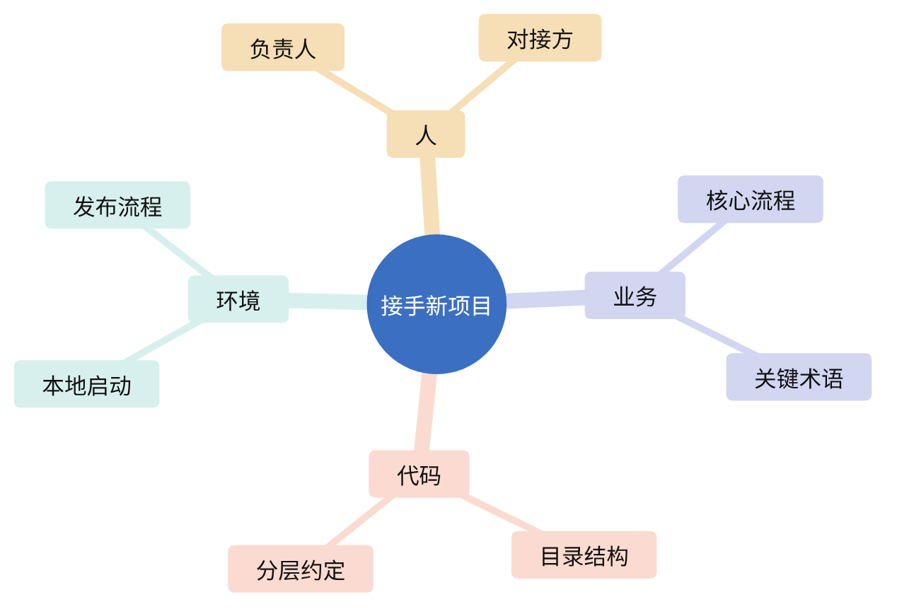

<details>
<summary>示例源码（assets/mindmap.mmd）</summary>

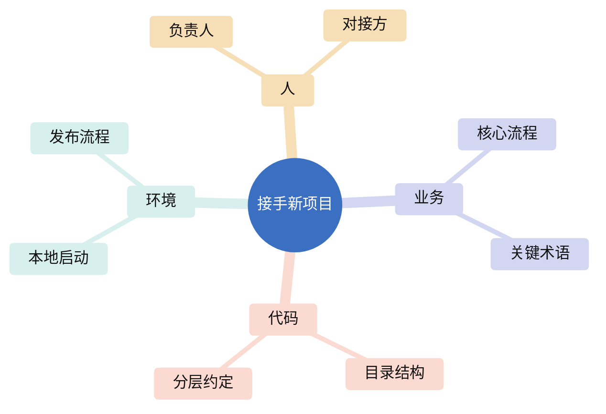

</details>

<a id="org"></a>

### 树形图 / 组织结构图 · `org`

严格的层级树，每个节点只有一个上级，表达隶属、汇报或包含关系。

- **什么时候用**：组织架构、模块 / 目录树、产品功能树。
- **别用**：要表达先后顺序（→ 流程图）。
- **推荐工具**：Mermaid `flowchart TB`；超过 3 层或 20 个节点 → drawio（树形布局）。
- **怎么画**：
  - 自上而下 `flowchart TB`；同一层的节点连续声明，布局更整齐。
  - 虚线 `-.->` 表示虚线汇报、助理岗位。
- **画好的要点**：
  - 只有顶层用主色，第二层用槽色，其余白底描边。
  - 同层节点文字长度尽量一致。


<details>
<summary>示例源码（assets/org.mmd）</summary>

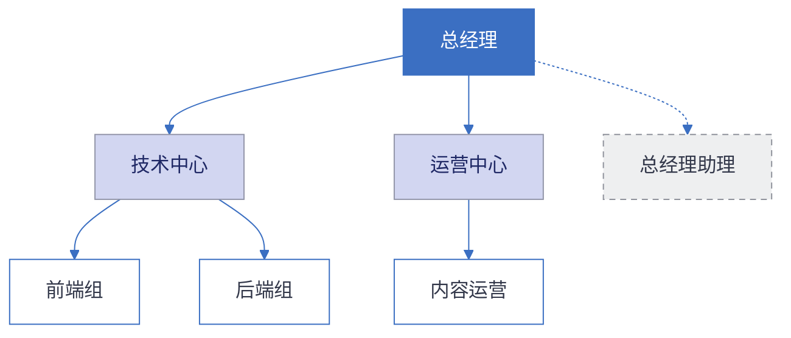

</details>

<a id="fishbone"></a>

### 鱼骨图 · `fishbone`

又叫因果图、石川图：鱼头是问题，大骨是原因类别，小骨是具体原因，用来系统地找根因。

- **什么时候用**：故障复盘、质量问题的根因分析（人机料法环测，或 代码 / 依赖 / 基础设施 / 流程）。
- **别用**：原因已经清楚，只是列改进项（→ 思维导图）。
- **推荐工具**：Mermaid `ishikawa-beta`（beta，目标平台渲染不了时改用 drawio）；要给每个大类分色、标出根因 → drawio。
- **怎么画**：
  - 第一行是问题（鱼头），下一级缩进是原因大类，再下一级是具体原因。
  - Mermaid 的鱼骨图只认 `mainBkg`、`lineColor`、`textColor` 三个颜色。
- **画好的要点**：
  - 原因大类 4–6 个，用名词。
  - 具体原因写成可验证的事实；drawio 里已验证的根因用 `verified`（失败色）标出。

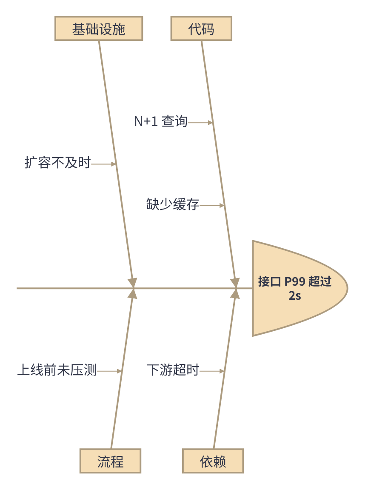

<details>
<summary>示例源码（assets/fishbone.mmd）</summary>

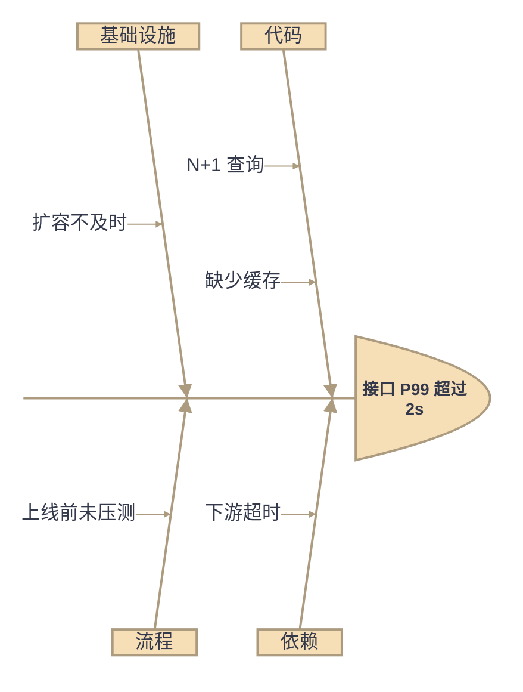

</details>

<a id="concept"></a>

### 概念图 · `concept`

由概念节点和带"关系词"的连线组成的网状图，任意两个概念之间都可以连线，每条线都能读成一句话。

- **什么时候用**：讲清一组概念之间的关系：技术原理、领域知识；关系写在连线上。
- **别用**：只有层级、没有横向关系（→ 思维导图）。
- **推荐工具**：Mermaid `flowchart LR`。
- **怎么画**：
  - `A -- 关系动词 --> B`；核心概念用 `(( ))` 圆形；例子用虚线 `-. 例如 .->`。
- **画好的要点**：
  - 每条线都要有动词标签。
  - 核心概念只有 1 个，用主色；一级概念不超过 6 个。


<details>
<summary>示例源码（assets/concept.mmd）</summary>

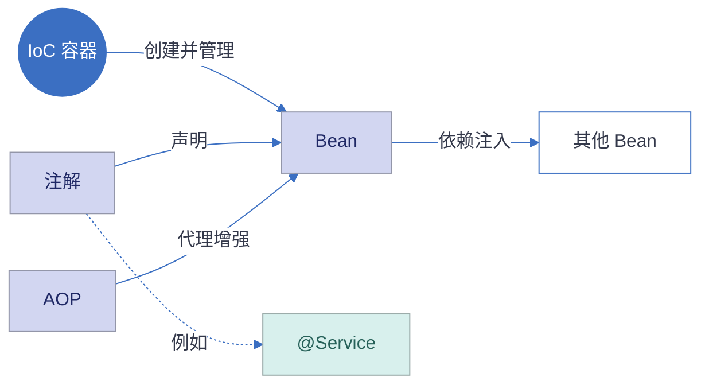

</details>

<a id="affinity"></a>

### 亲和图 · `affinity`

又叫 KJ 法：把大量零散信息写成便签，按相近程度自下而上分组，再给每组写一个结论式标题。

- **什么时候用**：把用户访谈、反馈、头脑风暴的零散便签归类成主题（KJ 法）。
- **别用**：已有明确分类体系（→ 思维导图或表格）。
- **推荐工具**：Mermaid `flowchart LR` + `subgraph` 当分组；便签超过 30 张或要协作拖动 → drawio。
- **怎么画**：
  - 每组一个 `subgraph 组名`，组名写成一句结论；组内便签用 `g1`–`g4` 类。
- **画好的要点**：
  - 一组一个颜色（系列色轮换），便签保留用户原话。
  - 分组 3–6 个。

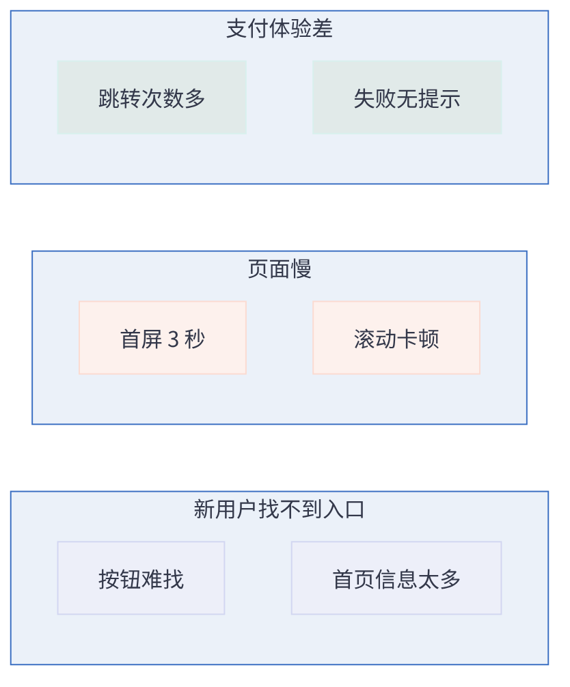

<details>
<summary>示例源码（assets/affinity.mmd）</summary>

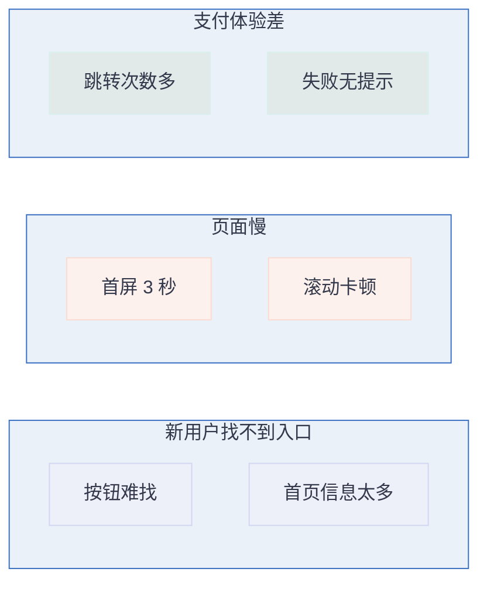

</details>

<a id="cat-flow"></a>

## 2. 流程行为

| 关注点 | 用哪种图 |
|---|---|
| 一个人 / 一个系统的步骤和分支 | 流程图 `flowchart` |
| 多个角色、部门、系统之间的交接 | 泳道图 `swimlane` |
| 对象之间按时间先后的调用 | 时序图 `sequence` |
| 一个对象有哪些状态、怎么切换 | 状态图 `state` |
| UML 规范的流程（分叉 / 汇合、对象流、分区） | 活动图 `activity` |
| 对象之间的连接和消息编号 | 通信图 `communication` |
| 多个交互片段怎么串起来 | 交互概览图 `interaction` |
| 状态随精确时间变化 | 时间图 `timing` |

### 流程图、泳道图、时序图、状态图的区别

| | 流程图 | 泳道图 | 时序图 | 状态图 |
|---|---|---|---|---|
| 主角 | 步骤 | 角色 + 步骤 | 参与者之间的消息 | 一个对象 |
| 回答的问题 | 怎么做 | 谁做、在哪交接 | 谁调用谁、先后顺序 | 有哪些状态、怎么变 |
| 节点 | 动作 | 动作（放在负责人的泳道里） | 参与者（系统、人） | 状态 |
| 连线 | 执行顺序 | 执行顺序、跨泳道交接 | 消息 / 调用 / 返回 | 由事件触发的状态转换 |
| 时间 | 藏在箭头顺序里 | 藏在箭头顺序里 | 显式，从上往下 | 没有时间轴 |
| 典型场景 | 审批逻辑、算法 | 退款、入职等跨部门流程 | 接口调用、支付回调 | 订单、工单状态机 |

同一件事"用户下单支付"，四种图各画一面：

- **流程图**：提交订单 → 库存够不够 → 锁库存 → 发起支付 → 结束。
- **泳道图**：同样的步骤，分到"用户 / 前端 / 订单服务 / 支付平台"四条泳道里，一眼看出交接点。
- **时序图**：前端 → 订单服务 POST /orders → 返回订单号 → 拉起收银台 → 支付平台异步回调订单服务。
- **状态图**：订单从"待支付"到"已支付"到"已完成"，超时变"已取消"。

UML 的四种补充图（活动图、通信图、交互概览图、时间图）在评审里用得少，需要符合 UML 规范时再用。

<a id="flowchart"></a>

### 流程图 · `flowchart`

用标准形状表示开始、处理、判断、数据，用箭头表示执行顺序，回答"按什么步骤做、在哪里分叉"。

- **什么时候用**：业务流程、算法步骤、审批逻辑、异常处理分支。
- **别用**：多角色交接（→ 泳道图）；系统之间的调用顺序（→ 时序图）；对象状态切换（→ 状态图）。
- **推荐工具**：Mermaid `flowchart`；超过 12 个节点或要交给别人编辑 → drawio。
- **怎么画**：
  - 形状有语义：`([ ])` 开始 / 结束、`[ ]` 处理、`{ }` 判断、`[( )]` 数据库、`[/ /]` 输入输出、`[[ ]]` 子流程。
  - 判断的出口写在线上：`-- 是 -->`、`-- 否 -->`。
- **画好的要点**：
  - 主路径保持一条直线（TB 或 LR），分支向一侧展开。
  - 关键路径（`key`）只标一条，异常分支（`error`）不超过 2 处。


<details>
<summary>示例源码（assets/flowchart.mmd）</summary>

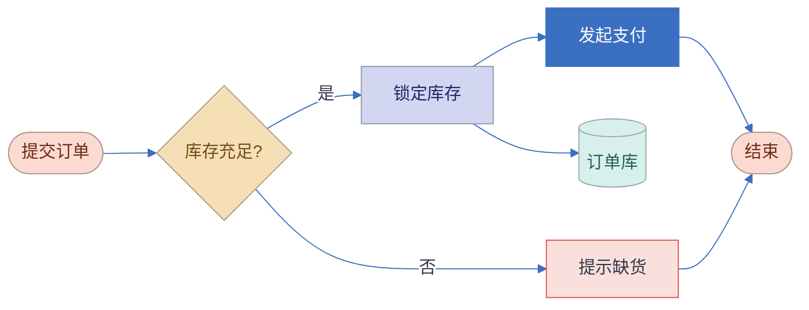

</details>

<a id="swimlane"></a>

### 泳道图 · `swimlane`

把流程图按角色切成一条条泳道，每个步骤放在负责它的角色那一行，回答"谁在什么时候做什么、在哪里交接"。

- **什么时候用**：跨角色、跨部门、跨系统的业务流程，突出"谁来做"和交接点。
- **别用**：只有一个角色（→ 流程图）。
- **推荐工具**：Mermaid `swimlane-beta`（beta）；目标平台渲染不了时把首行换成 `flowchart LR`，正文不用改；泳道超过 4 条或要按阶段分列 → drawio。
- **怎么画**：
  - 每条泳道一个 `subgraph 角色名`，节点在所属泳道里声明；连线统一写在所有泳道之后。
- **画好的要点**：
  - 泳道顺序按参与的先后。
  - 跨泳道的交接点用 `handoff`（主色）；泳道底色统一用 soft，不要每条泳道换一种颜色。

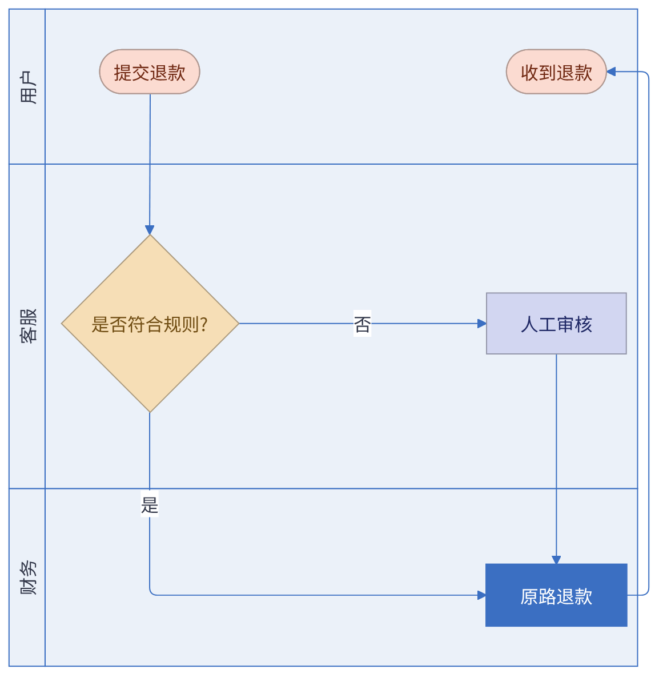

<details>
<summary>示例源码（assets/swimlane.mmd）</summary>

```mermaid
---
config:
  theme: base
  fontFamily: "PingFang SC, Microsoft YaHei, Noto Sans CJK SC, Source Han Sans SC, sans-serif"
  themeVariables:
    background: "#FFFFFF"
    primaryColor: "#FFFFFF"
    primaryBorderColor: "#3B6FC2"
    primaryTextColor: "#33384A"
    nodeTextColor: "#33384A"
    secondaryColor: "#FBDBD1"
    tertiaryColor: "#EBF1F9"
    lineColor: "#3B6FC2"
    textColor: "#33384A"
    clusterBkg: "#EBF1F9"
    clusterBorder: "#3B6FC2"
    edgeLabelBackground: "#FFFFFF"
    titleColor: "#33384A"
    noteBkgColor: "#FFF6CE"
    noteBorderColor: "#A6A086"
    noteTextColor: "#33384A"
---
swimlane-beta LR
  subgraph U[用户]
    A([提交退款]):::startend
    F([收到退款]):::startend
  end
  subgraph S[客服]
    B{是否符合规则?}:::decision
    C[人工审核]:::task
  end
  subgraph P[财务]
    D[原路退款]:::handoff
  end
  A --> B
  B -- 是 --> D
  B -- 否 --> C --> D
  D --> F
  class U,S,P lane
classDef startend fill:#FBDBD1,stroke:#B09992,color:#712A14
classDef task fill:#D2D6F1,stroke:#9396A9,color:#1F2865
classDef decision fill:#F6DEB6,stroke:#AC9B7F,color:#714E14
classDef handoff fill:#3B6FC2,stroke:#3B6FC2,color:#FFFFFF,stroke-width:2px
classDef lane fill:#EBF1F9,stroke:#3B6FC2,color:#33384A
%% 用法：节点 A:::startend 或 class A,B startend
```

</details>

<a id="sequence"></a>

### 时序图 · `sequence`

参与者横向排开，时间从上往下走，箭头表示消息或调用，回答"谁调用谁、先后顺序、同步还是异步"。

- **什么时候用**：接口调用链、前后端交互、第三方回调、分布式事务。
- **别用**：只关心步骤、不关心谁调用谁（→ 流程图）。
- **推荐工具**：Mermaid `sequenceDiagram`。
- **怎么画**：
  - `actor` 表示人，`participant` 表示系统；`->>` 同步调用，`-->>` 返回，`-)` 异步消息；`+` / `-` 开关激活条。
  - 片段：`alt / else`、`opt`、`loop`、`par`、`critical`；`autonumber` 自动编号；`box 颜色 名称 ... end` 给一组参与者加底色。
- **画好的要点**：
  - 参与者从左到右按调用顺序排。
  - 一张图只讲一个场景；返回用虚线；Note 只写关键约束。

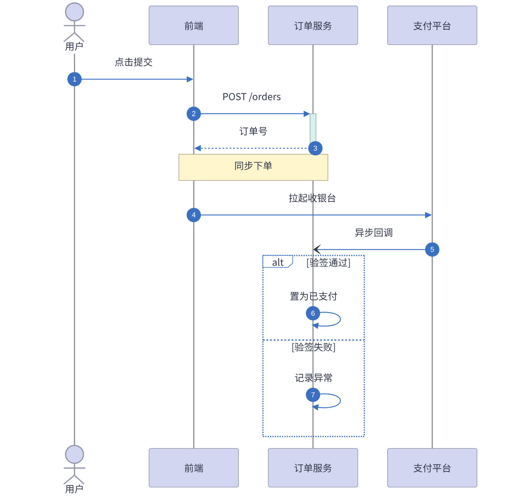

<details>
<summary>示例源码（assets/sequence.mmd）</summary>

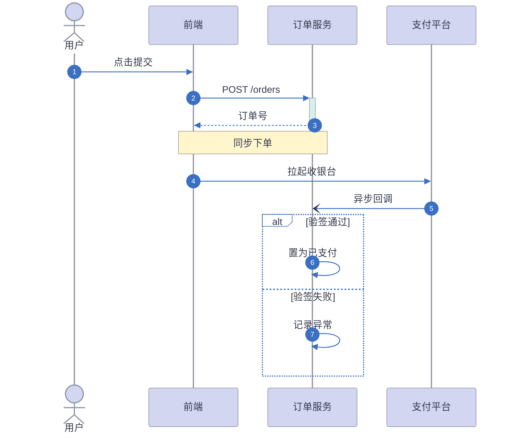

</details>

<a id="state"></a>

### 状态图 · `state`

描述一个对象（订单、工单、审批单）有哪些状态，以及在什么事件下从一个状态转到另一个状态。

- **什么时候用**：订单、工单、审批单的状态机；前端组件状态；枚举值流转。
- **别用**：关注的是做事的步骤（→ 流程图）。
- **推荐工具**：Mermaid `stateDiagram-v2`。
- **怎么画**：
  - `state "中文名" as Id` 定义状态；`[*]` 表示开始和结束；`A --> B : 事件`。
  - `class Id ok` 指定颜色，写在状态定义之后；`state 复合状态 { ... }` 嵌套。
- **画好的要点**：
  - 成功终态用 `ok`，失败 / 取消用 `fail`，进行中用 `active`。
  - 线上写触发事件，不写动作。

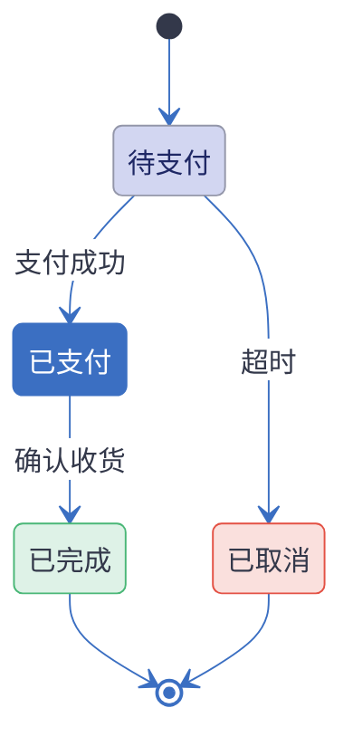

<details>
<summary>示例源码（assets/state.mmd）</summary>

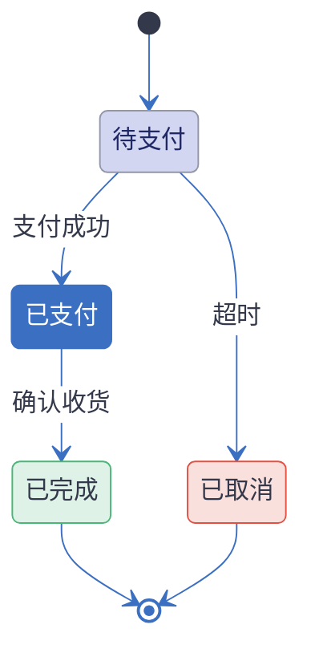

</details>

<a id="activity"></a>

### 活动图（UML） · `activity`

UML 里的流程图，在流程图的基础上增加了并行分叉 / 汇合、对象流和分区的规范符号。

- **什么时候用**：UML 规范的业务流程：并行分叉 / 汇合、对象流、分区。
- **别用**：不需要 UML 规范（→ 流程图）。
- **推荐工具**：Mermaid 没有原生活动图，用 `flowchart TB` 近似；并行要画粗横条或要标准符号 → drawio（UML 图形库）。
- **怎么画**：
  - 实心圆 `(( )):::bar` 当起止点；`{ }` 判断 / 合并；`[/ /]` 对象节点；分区用 subgraph。
- **画好的要点**：
  - 起止点和分叉条用 `bar`（深色）；分区底色用 `partition`。


<details>
<summary>示例源码（assets/activity.mmd）</summary>

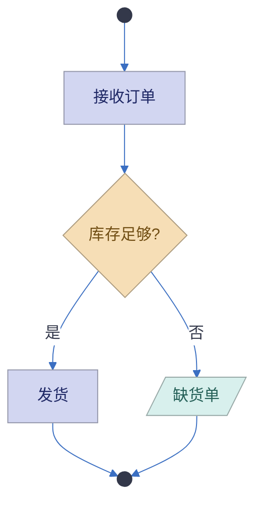

</details>

<a id="communication"></a>

### 通信图（UML） · `communication`

把时序图里的同一组消息画在对象的连接关系上，用编号表示顺序，强调"谁和谁有连接"。

- **什么时候用**：强调对象之间的连接和消息编号，是同一场景时序图的另一个视角。
- **别用**：关注时间先后（→ 时序图）。
- **推荐工具**：Mermaid `flowchart LR` 近似；要标准 UML 符号 → drawio。
- **怎么画**：
  - 对象写成 `:类名` 或 `对象:类名`；线上写 `"1.1: 方法()"`。
- **画好的要点**：
  - 编号按嵌套层级（1、1.1、1.1.1）。
  - 关键消息的接收方用 `msg`（主色）。

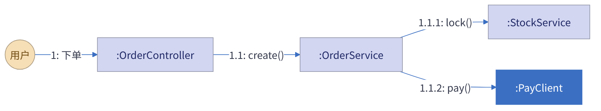

<details>
<summary>示例源码（assets/communication.mmd）</summary>

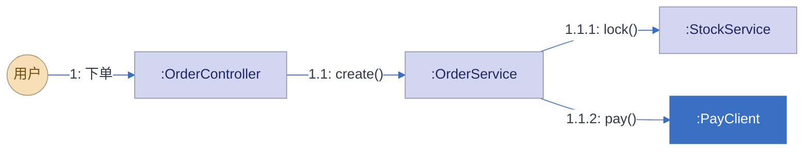

</details>

<a id="interaction"></a>

### 交互概览图（UML） · `interaction`

用活动图的控制流把多个交互片段（ref / sd）串成一个整体，相当于一组时序图的目录。

- **什么时候用**：把多个时序片段（ref / sd）用活动图的控制流串起来，看整体交互。
- **别用**：只有一个片段（→ 时序图）。
- **推荐工具**：Mermaid `flowchart LR` 近似；要在节点里嵌入完整时序片段 → drawio。
- **怎么画**：
  - 节点写 `ref 片段名` 或 `sd 片段名`；起止用实心圆。
- **画好的要点**：
  - 片段名和对应时序图的标题一致，方便对照。

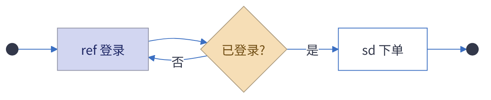

<details>
<summary>示例源码（assets/interaction.mmd）</summary>

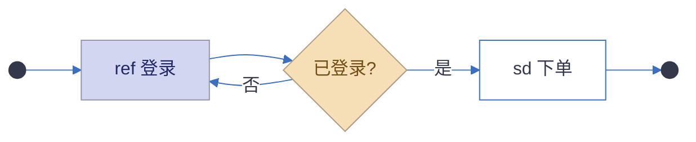

</details>

<a id="timing"></a>

### 时间图（UML） · `timing`

横轴是精确时间，每条生命线显示状态随时间的变化，关注超时、间隔这类时序约束。

- **什么时候用**：状态随精确时间变化：心跳、超时重试、令牌过期、硬件信号。
- **别用**：没有精确时间要求（→ 状态图或时序图）。
- **推荐工具**：drawio（Mermaid 没有时间图）；只是示意时用 Mermaid `flowchart LR` 近似。
- **怎么画**：
  - drawio：每条生命线一行（`lifeline` 底色），状态段是横向矩形，宽度按时长；底部画时间刻度。
- **画好的要点**：
  - 横轴刻度统一；状态段用系列色区分；同一状态在不同生命线上用同一颜色。

正式出图用 drawio；下面是 Mermaid 的近似画法。

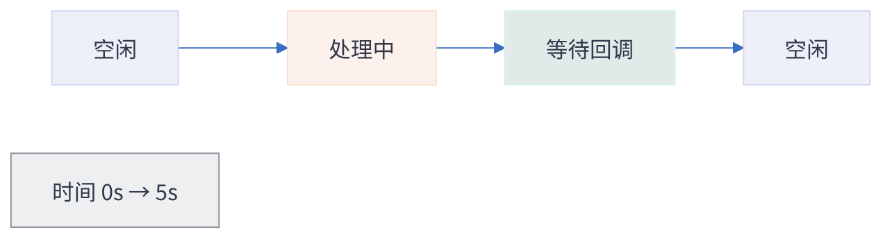

<details>
<summary>示例源码（assets/timing.mmd）</summary>

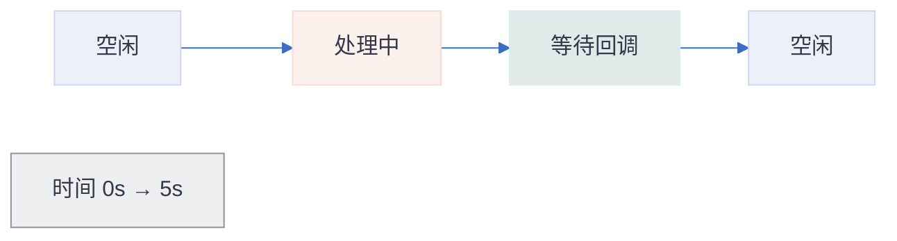

</details>

<a id="cat-structure"></a>

## 3. 系统结构

架构图先想清楚给谁看、讲哪一层，一张图只讲一层。

| 想讲清 | 用哪种图 |
|---|---|
| 系统和外部的人 / 系统怎么交互，再逐层下钻 | C4 模型 `c4` |
| 业务由哪些域和能力组成 | 业务架构图 `biz_arch` |
| 由哪些应用 / 服务组成、怎么调用 | 应用架构图 `app_arch` |
| 数据从哪来、怎么计算、存在哪、给谁用 | 数据架构图 `data_arch` |
| 每一层用了什么技术 | 技术架构图 `tech_arch` |
| 跑在哪些地域、集群、机器上 | 部署架构图 `deploy_arch` |
| 网络分区、设备和安全边界 | 网络拓扑图 `network` |

分层的通用顺序（自上而下）：用户 / 渠道 → 接入（CDN、网关）→ 应用 / 服务 → 中间件 → 数据 → 基础设施。

### 几种架构图的区别

| 架构图 | 给谁看 | 回答的问题 | 主要元素 |
|---|---|---|---|
| 业务架构 | 业务方、管理层 | 做哪些业务、能力怎么划分 | 业务域、业务能力、共享能力 |
| 应用架构 | 研发、架构师 | 由哪些系统 / 服务组成、怎么调用 | 应用、服务、调用关系 |
| 数据架构 | 数据团队 | 数据怎么流转、存在哪 | 数据源、计算、分层存储、消费方 |
| 技术架构 | 研发、选型评审 | 每层用什么技术 | 技术组件、中间件 |
| 部署架构 | 运维、SRE | 跑在哪、多少实例、流量怎么进来 | 地域、可用区、集群、节点、负载均衡 |
| 网络拓扑 | 运维、安全 | 网络怎么分区、边界在哪 | 网络设备、分区、防火墙 |
| C4 模型 | 所有技术相关的人 | 用统一的方法逐层放大系统 | 人员、系统、容器、组件 |

### C4 的四个层级

| 层级 | 看什么 | 典型读者 | Mermaid 写法 |
|---|---|---|---|
| L1 System Context | 本系统和用户、外部系统的关系 | 所有人，包括非技术人员 | `C4Context` |
| L2 Container | 系统内部的可部署单元：Web 前端、API 服务、数据库、消息队列 | 技术人员 | `C4Container` |
| L3 Component | 一个容器内部由哪些组件组成 | 开发 | `C4Component` |
| L4 Code | 组件内部的类 | 开发 | 一般直接看代码，或画类图 |

C4 还有三种补充图：多个系统的全景（System Landscape）、运行时交互（Dynamic，`C4Dynamic`）、部署（Deployment，`C4Deployment`）。

技术方案里的常见组合：先画一张 C4 Container（或应用架构）讲清"有哪些东西"，再用时序图讲关键链路，用部署架构讲"跑在哪"。

<a id="c4"></a>

### C4 模型（Context / Container / Component） · `c4`

Simon Brown 提出的分层架构图方法：Context（系统和外部）→ Container（可部署单元）→ Component（容器内组件）→ Code（类），像地图一样逐级放大。

- **什么时候用**：技术方案的系统总览：系统上下文（Context）→ 容器（Container）→ 组件（Component）逐层下钻。
- **别用**：讲业务能力（→ 业务架构图）；讲机器和网络（→ 部署架构图）。
- **推荐工具**：Mermaid `C4Context` / `C4Container` / `C4Component` / `C4Deployment`；正式评审要精细排版 → drawio（C4 图形库）。
- **怎么画**：
  - 元素：`Person`、`System` / `System_Ext`、`Container` / `ContainerDb`、`Component`；边界 `Container_Boundary(别名, "名称") { ... }`；关系 `Rel(起点, 终点, "说明", "协议")`。
  - C4 的元素颜色不受主题控制，要逐个写 `UpdateElementStyle`；用 diagram-kit 的 `palette.py mermaid c4 --body` 套配色时会按元素类型自动生成。
- **画好的要点**：
  - 一张图只画一层。
  - 外部系统用灰色；关系线写"动词 + 协议"。

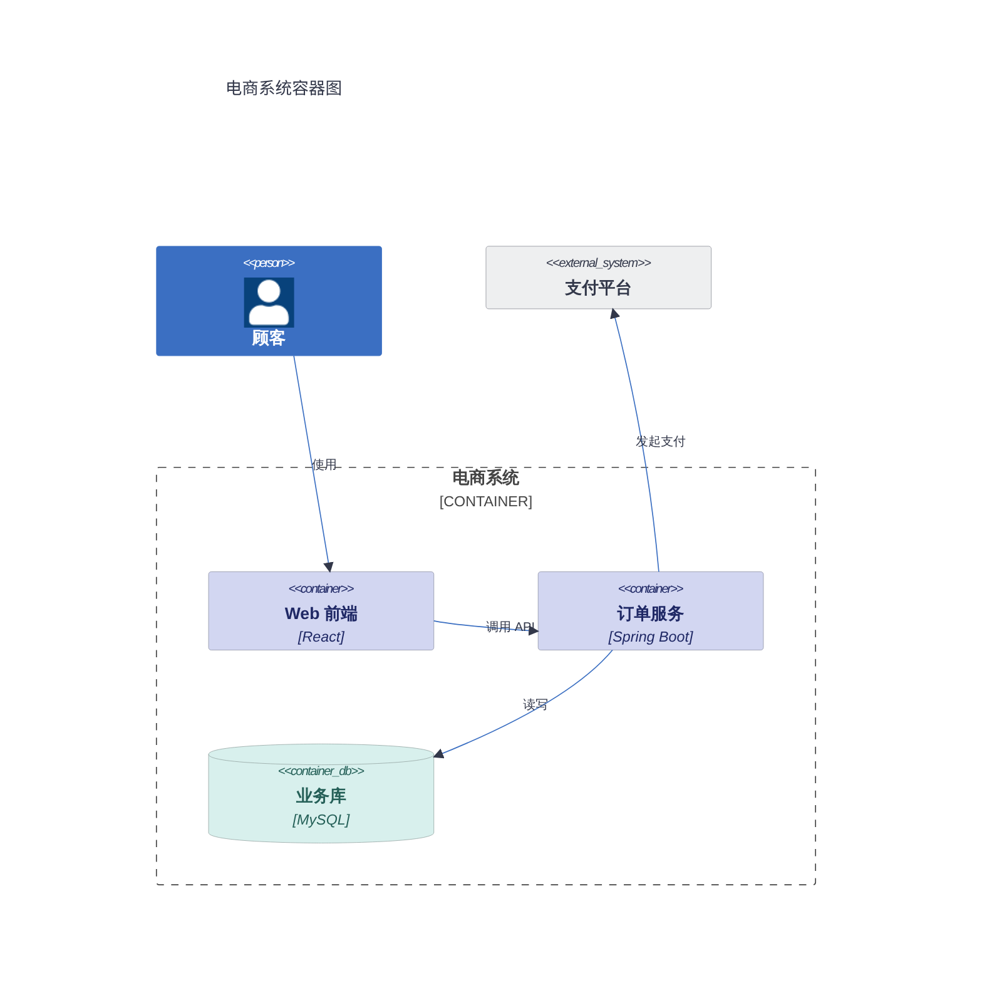

<details>
<summary>示例源码（assets/c4.mmd）</summary>

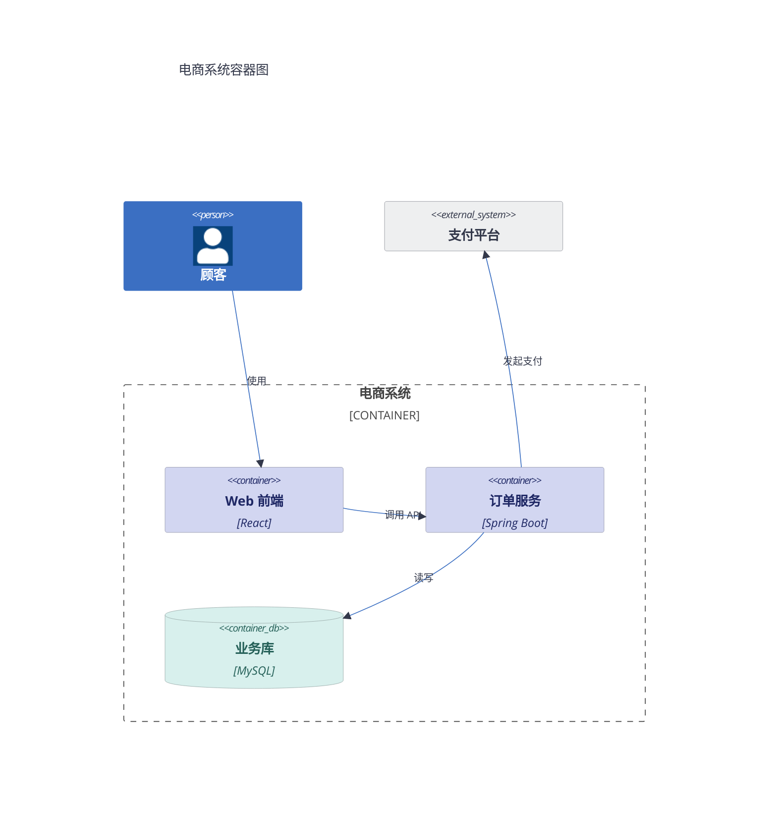

</details>

<a id="biz_arch"></a>

### 业务架构图 · `biz_arch`

从业务视角描述企业有哪些业务域、业务能力和共享能力，不涉及具体系统和技术。

- **什么时候用**：给业务方、管理层讲业务域、业务能力和共享能力（中台）的分层。
- **别用**：讲服务和调用（→ 应用架构图）。
- **推荐工具**：Mermaid `block-beta`（分层方块排版）；层多、要图标和精细排版 → drawio，12 块以内要发布级效果 → diagram-design。
- **怎么画**：
  - `columns N` 定列数；`id["名称"]:N` 跨 N 列；一行一层；`class a,b 角色` 上色，写在块定义之后。
- **画好的要点**：
  - 自上而下：用户触点 → 业务域 → 业务能力 → 共享能力。
  - 同层方块等宽，只用名词。

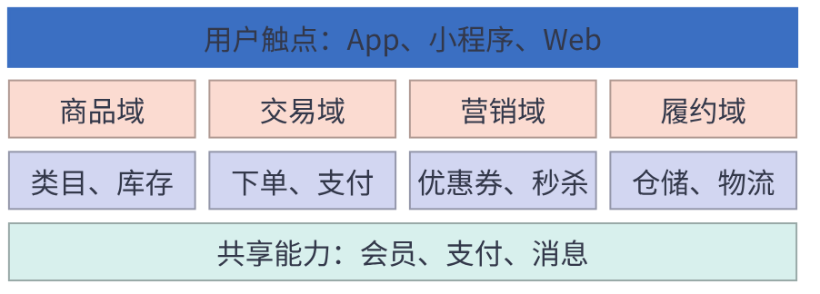

<details>
<summary>示例源码（assets/biz_arch.mmd）</summary>

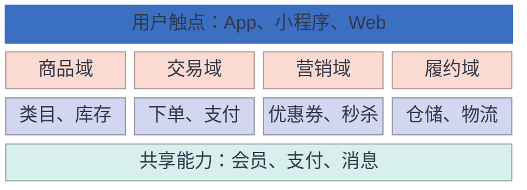

</details>

<a id="app_arch"></a>

### 应用架构图 · `app_arch`

描述系统由哪些应用 / 服务组成、各自的职责，以及它们之间的调用和依赖。

- **什么时候用**：系统由哪些应用 / 服务组成、依赖和调用方向；技术方案评审最常用。
- **别用**：讲每层用什么技术（→ 技术架构图）。
- **推荐工具**：Mermaid `flowchart` + subgraph 分层；超过 12 个节点 → drawio。
- **怎么画**：
  - 每层一个 subgraph；先声明节点，最后统一写连线；中间件、数据库用 `[( )]`。
- **画好的要点**：
  - 分层容器用 `layer`（soft 底色），层名写在容器标题。
  - 外部系统用灰色放在边缘；调用方向保持一致。


<details>
<summary>示例源码（assets/app_arch.mmd）</summary>

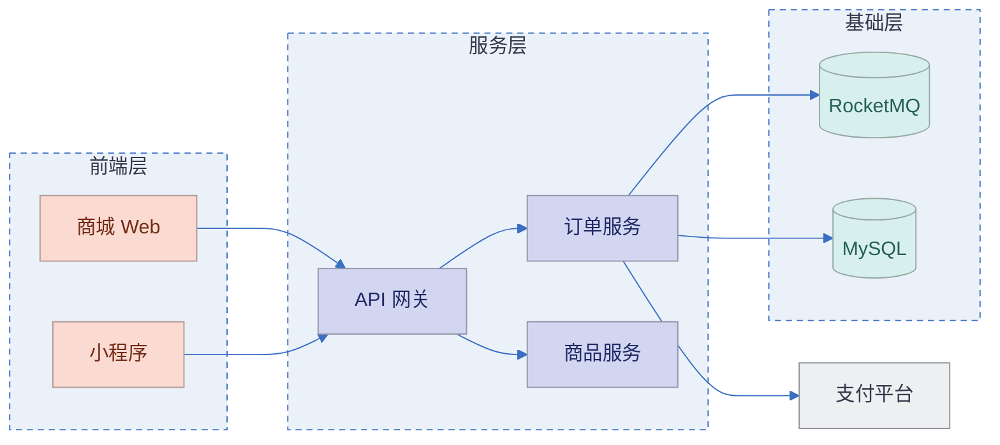

</details>

<a id="data_arch"></a>

### 数据架构图 · `data_arch`

描述数据从哪里产生、怎么采集和计算、分几层存储、最终给谁使用。

- **什么时候用**：数据采集 → 计算 → 分层存储（ODS / DWD / DWS / ADS）→ 消费的链路。
- **别用**：讲表结构（→ ER 图）。
- **推荐工具**：Mermaid `flowchart LR`；分层多、要图标 → drawio。
- **怎么画**：
  - 从左到右按数据流向；存储用圆柱 `[( )]`。
- **画好的要点**：
  - 数据源、计算、存储、消费分别用 `source` / `compute` / `store` / `consume`，四种颜色就是四个环节。

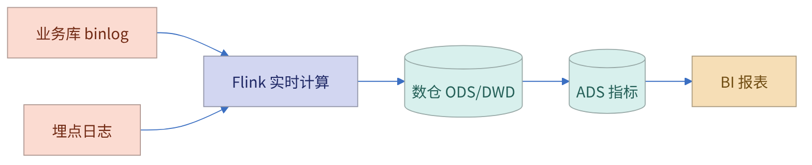

<details>
<summary>示例源码（assets/data_arch.mmd）</summary>

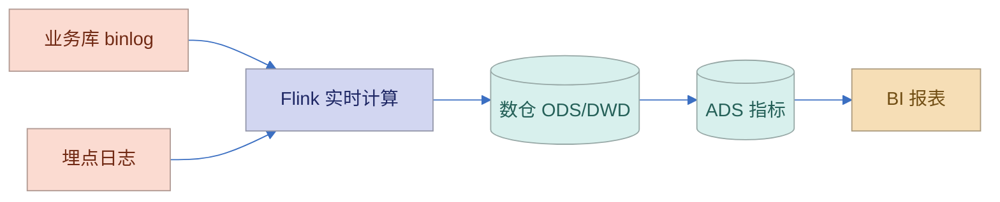

</details>

<a id="tech_arch"></a>

### 技术架构图 · `tech_arch`

按层列出每一层采用的技术和中间件，是技术选型的全景图。

- **什么时候用**：每一层选了什么技术（技术栈全景），选型评审。
- **别用**：讲服务调用关系（→ 应用架构图）。
- **推荐工具**：Mermaid `block-beta`：左列层名，右侧技术组件；要真实 logo → drawio。
- **怎么画**：
  - 左列 `L1["接入"]:1`，右侧组件按列排；横切能力（日志、监控、CI/CD）单独一行。
- **画好的要点**：
  - 层名用主色，组件白底；横切能力用 `cross`；本次新增或替换的组件用 `highlight`。

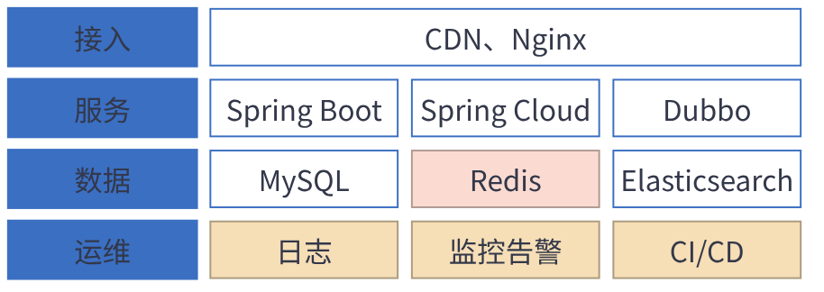

<details>
<summary>示例源码（assets/tech_arch.mmd）</summary>

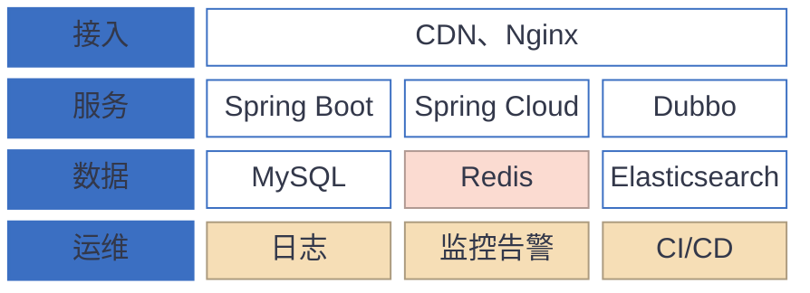

</details>

<a id="deploy_arch"></a>

### 部署架构图 · `deploy_arch`

描述软件实际运行在哪里：地域、可用区、VPC、集群、节点、实例数和流量入口。

- **什么时候用**：服务部署在哪些地域 / 可用区 / VPC / 集群，实例数和流量入口。
- **别用**：讲逻辑分层（→ 应用架构图）。
- **推荐工具**：drawio 优先（真实云厂商 / K8s 图标、嵌套边界）；简单场景用 Mermaid `flowchart TB` + 嵌套 subgraph。
- **怎么画**：
  - 边界嵌套：地域 → 可用区 / VPC（`zone`，虚线）→ 子网 / 集群（`subnet`）→ 节点；节点名后写实例数，如 `x3`。
- **画好的要点**：
  - 流量自上而下：用户 → WAF / CDN → 负载均衡 → 网关 → 服务 → 存储。
  - 安全设备用 `security`（失败色）。

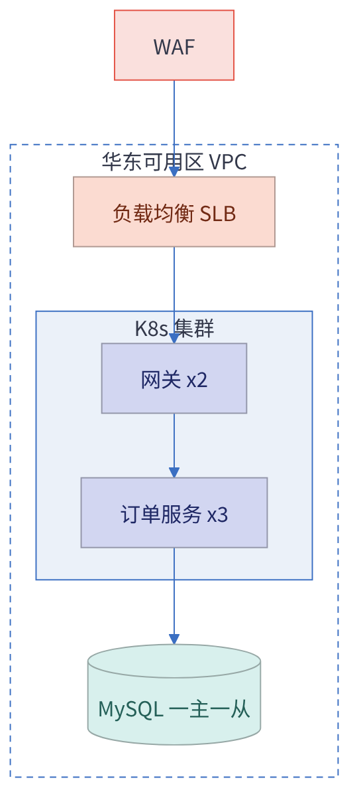

<details>
<summary>示例源码（assets/deploy_arch.mmd）</summary>

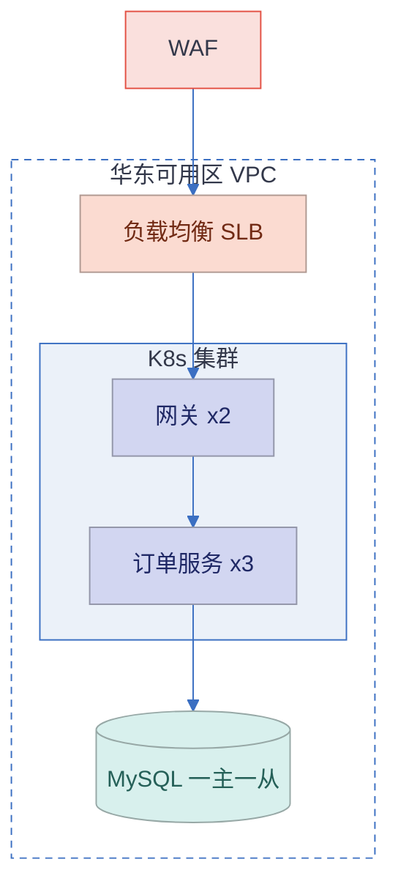

</details>

<a id="network"></a>

### 网络拓扑图 · `network`

描述网络分区、网络设备、链路和安全边界，偏运维和安全视角。

- **什么时候用**：网络分区（外网 / DMZ / 内网）、网络设备、链路和安全边界。
- **别用**：讲服务部署（→ 部署架构图）。
- **推荐工具**：drawio（网络设备图标）；示意级别用 Mermaid `flowchart TB`。
- **怎么画**：
  - 每个分区一个 subgraph，用 `class 分区 dmz` 上底色；设备在分区内声明。
- **画好的要点**：
  - DMZ 用警告色，内网用 soft，外网用灰色。
  - 防火墙、WAF 放在分区边界上。

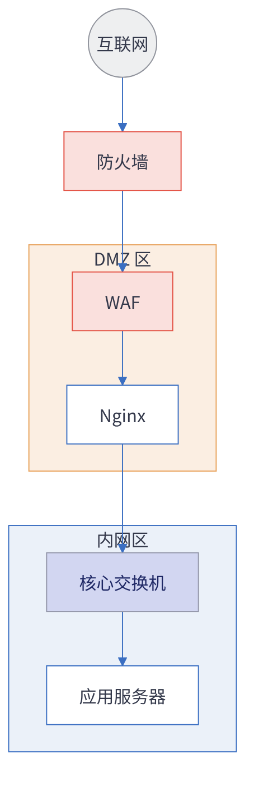

<details>
<summary>示例源码（assets/network.mmd）</summary>

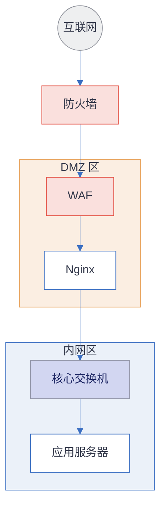

</details>

<a id="cat-modeling"></a>

## 4. 建模设计

| 想讲清 | 用哪种图 |
|---|---|
| 代码里类的字段、方法、继承和依赖 | 类图 `class` |
| 表结构和表之间的关系 | ER 图 `er` |
| 谁用系统做什么（功能范围） | 用例图 `usecase` |
| 某一时刻的对象实例和取值 | 对象图 `object` |
| 组件之间通过哪些接口依赖 | 组件图 `component` |
| 包 / 模块的分层和依赖 | 包图 `package` |
| 制品部署到哪些节点（UML 视角） | 部署图 `uml_deploy` |
| 一个类内部由哪些部件、端口组成 | 组合结构图 `composite` |
| UML 扩展（构造型、标记值） | Profile 图 `profile` |

UML 里 Mermaid 原生支持的只有类图、对象图（借用类图）、时序图、状态图；其余用 flowchart 近似，要标准 UML 符号时用 drawio 的 UML 图形库。

### 类图和 ER 图的区别

| | 类图 | ER 图 |
|---|---|---|
| 描述的对象 | 代码里的类 | 数据库里的表 |
| 有没有方法 | 有 | 没有 |
| 关系 | 继承、实现、关联、依赖、组合、聚合 | 一对一、一对多、多对多（用基数表示） |
| 多对多 | 两个类直接关联 | 要拆出一张中间表 |
| 用在 | 领域模型、代码结构设计 | 数据库设计、数据字典 |

### UML 的 14 种图

| 分类 | 图 | 常用程度 |
|---|---|---|
| 结构图 | 类图、对象图、组件图、组合结构图、包图、部署图、Profile 图 | 类图最常用，其余按需 |
| 行为图 | 用例图、活动图、状态机图 | 用例图、状态图常用 |
| 行为图 · 交互图 | 时序图、通信图、交互概览图、时间图 | 时序图最常用 |

时序图、状态图、活动图、通信图、交互概览图、时间图归在"流程行为"类里讲。

<a id="class"></a>

### 类图 · `class`

描述类的字段、方法，以及类之间的继承、实现、关联、依赖、组合、聚合关系。

- **什么时候用**：领域模型、代码结构设计、设计模式说明。
- **别用**：讲表结构（→ ER 图）。
- **推荐工具**：Mermaid `classDiagram`。
- **怎么画**：
  - `class 名 { -字段 类型  +方法() 返回 }`；`<<interface>>`、`<<abstract>>`、`<<enumeration>>`。
  - 关系：`<|--` 继承、`<|..` 实现、`-->` 关联、`..>` 依赖、`*--` 组合、`o--` 聚合；`class X:::focus` 上色。
- **画好的要点**：
  - 只画和本次设计有关的类和成员。
  - 本次改动的类用 `focus`；接口、枚举、抽象类分别用各自的槽色。

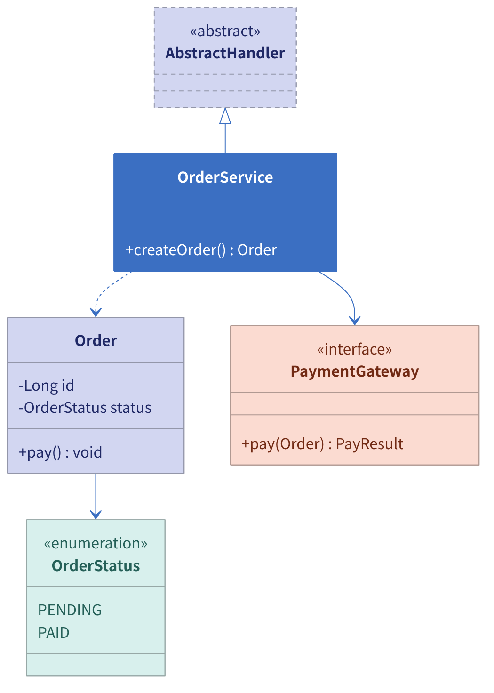

<details>
<summary>示例源码（assets/class.mmd）</summary>

```mermaid
---
config:
  theme: base
  fontFamily: "PingFang SC, Microsoft YaHei, Noto Sans CJK SC, Source Han Sans SC, sans-serif"
  themeVariables:
    background: "#FFFFFF"
    primaryColor: "#FFFFFF"
    primaryBorderColor: "#3B6FC2"
    primaryTextColor: "#33384A"
    nodeTextColor: "#33384A"
    secondaryColor: "#FBDBD1"
    tertiaryColor: "#EBF1F9"
    lineColor: "#3B6FC2"
    textColor: "#33384A"
    clusterBkg: "#EBF1F9"
    clusterBorder: "#3B6FC2"
    edgeLabelBackground: "#FFFFFF"
    titleColor: "#33384A"
    noteBkgColor: "#FFF6CE"
    noteBorderColor: "#A6A086"
    noteTextColor: "#33384A"
    classText: "#1F2865"
---
classDiagram
  class Order {
    -Long id
    -OrderStatus status
    +pay() void
  }
  class OrderService {
    +createOrder() Order
  }
  class PaymentGateway {
    <<interface>>
    +pay(Order) PayResult
  }
  class OrderStatus {
    <<enumeration>>
    PENDING
    PAID
  }
  class AbstractHandler {
    <<abstract>>
  }
  OrderService --> PaymentGateway
  OrderService ..> Order
  Order --> OrderStatus
  AbstractHandler <|-- OrderService
  class OrderService:::focus
  class PaymentGateway:::iface
  class OrderStatus:::enum
  class AbstractHandler:::abstract
  class Order:::cls
classDef cls fill:#D2D6F1,stroke:#9396A9,color:#1F2865
classDef iface fill:#FBDBD1,stroke:#B09992,color:#712A14
classDef enum fill:#D8F0ED,stroke:#97A8A6,color:#256058
classDef abstract fill:#D2D6F1,stroke:#9396A9,color:#1F2865,stroke-dasharray:5 4
classDef focus fill:#3B6FC2,stroke:#3B6FC2,color:#FFFFFF,stroke-width:2px
%% 用法：class OrderService:::focus，或 cssClass "PayGateway" iface
```

</details>

<a id="er"></a>

### ER 图 · `er`

实体-关系图：描述数据库里的实体（表）、属性（字段），以及实体之间一对一、一对多、多对多的关系。

- **什么时候用**：数据库表结构和表之间的关系，技术方案里的数据设计。
- **别用**：讲代码里的类（→ 类图）。
- **推荐工具**：Mermaid `erDiagram`；表超过 15 张 → 拆成多张图或用 drawio。
- **怎么画**：
  - `A ||--o{ B : "关系"`；基数 `||` 一、`o|` 零或一、`}o` 零或多、`}|` 一或多。
  - 实体内 `类型 字段 PK/FK/UK "注释"`；在关系行里写 `实体:::core` 上色。
- **画好的要点**：
  - 用真实表名；只列主外键和关键字段。
  - 核心实体用 `core`（主色），中间表用 `link`。

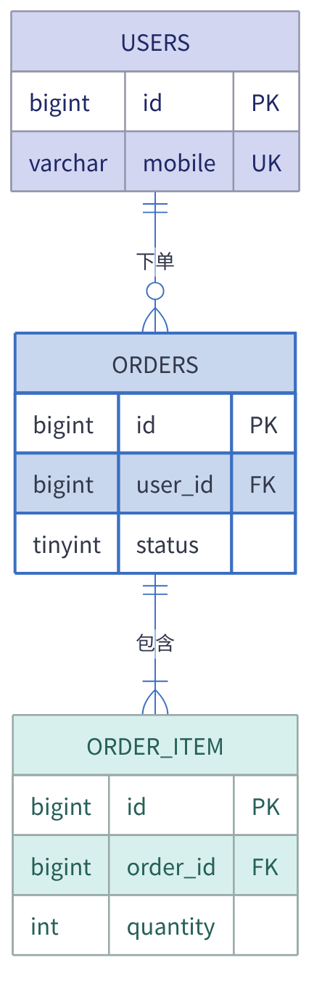

<details>
<summary>示例源码（assets/er.mmd）</summary>

```mermaid
---
config:
  theme: base
  fontFamily: "PingFang SC, Microsoft YaHei, Noto Sans CJK SC, Source Han Sans SC, sans-serif"
  themeVariables:
    background: "#FFFFFF"
    primaryColor: "#FFFFFF"
    primaryBorderColor: "#3B6FC2"
    primaryTextColor: "#33384A"
    nodeTextColor: "#33384A"
    secondaryColor: "#FBDBD1"
    tertiaryColor: "#FFFFFF"
    lineColor: "#3B6FC2"
    textColor: "#33384A"
    clusterBkg: "#EBF1F9"
    clusterBorder: "#3B6FC2"
    edgeLabelBackground: "#FFFFFF"
    titleColor: "#33384A"
    noteBkgColor: "#FFF6CE"
    noteBorderColor: "#A6A086"
    noteTextColor: "#33384A"
    attributeBackgroundColorOdd: "#FFFFFF"
    attributeBackgroundColorEven: "#EBF1F9"
---
erDiagram
  USERS:::entity ||--o{ ORDERS:::core : "下单"
  ORDERS ||--|{ ORDER_ITEM:::link : "包含"
  USERS {
    bigint id PK
    varchar mobile UK
  }
  ORDERS {
    bigint id PK
    bigint user_id FK
    tinyint status
  }
  ORDER_ITEM {
    bigint id PK
    bigint order_id FK
    int quantity
  }
classDef entity fill:#D2D6F1,stroke:#9396A9,color:#1F2865
classDef core fill:#C8D7EE,stroke:#3B6FC2,color:#33384A,stroke-width:2px
classDef link fill:#D8F0ED,stroke:#97A8A6,color:#256058
%% 用法：ORDERS:::core（实体名后加 :::类名）
```

</details>

<a id="usecase"></a>

### 用例图 · `usecase`

描述"谁（参与者）用系统做什么（用例）"，以及系统边界、包含和扩展关系。

- **什么时候用**：谁用系统做什么：功能范围、需求边界。
- **别用**：要讲交互步骤（→ 页面流程图或时序图）。
- **推荐工具**：Mermaid 没有原生用例图，用 `flowchart LR` 近似；要标准小人符号 → drawio。
- **怎么画**：
  - 参与者 `(( ))` 放在边界外；用例 `([ ])`；系统边界用 subgraph + `class SYS boundary`（虚线）。
  - `-. include .->`、`-. extend .->` 表示包含和扩展。
- **画好的要点**：
  - 用例写成"动词 + 名词"；一张图一个系统边界。

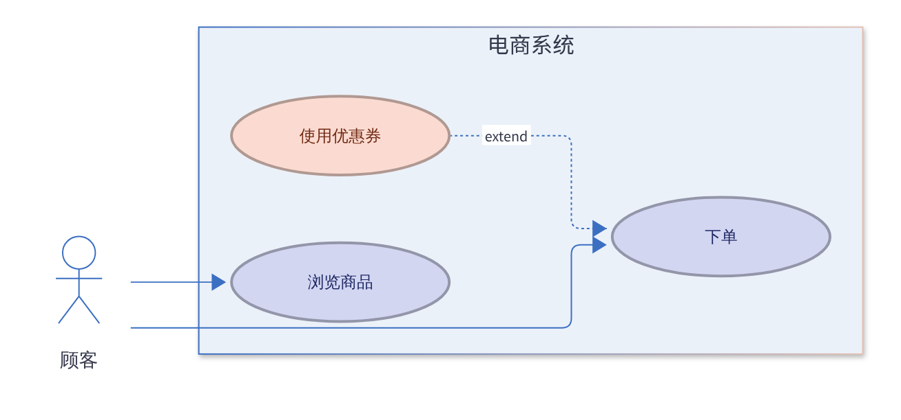

<details>
<summary>示例源码（assets/usecase.mmd）</summary>

```mermaid
---
config:
  theme: base
  fontFamily: "PingFang SC, Microsoft YaHei, Noto Sans CJK SC, Source Han Sans SC, sans-serif"
  themeVariables:
    background: "#FFFFFF"
    primaryColor: "#FFFFFF"
    primaryBorderColor: "#3B6FC2"
    primaryTextColor: "#33384A"
    nodeTextColor: "#33384A"
    secondaryColor: "#FBDBD1"
    tertiaryColor: "#EBF1F9"
    lineColor: "#3B6FC2"
    textColor: "#33384A"
    clusterBkg: "#EBF1F9"
    clusterBorder: "#3B6FC2"
    edgeLabelBackground: "#FFFFFF"
    titleColor: "#33384A"
    noteBkgColor: "#FFF6CE"
    noteBorderColor: "#A6A086"
    noteTextColor: "#33384A"
    usecaseBkg: "#D2D6F1"
    usecaseBorder: "#9396A9"
    usecaseActorBkg: "#F6DEB6"
    usecaseActorBorder: "#AC9B7F"
    usecaseBoundaryBkg: "#FFFFFF"
    usecaseBoundaryBorder: "#3B6FC2"
    usecaseIncludeLine: "#3B6FC2"
    usecaseExtendLine: "#3B6FC2"
---
usecase-beta
  direction LR
  actor Customer("顾客")
  systemBoundary "电商系统"
    Browse("浏览商品"):::uc
    Order("下单"):::uc
    Coupon("使用优惠券"):::ext
  end
  Customer --> Browse
  Customer --> Order
  Coupon ..> : extend Order
classDef person fill:#F6DEB6,stroke:#AC9B7F,color:#714E14
classDef uc fill:#D2D6F1,stroke:#9396A9,color:#1F2865
classDef ext fill:#FBDBD1,stroke:#B09992,color:#712A14
classDef boundary fill:#FFFFFF,stroke:#3B6FC2,color:#33384A,stroke-dasharray:5 4
%% 用法：Order("下单"):::ext、actor Admin("管理员"):::person；systemBoundary 也能挂 :::boundary；class 名不能用 actor 这类关键字
```

</details>

<a id="object"></a>

### 对象图（UML） · `object`

类图在某一时刻的"快照"：具体对象实例的取值和它们之间的链接。

- **什么时候用**：某一时刻的对象实例和取值，用来解释类图或举例。
- **别用**：讲类的定义（→ 类图）。
- **推荐工具**：Mermaid `classDiagram`（借用类图语法）。
- **怎么画**：
  - `class order1["order1 : Order"] { status = PAID }`：标签写"实例名 : 类名"，属性写"字段 = 值"。
- **画好的要点**：
  - 关注的对象用 `focus`，值对象用 `value`。

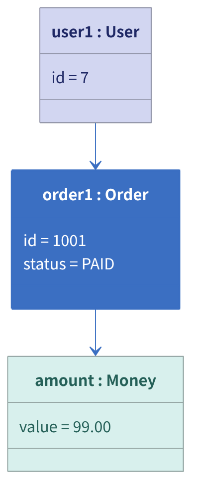

<details>
<summary>示例源码（assets/object.mmd）</summary>

```mermaid
---
config:
  theme: base
  fontFamily: "PingFang SC, Microsoft YaHei, Noto Sans CJK SC, Source Han Sans SC, sans-serif"
  themeVariables:
    background: "#FFFFFF"
    primaryColor: "#FFFFFF"
    primaryBorderColor: "#3B6FC2"
    primaryTextColor: "#33384A"
    nodeTextColor: "#33384A"
    secondaryColor: "#FBDBD1"
    tertiaryColor: "#EBF1F9"
    lineColor: "#3B6FC2"
    textColor: "#33384A"
    clusterBkg: "#EBF1F9"
    clusterBorder: "#3B6FC2"
    edgeLabelBackground: "#FFFFFF"
    titleColor: "#33384A"
    noteBkgColor: "#FFF6CE"
    noteBorderColor: "#A6A086"
    noteTextColor: "#33384A"
    classText: "#1F2865"
---
classDiagram
  class order1["order1 : Order"] {
    id = 1001
    status = PAID
  }
  class user1["user1 : User"] {
    id = 7
  }
  class money["amount : Money"] {
    value = 99.00
  }
  user1 --> order1
  order1 --> money
  class order1:::focus
  class user1:::obj
  class money:::value
classDef obj fill:#D2D6F1,stroke:#9396A9,color:#1F2865
classDef focus fill:#3B6FC2,stroke:#3B6FC2,color:#FFFFFF,stroke-width:2px
classDef value fill:#D8F0ED,stroke:#97A8A6,color:#256058
%% 用法：class OrderService:::focus，或 cssClass "PayGateway" iface
```

</details>

<a id="component"></a>

### 组件图（UML） · `component`

描述系统由哪些可替换的组件组成，组件之间通过哪些提供 / 需要的接口连接。

- **什么时候用**：组件 / 模块之间通过哪些接口依赖。
- **别用**：讲运行时调用顺序（→ 时序图）。
- **推荐工具**：Mermaid `flowchart LR` 近似；要标准组件符号 → drawio。
- **怎么画**：
  - 组件 `[ ]`，接口用圆形 `(( ))` 表示"棒棒糖"，子系统用 subgraph。
- **画好的要点**：
  - 组件、库、接口分别用 `comp` / `lib` / `iface`；子系统底色用 `group`。

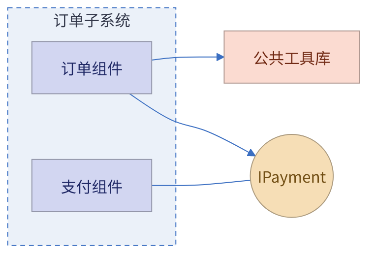

<details>
<summary>示例源码（assets/component.mmd）</summary>

```mermaid
---
config:
  theme: base
  fontFamily: "PingFang SC, Microsoft YaHei, Noto Sans CJK SC, Source Han Sans SC, sans-serif"
  themeVariables:
    background: "#FFFFFF"
    primaryColor: "#FFFFFF"
    primaryBorderColor: "#3B6FC2"
    primaryTextColor: "#33384A"
    nodeTextColor: "#33384A"
    secondaryColor: "#FBDBD1"
    tertiaryColor: "#EBF1F9"
    lineColor: "#3B6FC2"
    textColor: "#33384A"
    clusterBkg: "#EBF1F9"
    clusterBorder: "#3B6FC2"
    edgeLabelBackground: "#FFFFFF"
    titleColor: "#33384A"
    noteBkgColor: "#FFF6CE"
    noteBorderColor: "#A6A086"
    noteTextColor: "#33384A"
---
flowchart LR
  subgraph SUB[订单子系统]
    C1[订单组件]:::comp
    C2[支付组件]:::comp
  end
  L[公共工具库]:::lib
  I((IPayment)):::iface
  C1 --> I
  C2 --- I
  C1 --> L
  class SUB group
classDef comp fill:#D2D6F1,stroke:#9396A9,color:#1F2865
classDef lib fill:#FBDBD1,stroke:#B09992,color:#712A14
classDef iface fill:#F6DEB6,stroke:#AC9B7F,color:#714E14
classDef group fill:#EBF1F9,stroke:#3B6FC2,color:#33384A,stroke-dasharray:5 4
%% 用法：节点 A:::comp 或 class A,B comp
```

</details>

<a id="package"></a>

### 包图（UML） · `package`

把类和模块按包组织，展示包的层次和包之间的依赖。

- **什么时候用**：包 / 模块的分层和依赖，检查循环依赖。
- **别用**：要看类的细节（→ 类图）。
- **推荐工具**：Mermaid `flowchart TB` + 嵌套 subgraph。
- **怎么画**：
  - 外层包、子包都是 subgraph；依赖用虚线 `-.->`。
- **画好的要点**：
  - 外层包 `pkg1`、子包 `pkg2`，越往里越浅；关注的包用 `focus`。
  - 只画有依赖的包。

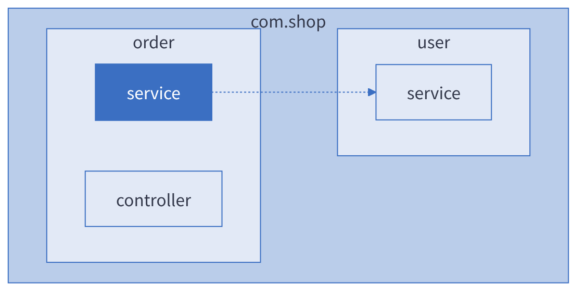

<details>
<summary>示例源码（assets/package.mmd）</summary>

```mermaid
---
config:
  theme: base
  fontFamily: "PingFang SC, Microsoft YaHei, Noto Sans CJK SC, Source Han Sans SC, sans-serif"
  themeVariables:
    background: "#FFFFFF"
    primaryColor: "#FFFFFF"
    primaryBorderColor: "#3B6FC2"
    primaryTextColor: "#33384A"
    nodeTextColor: "#33384A"
    secondaryColor: "#FBDBD1"
    tertiaryColor: "#EBF1F9"
    lineColor: "#3B6FC2"
    textColor: "#33384A"
    clusterBkg: "#EBF1F9"
    clusterBorder: "#3B6FC2"
    edgeLabelBackground: "#FFFFFF"
    titleColor: "#33384A"
    noteBkgColor: "#FFF6CE"
    noteBorderColor: "#A6A086"
    noteTextColor: "#33384A"
---
flowchart TB
  subgraph APP[com.shop]
    subgraph ORDER[order]
      O1[controller]:::pkg2
      O2[service]:::focus
    end
    subgraph USER[user]
      U1[service]:::pkg2
    end
  end
  O2 -.-> U1
  class APP pkg1
  class ORDER,USER pkg2
classDef pkg1 fill:#BACDEA,stroke:#3B6FC2,color:#33384A
classDef pkg2 fill:#E2E9F6,stroke:#3B6FC2,color:#33384A
classDef focus fill:#3B6FC2,stroke:#3B6FC2,color:#FFFFFF,stroke-width:2px
%% 用法：节点 A:::pkg1 或 class A,B pkg1
```

</details>

<a id="uml_deploy"></a>

### 部署图（UML） · `uml_deploy`

描述制品（jar、镜像）部署在哪些物理 / 虚拟节点和执行环境上。

- **什么时候用**：UML 视角的节点、执行环境、制品（jar / 镜像）部署关系。
- **别用**：要讲云上部署全景（→ 部署架构图）。
- **推荐工具**：Mermaid `flowchart LR` 近似；要立方体节点符号 → drawio。
- **怎么画**：
  - 设备节点、执行环境、制品依次嵌套或连线；网络边界用 subgraph + `zone`（虚线）。
- **画好的要点**：
  - 设备、环境、制品分别用 `device` / `env` / `artifact`。

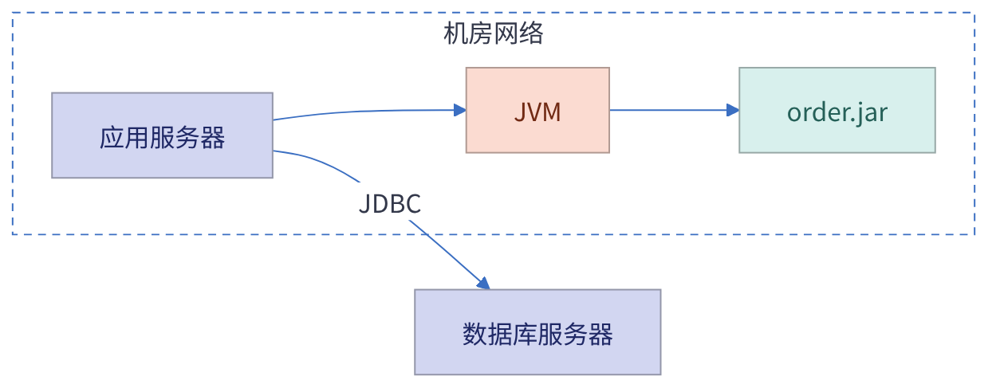

<details>
<summary>示例源码（assets/uml_deploy.mmd）</summary>

```mermaid
---
config:
  theme: base
  fontFamily: "PingFang SC, Microsoft YaHei, Noto Sans CJK SC, Source Han Sans SC, sans-serif"
  themeVariables:
    background: "#FFFFFF"
    primaryColor: "#FFFFFF"
    primaryBorderColor: "#3B6FC2"
    primaryTextColor: "#33384A"
    nodeTextColor: "#33384A"
    secondaryColor: "#FBDBD1"
    tertiaryColor: "#EBF1F9"
    lineColor: "#3B6FC2"
    textColor: "#33384A"
    clusterBkg: "#EBF1F9"
    clusterBorder: "#3B6FC2"
    edgeLabelBackground: "#FFFFFF"
    titleColor: "#33384A"
    noteBkgColor: "#FFF6CE"
    noteBorderColor: "#A6A086"
    noteTextColor: "#33384A"
---
flowchart LR
  subgraph DC[机房网络]
    N1[应用服务器]:::device
    E1[JVM]:::env
    A1[order.jar]:::artifact
  end
  N2[数据库服务器]:::device
  N1 --> E1 --> A1
  N1 -- JDBC --> N2
  class DC zone
classDef device fill:#D2D6F1,stroke:#9396A9,color:#1F2865
classDef env fill:#FBDBD1,stroke:#B09992,color:#712A14
classDef artifact fill:#D8F0ED,stroke:#97A8A6,color:#256058
classDef zone fill:#FFFFFF,stroke:#3B6FC2,color:#33384A,stroke-dasharray:5 4
%% 用法：节点 A:::device 或 class A,B device
```

</details>

<a id="composite"></a>

### 组合结构图（UML） · `composite`

展示一个类的内部结构：由哪些部件组成，通过哪些端口和外部交互。

- **什么时候用**：一个类内部由哪些部件组成、通过哪些端口和外部交互。
- **别用**：一般的类关系（→ 类图）。
- **推荐工具**：drawio 优先；Mermaid `flowchart LR` 近似。
- **怎么画**：
  - 类元边框用 subgraph（`frame`），部件写成 `名称 : 类型`，端口用小圆 `(( ))`。
- **画好的要点**：
  - 端口用 `port`（槽3）放在边框边缘。

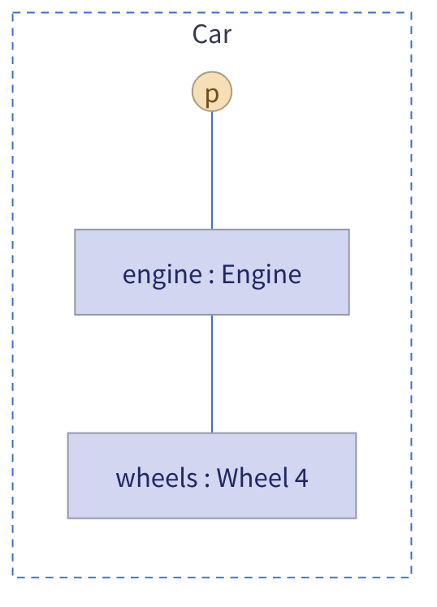

<details>
<summary>示例源码（assets/composite.mmd）</summary>

```mermaid
---
config:
  theme: base
  fontFamily: "PingFang SC, Microsoft YaHei, Noto Sans CJK SC, Source Han Sans SC, sans-serif"
  themeVariables:
    background: "#FFFFFF"
    primaryColor: "#FFFFFF"
    primaryBorderColor: "#3B6FC2"
    primaryTextColor: "#33384A"
    nodeTextColor: "#33384A"
    secondaryColor: "#FBDBD1"
    tertiaryColor: "#EBF1F9"
    lineColor: "#3B6FC2"
    textColor: "#33384A"
    clusterBkg: "#EBF1F9"
    clusterBorder: "#3B6FC2"
    edgeLabelBackground: "#FFFFFF"
    titleColor: "#33384A"
    noteBkgColor: "#FFF6CE"
    noteBorderColor: "#A6A086"
    noteTextColor: "#33384A"
---
flowchart LR
  subgraph CAR[Car]
    E[engine : Engine]:::part
    W[wheels : Wheel 4]:::part
    P1((p)):::port
  end
  E --- W
  P1 --- E
  class CAR frame
classDef frame fill:#FFFFFF,stroke:#3B6FC2,color:#33384A,stroke-dasharray:5 4
classDef part fill:#D2D6F1,stroke:#9396A9,color:#1F2865
classDef port fill:#F6DEB6,stroke:#AC9B7F,color:#714E14
%% 用法：节点 A:::frame 或 class A,B frame
```

</details>

<a id="profile"></a>

### Profile 图（UML） · `profile`

用构造型（stereotype）和标记值扩展 UML，为某个领域定制建模语言。

- **什么时候用**：UML 扩展：自定义构造型、标记值（比如给实体类加数据库映射）。
- **别用**：一般的类设计（→ 类图）。
- **推荐工具**：Mermaid `classDiagram`。
- **怎么画**：
  - `<<stereotype>>`、`<<metaclass>>`；扩展关系 `Class <|-- Entity : extension`。
- **画好的要点**：
  - 构造型、元类、标记值分别用 `stereo` / `meta` / `tagged`。

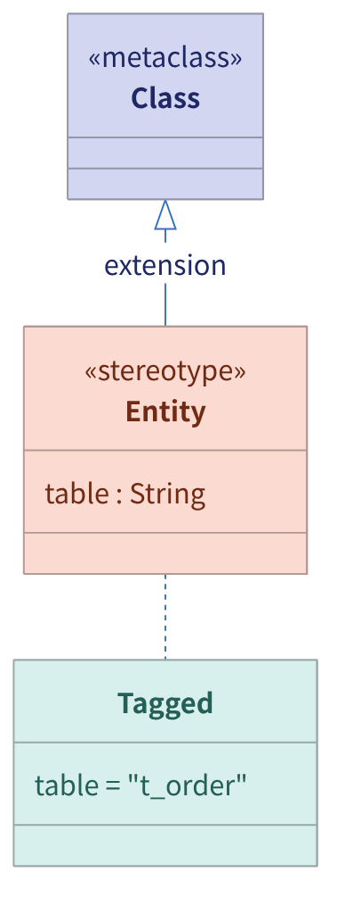

<details>
<summary>示例源码（assets/profile.mmd）</summary>

```mermaid
---
config:
  theme: base
  fontFamily: "PingFang SC, Microsoft YaHei, Noto Sans CJK SC, Source Han Sans SC, sans-serif"
  themeVariables:
    background: "#FFFFFF"
    primaryColor: "#FFFFFF"
    primaryBorderColor: "#3B6FC2"
    primaryTextColor: "#33384A"
    nodeTextColor: "#33384A"
    secondaryColor: "#FBDBD1"
    tertiaryColor: "#EBF1F9"
    lineColor: "#3B6FC2"
    textColor: "#33384A"
    clusterBkg: "#EBF1F9"
    clusterBorder: "#3B6FC2"
    edgeLabelBackground: "#FFFFFF"
    titleColor: "#33384A"
    noteBkgColor: "#FFF6CE"
    noteBorderColor: "#A6A086"
    noteTextColor: "#33384A"
    classText: "#1F2865"
---
classDiagram
  class Entity {
    <<stereotype>>
    table : String
  }
  class Class {
    <<metaclass>>
  }
  class Tagged {
    table = "t_order"
  }
  Class <|-- Entity : extension
  Entity .. Tagged
  class Entity:::stereo
  class Class:::meta
  class Tagged:::tagged
classDef stereo fill:#FBDBD1,stroke:#B09992,color:#712A14
classDef meta fill:#D2D6F1,stroke:#9396A9,color:#1F2865
classDef tagged fill:#D8F0ED,stroke:#97A8A6,color:#256058
%% 用法：class OrderService:::focus，或 cssClass "PayGateway" iface
```

</details>

<a id="cat-product"></a>

## 5. 产品设计

需求管理、交互设计、原型设计里常用的图。

| 想讲清 | 用哪种图 |
|---|---|
| 用户完成一件事的阶段、触点、情绪 | 用户旅程图 `journey` |
| 需求条目之间、需求与设计 / 测试之间的追踪关系 | 需求图 `requirement` |
| 页面之间怎么跳转、有哪些交互分支 | 页面流程图 `ui_flow` |
| 页面布局、元素和标注 | 线框图 / 原型图 `wireframe` |
| 按用户活动组织需求、切出 MVP | 用户故事地图 `story_map` |
| 需求优先级排序 | 象限图 `quadrant`（见 types-data.md） |
| 用户访谈、反馈归类 | 亲和图 `affinity`（见 types-thinking.md） |
| 需求范围的发散梳理 | 思维导图 `mindmap`（见 types-thinking.md） |

### 产品类图怎么配合

一个需求从提出到交付，通常按这个顺序用图：

1. **用户旅程图**：用户现在怎么完成这件事、哪里体验差（找问题）。
2. **亲和图 / 思维导图**：整理调研和需求范围（见思考梳理类）。
3. **用户故事地图**：把需求按用户活动排开，切出 MVP（定范围）。
4. **象限图**：给需求排优先级（见数据呈现类）。
5. **页面流程图 + 线框图**：页面怎么跳转、每页长什么样（出方案）。
6. **需求图**：需求和设计、测试用例怎么对应（追踪）。

<a id="journey"></a>

### 用户旅程图 · `journey`

按阶段描绘用户完成一个目标的步骤、触点和情绪起伏，用来找体验痛点和机会点。

- **什么时候用**：用户完成一件事的阶段、步骤和情绪变化，找体验痛点。
- **别用**：要画页面跳转（→ 页面流程图）。
- **推荐工具**：Mermaid `journey`（1–5 分显示为表情）；要加触点、痛点、机会点多行泳道 → drawio。
- **怎么画**：
  - `section 阶段`；`步骤: 分数: 角色1, 角色2`。
- **画好的要点**：
  - 阶段 3–6 个；分数如实反映情绪低谷，低分步骤就是痛点。

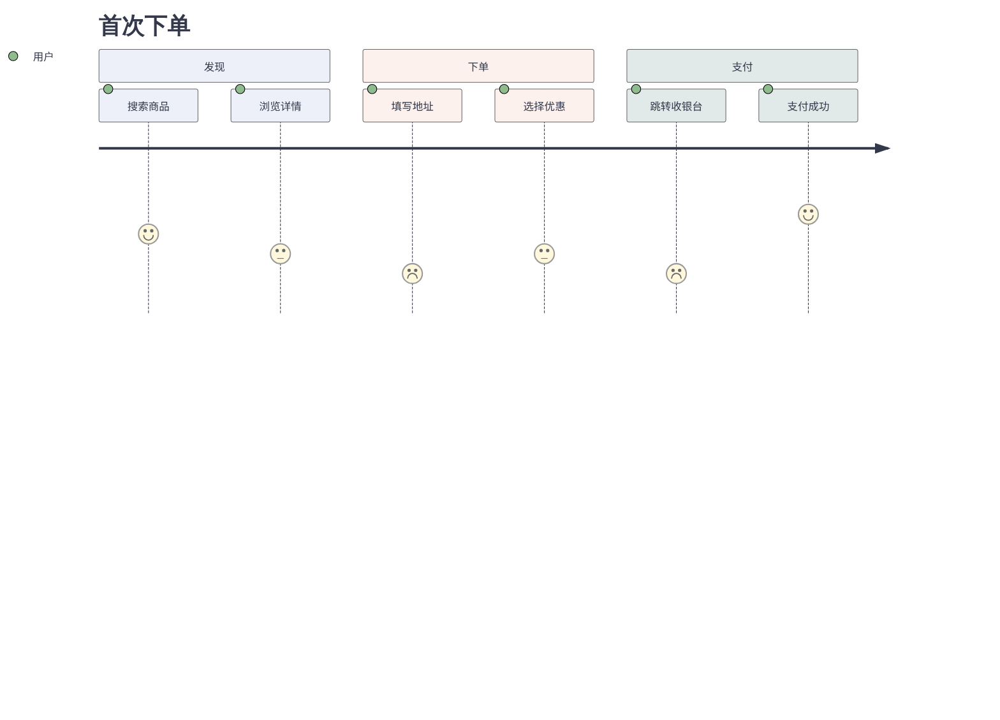

<details>
<summary>示例源码（assets/journey.mmd）</summary>

```mermaid
---
config:
  theme: base
  fontFamily: "PingFang SC, Microsoft YaHei, Noto Sans CJK SC, Source Han Sans SC, sans-serif"
  themeVariables:
    background: "#FFFFFF"
    primaryColor: "#FFFFFF"
    primaryBorderColor: "#3B6FC2"
    primaryTextColor: "#33384A"
    nodeTextColor: "#33384A"
    secondaryColor: "#FBDBD1"
    tertiaryColor: "#EBF1F9"
    lineColor: "#3B6FC2"
    textColor: "#33384A"
    clusterBkg: "#EBF1F9"
    clusterBorder: "#3B6FC2"
    edgeLabelBackground: "#FFFFFF"
    titleColor: "#33384A"
    noteBkgColor: "#FFF6CE"
    noteBorderColor: "#A6A086"
    noteTextColor: "#33384A"
    fillType0: "#EDEFF9"
    fillType1: "#FDF1ED"
    fillType2: "#E1EAE9"
    fillType3: "#FBF2E2"
    fillType4: "#F2F5EB"
    fillType5: "#DBDCE4"
    fillType6: "#EDEFF9"
    fillType7: "#FDF1ED"
    faceColor: "#FFF6CE"
---
journey
  title 首次下单
  section 发现
    搜索商品: 4: 用户
    浏览详情: 3: 用户
  section 下单
    填写地址: 2: 用户
    选择优惠: 3: 用户
  section 支付
    跳转收银台: 2: 用户
    支付成功: 5: 用户
%% 第 n 个 section 用 fillType<n-1>
```

</details>

<a id="requirement"></a>

### 需求图 · `requirement`

SysML 里的需求图：每个需求一个框，带编号、风险和验证方式，用关系线追踪需求与设计、测试之间的对应。

- **什么时候用**：需求条目之间、需求与设计 / 代码 / 测试之间的追踪关系（SysML 需求图）。
- **别用**：只是列需求清单（→ 表格或思维导图）。
- **推荐工具**：Mermaid `requirementDiagram`。
- **怎么画**：
  - `requirement 标识 { id: R1  text: "..."  risk: high  verifymethod: test }`；类型还有 `functionalRequirement`、`interfaceRequirement`、`performanceRequirement`、`designConstraint` 等。
  - `element 名 { type: code }`；关系 `- satisfies ->`、`- verifies ->`、`- traces ->`、`- contains ->`、`- derives ->`、`- refines ->`、`- copies ->`。
  - 标识用英文（中文标识会报错，非要用中文就加引号），中文内容写在 `text` 里。
- **画好的要点**：
  - 一个需求一个框；只画有追踪价值的关系。

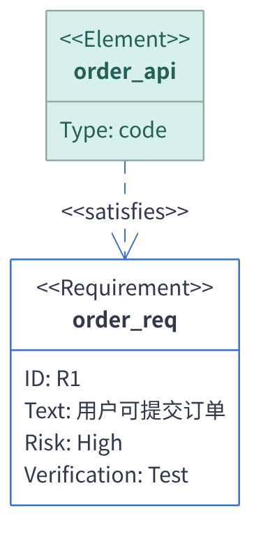

<details>
<summary>示例源码（assets/requirement.mmd）</summary>

```mermaid
---
config:
  theme: base
  fontFamily: "PingFang SC, Microsoft YaHei, Noto Sans CJK SC, Source Han Sans SC, sans-serif"
  themeVariables:
    background: "#FFFFFF"
    primaryColor: "#FFFFFF"
    primaryBorderColor: "#3B6FC2"
    primaryTextColor: "#33384A"
    nodeTextColor: "#33384A"
    secondaryColor: "#FBDBD1"
    tertiaryColor: "#EBF1F9"
    lineColor: "#3B6FC2"
    textColor: "#33384A"
    clusterBkg: "#EBF1F9"
    clusterBorder: "#3B6FC2"
    edgeLabelBackground: "#FFFFFF"
    titleColor: "#33384A"
    noteBkgColor: "#FFF6CE"
    noteBorderColor: "#A6A086"
    noteTextColor: "#33384A"
    requirementBackground: "#D2D6F1"
    requirementBorderColor: "#9396A9"
    requirementTextColor: "#1F2865"
    relationColor: "#3B6FC2"
    relationLabelBackground: "#FFFFFF"
    relationLabelColor: "#33384A"
---
requirementDiagram
  requirement order_req {
    id: R1
    text: "用户可提交订单"
    risk: high
    verifymethod: test
  }
  element order_api {
    type: code
  }
  order_api - satisfies -> order_req
  class order_api element
classDef req fill:#D2D6F1,stroke:#9396A9,color:#1F2865
classDef element fill:#D8F0ED,stroke:#97A8A6,color:#256058
%% element 的配色：classDef 后 class 元素名 element
```

</details>

<a id="ui_flow"></a>

### 页面流程图 / 交互流程 · `ui_flow`

页面级的流程图：节点是页面，连线是用户操作或跳转条件，回答"用户怎么从 A 页走到 B 页"。

- **什么时候用**：页面之间的跳转、登录拦截等状态分支、交互说明（PRD / 交互文档里最常用）。
- **别用**：要画页面长什么样（→ 线框图）。
- **推荐工具**：Mermaid `flowchart LR`；要带页面缩略图 → drawio；需求阶段的高保真交互稿 → Figma。
- **怎么画**：
  - 页面 `[ ]`、用户操作 `[/ /]`、判断 `{ }`、入口 / 出口 `([ ])`；交互说明用 `annotation` 节点虚线连到页面。
- **画好的要点**：
  - 主路径自左向右一条线；页面名和真实页面一致。
  - 返回 / 回退用虚线。

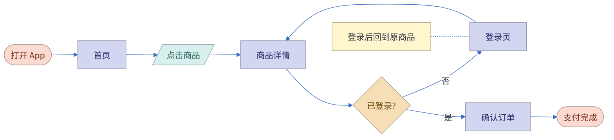

<details>
<summary>示例源码（assets/ui_flow.mmd）</summary>

```mermaid
---
config:
  theme: base
  fontFamily: "PingFang SC, Microsoft YaHei, Noto Sans CJK SC, Source Han Sans SC, sans-serif"
  themeVariables:
    background: "#FFFFFF"
    primaryColor: "#FFFFFF"
    primaryBorderColor: "#3B6FC2"
    primaryTextColor: "#33384A"
    nodeTextColor: "#33384A"
    secondaryColor: "#FBDBD1"
    tertiaryColor: "#EBF1F9"
    lineColor: "#3B6FC2"
    textColor: "#33384A"
    clusterBkg: "#EBF1F9"
    clusterBorder: "#3B6FC2"
    edgeLabelBackground: "#FFFFFF"
    titleColor: "#33384A"
    noteBkgColor: "#FFF6CE"
    noteBorderColor: "#A6A086"
    noteTextColor: "#33384A"
---
flowchart LR
  IN([打开 App]):::entry --> P1[首页]:::page
  P1 --> A1[/点击商品/]:::action --> P2[商品详情]:::page
  P2 --> D{已登录?}:::decision
  D -- 否 --> P3[登录页]:::page --> P2
  D -- 是 --> P4[确认订单]:::page --> OUT([支付完成]):::entry
  N[登录后回到原商品]:::annotation -.- P3
classDef page fill:#D2D6F1,stroke:#9396A9,color:#1F2865
classDef action fill:#D8F0ED,stroke:#97A8A6,color:#256058
classDef decision fill:#F6DEB6,stroke:#AC9B7F,color:#714E14
classDef entry fill:#FBDBD1,stroke:#B09992,color:#712A14
classDef annotation fill:#FFF6CE,stroke:#A6A086,color:#33384A
%% 用法：节点 A:::page 或 class A,B page
```

</details>

<a id="wireframe"></a>

### 线框图 / 原型图 · `wireframe`

用灰框、占位块和标注表达页面布局和信息层级的低保真草图；能点击、有交互的叫原型。

- **什么时候用**：页面布局、信息结构、元素优先级（低保真）；PRD 里的页面示意。
- **别用**：要可点击、可演示的高保真原型（→ Figma）。
- **推荐工具**：drawio（mockup 图形库）；Mermaid 只能做极简的区块示意。
- **怎么画**：
  - drawio：画布 `canvas`，图片占位 `block`（加对角线），组件区块 `component`，主按钮 `primaryBtn`，标注编号 `marker`（红色圆点）+ 右侧说明列表。
- **画好的要点**：
  - 灰阶为主，只有主操作一个颜色。
  - 用真实文案，不用占位假字；标注编号和说明一一对应。

正式出图用 drawio；下面是 Mermaid 的近似画法。

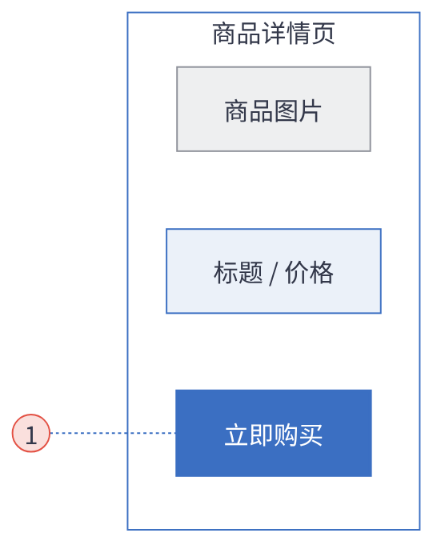

<details>
<summary>示例源码（assets/wireframe.mmd）</summary>

```mermaid
---
config:
  theme: base
  fontFamily: "PingFang SC, Microsoft YaHei, Noto Sans CJK SC, Source Han Sans SC, sans-serif"
  themeVariables:
    background: "#FFFFFF"
    primaryColor: "#FFFFFF"
    primaryBorderColor: "#3B6FC2"
    primaryTextColor: "#33384A"
    nodeTextColor: "#33384A"
    secondaryColor: "#FBDBD1"
    tertiaryColor: "#EBF1F9"
    lineColor: "#3B6FC2"
    textColor: "#33384A"
    clusterBkg: "#EBF1F9"
    clusterBorder: "#3B6FC2"
    edgeLabelBackground: "#FFFFFF"
    titleColor: "#33384A"
    noteBkgColor: "#FFF6CE"
    noteBorderColor: "#A6A086"
    noteTextColor: "#33384A"
---
flowchart LR
  subgraph PAGE[商品详情页]
    IMG[商品图片]:::block
    INFO[标题 / 价格]:::component
    BTN[立即购买]:::primaryBtn
  end
  M1((1)):::marker -.- BTN
  class PAGE canvas
%% 该图 Mermaid 没有原生类型，优先用 drawio；下面是 flowchart 近似画法的配色
classDef canvas fill:#FFFFFF,stroke:#3B6FC2,color:#33384A
classDef block fill:#EEEFF0,stroke:#8F929B,color:#33384A
classDef primaryBtn fill:#3B6FC2,stroke:#3B6FC2,color:#FFFFFF,stroke-width:2px
classDef component fill:#EBF1F9,stroke:#3B6FC2,color:#33384A
classDef marker fill:#FAE0DD,stroke:#E35144,color:#33384A
%% 用法：节点 A:::canvas 或 class A,B canvas
```

</details>

<a id="story_map"></a>

### 用户故事地图 · `story_map`

Jeff Patton 提出的需求组织方法：横向是用户活动和任务（骨架），纵向是按优先级排列的故事，横线切出发布版本。

- **什么时候用**：按用户活动（骨架）横向排列，下面挂任务和故事，横线切出 MVP 和后续版本。
- **别用**：只是排期（→ 甘特图或路线图）。
- **推荐工具**：Mermaid `flowchart LR` 近似；卡片超过 20 张或要协作拖动 → drawio。
- **怎么画**：
  - 第一行用户活动用 `-->` 串起来；每个活动下挂任务，再挂故事卡。
- **画好的要点**：
  - 用户活动用主色，任务用槽色，故事卡用便签黄。
  - 本期 MVP 用 `mvp`，后续版本用 `later`（灰）。

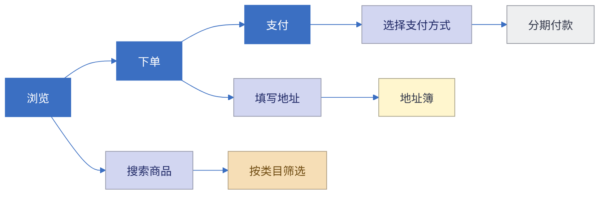

<details>
<summary>示例源码（assets/story_map.mmd）</summary>

```mermaid
---
config:
  theme: base
  fontFamily: "PingFang SC, Microsoft YaHei, Noto Sans CJK SC, Source Han Sans SC, sans-serif"
  themeVariables:
    background: "#FFFFFF"
    primaryColor: "#FFFFFF"
    primaryBorderColor: "#3B6FC2"
    primaryTextColor: "#33384A"
    nodeTextColor: "#33384A"
    secondaryColor: "#FBDBD1"
    tertiaryColor: "#EBF1F9"
    lineColor: "#3B6FC2"
    textColor: "#33384A"
    clusterBkg: "#EBF1F9"
    clusterBorder: "#3B6FC2"
    edgeLabelBackground: "#FFFFFF"
    titleColor: "#33384A"
    noteBkgColor: "#FFF6CE"
    noteBorderColor: "#A6A086"
    noteTextColor: "#33384A"
---
flowchart LR
  A1[浏览]:::activity --> A2[下单]:::activity --> A3[支付]:::activity
  A1 --> T1[搜索商品]:::task --> S1[按类目筛选]:::mvp
  A2 --> T2[填写地址]:::task --> S2[地址簿]:::story
  A3 --> T3[选择支付方式]:::task --> S3[分期付款]:::later
classDef activity fill:#3B6FC2,stroke:#3B6FC2,color:#FFFFFF,stroke-width:2px
classDef task fill:#D2D6F1,stroke:#9396A9,color:#1F2865
classDef story fill:#FFF6CE,stroke:#A6A086,color:#33384A
classDef mvp fill:#F6DEB6,stroke:#AC9B7F,color:#714E14
classDef later fill:#EEEFF0,stroke:#8F929B,color:#33384A
%% 用法：节点 A:::activity 或 class A,B activity
```

</details>

<a id="cat-planning"></a>

## 6. 计划进度

| 想讲清 | 用哪种图 |
|---|---|
| 任务排期、依赖、关键路径 | 甘特图 `gantt` |
| 已经发生的事件 / 版本演进 | 时间线 `timeline` |
| 未来的方向（Now / Next / Later 或按季度） | 路线图 `roadmap` |
| 任务现在处在哪个阶段 | 看板 `kanban` |
| 分支策略、发布流程 | Git 分支图 `gitgraph` |

### 甘特图、时间线、路线图、看板的区别

| | 甘特图 | 时间线 | 路线图 | 看板 |
|---|---|---|---|---|
| 时间方向 | 当前 + 未来，精确到天 | 过去 | 未来，粒度粗 | 没有时间轴 |
| 回答的问题 | 什么时候做完、谁依赖谁 | 发生过什么 | 接下来往哪走 | 现在做到哪了 |
| 粒度 | 任务 | 事件 / 版本 | 主题 / 目标 | 卡片 |
| 典型读者 | 项目经理、研发 | 所有人 | 管理层、业务方 | 团队日常 |
| 变化频率 | 每周更新 | 只追加 | 每季度调整 | 每天变 |

<a id="gantt"></a>

### 甘特图 · `gantt`

横轴是日期，每个任务一条横条，显示起止时间、依赖、关键路径和里程碑。

- **什么时候用**：任务排期、依赖、关键路径、里程碑。
- **别用**：只想看任务在哪个阶段（→ 看板）。
- **推荐工具**：Mermaid `gantt`。
- **怎么画**：
  - `dateFormat YYYY-MM-DD`、`axisFormat %m-%d`；任务 `名称 :状态, id, 开始, 时长`，状态可选 `done` / `active` / `crit` / `milestone`。
  - `after id` 表示依赖；`excludes weekends` 排除周末。
- **画好的要点**：
  - section 按阶段或团队分；关键路径用 `crit`；里程碑时长写 `0d`。
  - 任务名不超过 8 个字。

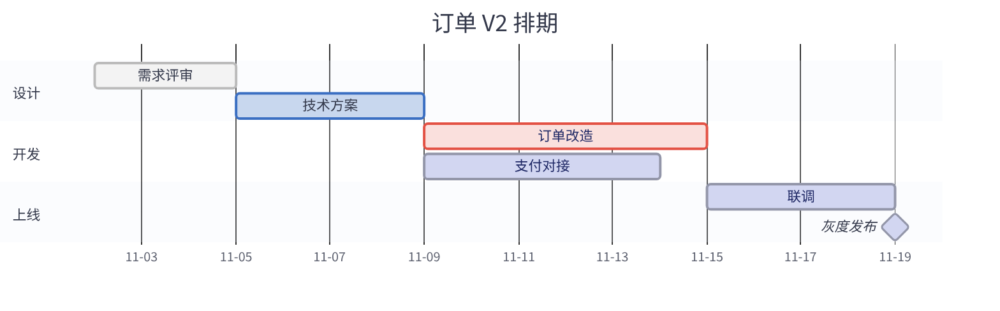

<details>
<summary>示例源码（assets/gantt.mmd）</summary>

```mermaid
---
config:
  theme: base
  fontFamily: "PingFang SC, Microsoft YaHei, Noto Sans CJK SC, Source Han Sans SC, sans-serif"
  themeVariables:
    background: "#FFFFFF"
    primaryColor: "#FFFFFF"
    primaryBorderColor: "#3B6FC2"
    primaryTextColor: "#33384A"
    nodeTextColor: "#33384A"
    secondaryColor: "#FBDBD1"
    tertiaryColor: "#EBF1F9"
    lineColor: "#3B6FC2"
    textColor: "#33384A"
    clusterBkg: "#EBF1F9"
    clusterBorder: "#3B6FC2"
    edgeLabelBackground: "#FFFFFF"
    titleColor: "#33384A"
    noteBkgColor: "#FFF6CE"
    noteBorderColor: "#A6A086"
    noteTextColor: "#33384A"
    taskBkgColor: "#D2D6F1"
    taskBorderColor: "#9396A9"
    taskTextColor: "#1F2865"
    taskTextLightColor: "#1F2865"
    taskTextDarkColor: "#33384A"
    taskTextOutsideColor: "#33384A"
    activeTaskBkgColor: "#C8D7EE"
    activeTaskBorderColor: "#3B6FC2"
    doneTaskBkgColor: "#F3F3F3"
    doneTaskBorderColor: "#BBBBBB"
    critBkgColor: "#FAE0DD"
    critBorderColor: "#E35144"
    sectionBkgColor: "#EBF1F9"
    altSectionBkgColor: "#FFFFFF"
    sectionBkgColor2: "#EBF1F9"
    todayLineColor: "#E35144"
---
gantt
  title 订单 V2 排期
  dateFormat YYYY-MM-DD
  axisFormat %m-%d
  section 设计
    需求评审 :done, a1, 2026-11-02, 3d
    技术方案 :active, a2, after a1, 4d
  section 开发
    订单改造 :crit, b1, after a2, 6d
    支付对接 :b2, after a2, 5d
  section 上线
    联调 :c1, after b1, 4d
    灰度发布 :milestone, c2, after c1, 0d
%% active / done / crit / milestone 上的文字都用 taskTextDarkColor；网格竖线由渲染端决定，主题变量改不了
```

</details>

<a id="timeline"></a>

### 时间线 · `timeline`

按时间顺序排列已经发生的事件或版本，重点是"什么时候发生了什么"。

- **什么时候用**：已经发生的事件、版本演进、项目历程。
- **别用**：未来规划（→ 路线图）；有依赖的排期（→ 甘特图）。
- **推荐工具**：Mermaid `timeline`。
- **怎么画**：
  - `时间 : 事件 : 事件`；`section` 分期。
- **画好的要点**：
  - 时间点不超过 8 个，每个时间点不超过 3 个事件。

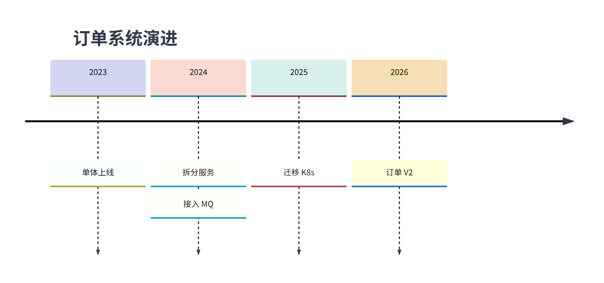

<details>
<summary>示例源码（assets/timeline.mmd）</summary>

```mermaid
---
config:
  theme: base
  fontFamily: "PingFang SC, Microsoft YaHei, Noto Sans CJK SC, Source Han Sans SC, sans-serif"
  themeVariables:
    background: "#FFFFFF"
    primaryColor: "#FFFFFF"
    primaryBorderColor: "#3B6FC2"
    primaryTextColor: "#33384A"
    nodeTextColor: "#33384A"
    secondaryColor: "#FBDBD1"
    tertiaryColor: "#EBF1F9"
    lineColor: "#3B6FC2"
    textColor: "#33384A"
    clusterBkg: "#EBF1F9"
    clusterBorder: "#3B6FC2"
    edgeLabelBackground: "#FFFFFF"
    titleColor: "#33384A"
    noteBkgColor: "#FFF6CE"
    noteBorderColor: "#A6A086"
    noteTextColor: "#33384A"
    cScale0: "#D2D6F1"
    cScaleLabel0: "#111111"
    cScale1: "#FBDBD1"
    cScaleLabel1: "#111111"
    cScale2: "#D8F0ED"
    cScaleLabel2: "#111111"
    cScale3: "#F6DEB6"
    cScaleLabel3: "#111111"
    cScale4: "#DEE7CD"
    cScaleLabel4: "#111111"
    cScale5: "#A4A7BC"
    cScaleLabel5: "#111111"
    cScale6: "#D2D6F1"
    cScaleLabel6: "#111111"
    cScale7: "#FBDBD1"
    cScaleLabel7: "#111111"
    cScale8: "#D8F0ED"
    cScaleLabel8: "#111111"
    cScale9: "#F6DEB6"
    cScaleLabel9: "#111111"
    cScale10: "#DEE7CD"
    cScaleLabel10: "#111111"
    cScale11: "#A4A7BC"
    cScaleLabel11: "#111111"
---
timeline
  title 订单系统演进
  2023 : 单体上线
  2024 : 拆分服务 : 接入 MQ
  2025 : 迁移 K8s
  2026 : 订单 V2
```

</details>

<a id="roadmap"></a>

### 路线图 · `roadmap`

面向未来的方向图：按时间段（季度或 Now / Next / Later）列出计划交付的主题，越远越粗。

- **什么时候用**：未来的方向：Now / Next / Later 或按季度。
- **别用**：精确到天的排期（→ 甘特图）。
- **推荐工具**：Mermaid `timeline` + section（颜色由深到浅表示确定程度）；多主题泳道 × 季度 → drawio。
- **怎么画**：
  - `section Now` / `section Next` / `section Later`，每段下写 `时间 : 事项`。
- **画好的要点**：
  - 越远越粗：Now 写具体交付，Later 写方向。


<details>
<summary>示例源码（assets/roadmap.mmd）</summary>

```mermaid
---
config:
  theme: base
  fontFamily: "PingFang SC, Microsoft YaHei, Noto Sans CJK SC, Source Han Sans SC, sans-serif"
  themeVariables:
    background: "#FFFFFF"
    primaryColor: "#FFFFFF"
    primaryBorderColor: "#3B6FC2"
    primaryTextColor: "#33384A"
    nodeTextColor: "#33384A"
    secondaryColor: "#FBDBD1"
    tertiaryColor: "#EBF1F9"
    lineColor: "#3B6FC2"
    textColor: "#33384A"
    clusterBkg: "#EBF1F9"
    clusterBorder: "#3B6FC2"
    edgeLabelBackground: "#FFFFFF"
    titleColor: "#33384A"
    noteBkgColor: "#FFF6CE"
    noteBorderColor: "#A6A086"
    noteTextColor: "#33384A"
    cScale0: "#3B6FC2"
    cScaleLabel0: "#FFFFFF"
    cScale1: "#93B0DD"
    cScaleLabel1: "#33384A"
    cScale2: "#E2E9F6"
    cScaleLabel2: "#33384A"
    cScale3: "#F6DEB6"
    cScaleLabel3: "#111111"
    cScale4: "#DEE7CD"
    cScaleLabel4: "#111111"
    cScale5: "#A4A7BC"
    cScaleLabel5: "#111111"
    cScale6: "#D2D6F1"
    cScaleLabel6: "#111111"
    cScale7: "#FBDBD1"
    cScaleLabel7: "#111111"
    cScale8: "#D8F0ED"
    cScaleLabel8: "#111111"
    cScale9: "#F6DEB6"
    cScaleLabel9: "#111111"
    cScale10: "#DEE7CD"
    cScaleLabel10: "#111111"
    cScale11: "#A4A7BC"
    cScaleLabel11: "#111111"
---
timeline
  title 2027 订单路线图
  section Now
    Q1 : 会员体系 : 订单导出
  section Next
    Q2 : 多仓发货
  section Later
    H2 : 海外支付 : 智能推荐
%% section 依次为 Now / Next / Later，颜色由深到浅，只写三个 section
```

</details>

<a id="kanban"></a>

### 看板 · `kanban`

按状态分列（待办、进行中、测试、完成），每个任务一张卡片，看工作在流程里的位置。

- **什么时候用**：任务当前处在哪个阶段，一眼看 WIP。
- **别用**：要看时间和依赖（→ 甘特图）。
- **推荐工具**：Mermaid `kanban`。
- **怎么画**：
  - 列 `id[列名]`，卡片缩进写 `id[卡片]`；卡片元数据 `@{ assigned: '张三', ticket: 'JIRA-1', priority: 'High' }`，priority 可选 `Very High` / `High` / `Low` / `Very Low`。
- **画好的要点**：
  - 列 3–5 个，列颜色按系列色轮换。


<details>
<summary>示例源码（assets/kanban.mmd）</summary>

```mermaid
---
config:
  theme: base
  fontFamily: "PingFang SC, Microsoft YaHei, Noto Sans CJK SC, Source Han Sans SC, sans-serif"
  themeVariables:
    background: "#FFFFFF"
    primaryColor: "#FFFFFF"
    primaryBorderColor: "#3B6FC2"
    primaryTextColor: "#33384A"
    nodeTextColor: "#33384A"
    secondaryColor: "#FBDBD1"
    tertiaryColor: "#EBF1F9"
    lineColor: "#3B6FC2"
    textColor: "#33384A"
    clusterBkg: "#EBF1F9"
    clusterBorder: "#3B6FC2"
    edgeLabelBackground: "#FFFFFF"
    titleColor: "#33384A"
    noteBkgColor: "#FFF6CE"
    noteBorderColor: "#A6A086"
    noteTextColor: "#33384A"
    cScale0: "#DEE7CD"
    cScaleLabel0: "#111111"
    cScale1: "#A4A7BC"
    cScaleLabel1: "#111111"
    cScale2: "#D2D6F1"
    cScaleLabel2: "#111111"
    cScale3: "#FBDBD1"
    cScaleLabel3: "#111111"
    cScale4: "#D8F0ED"
    cScaleLabel4: "#111111"
    cScale5: "#F6DEB6"
    cScaleLabel5: "#111111"
    cScale6: "#DEE7CD"
    cScaleLabel6: "#111111"
    cScale7: "#A4A7BC"
    cScaleLabel7: "#111111"
    cScale8: "#D2D6F1"
    cScaleLabel8: "#111111"
    cScale9: "#FBDBD1"
    cScaleLabel9: "#111111"
    cScale10: "#D8F0ED"
    cScaleLabel10: "#111111"
    cScale11: "#F6DEB6"
    cScaleLabel11: "#111111"
---
kanban
  todo[待办]
    t1[订单导出]
  doing[进行中]
    t2[支付对接]@{ priority: 'High' }
  review[测试中]
    t3[下单页]
  done[已完成]
    t4[需求评审]
```

</details>

<a id="gitgraph"></a>

### Git 分支图 · `gitgraph`

用分支线和提交点画出 Git 分支的创建、提交和合并顺序，用来说明分支策略。

- **什么时候用**：分支策略、发布流程、合并顺序。
- **别用**：讲代码演进历史（→ 时间线）。
- **推荐工具**：Mermaid `gitGraph`。
- **怎么画**：
  - `commit`、`branch 名`、`checkout 名`、`merge 名`、`commit id: "说明" tag: "v1.0"`、`cherry-pick id: "x"`。
- **画好的要点**：
  - 分支按出现顺序取系列色（main、develop、feature、hotfix）。
  - 只画说明策略需要的提交。


<details>
<summary>示例源码（assets/gitgraph.mmd）</summary>

```mermaid
---
config:
  theme: base
  fontFamily: "PingFang SC, Microsoft YaHei, Noto Sans CJK SC, Source Han Sans SC, sans-serif"
  themeVariables:
    background: "#FFFFFF"
    primaryColor: "#FFFFFF"
    primaryBorderColor: "#3B6FC2"
    primaryTextColor: "#33384A"
    nodeTextColor: "#33384A"
    secondaryColor: "#FBDBD1"
    tertiaryColor: "#EBF1F9"
    lineColor: "#3B6FC2"
    textColor: "#33384A"
    clusterBkg: "#EBF1F9"
    clusterBorder: "#3B6FC2"
    edgeLabelBackground: "#FFFFFF"
    titleColor: "#33384A"
    noteBkgColor: "#FFF6CE"
    noteBorderColor: "#A6A086"
    noteTextColor: "#33384A"
    git0: "#D2D6F1"
    gitBranchLabel0: "#111111"
    gitInv0: "#FFFFFF"
    git1: "#FBDBD1"
    gitBranchLabel1: "#111111"
    gitInv1: "#FFFFFF"
    git2: "#D8F0ED"
    gitBranchLabel2: "#111111"
    gitInv2: "#FFFFFF"
    git3: "#F6DEB6"
    gitBranchLabel3: "#111111"
    gitInv3: "#FFFFFF"
    git4: "#DEE7CD"
    gitBranchLabel4: "#111111"
    gitInv4: "#FFFFFF"
    git5: "#A4A7BC"
    gitBranchLabel5: "#111111"
    gitInv5: "#FFFFFF"
    git6: "#D2D6F1"
    gitBranchLabel6: "#111111"
    gitInv6: "#FFFFFF"
    git7: "#FBDBD1"
    gitBranchLabel7: "#111111"
    gitInv7: "#FFFFFF"
    commitLabelColor: "#33384A"
    commitLabelBackground: "#EBF1F9"
    tagLabelColor: "#FFFFFF"
    tagLabelBackground: "#3B6FC2"
    tagLabelBorder: "#3B6FC2"
---
gitGraph
  commit
  branch develop
  checkout develop
  commit
  branch feature
  checkout feature
  commit
  checkout develop
  merge feature
  checkout main
  branch hotfix
  commit
  checkout main
  merge hotfix
  merge develop
```

</details>

<a id="cat-data"></a>

## 7. 数据呈现

| 想看 | 用哪种图 |
|---|---|
| 随时间的趋势、类别之间的对比 | 柱状图 / 折线图 `bar_line` |
| 占比（5 类以内） | 饼图 / 环形图 `pie` |
| 按两个维度打分归类 | 象限图 `quadrant` |
| 流量、资金、转化在环节之间的流向 | 桑基图 `sankey` |
| 多维能力对比 | 雷达图 `radar` |
| 两个数值变量的相关性 | 散点图 `scatter` |
| 数值的分布 | 直方图 / 箱线图 `distribution` |
| 集合的交集 | 韦恩图 `venn` |
| 层级结构里的占比 | 矩形树图 `treemap` |

数据点多、需要精确坐标轴、多系列堆叠、双轴或交互时，改用代码绘图（ECharts / matplotlib），颜色用 `palette.py chart <type>` 取。

### 按想表达的意思选数据图

| 想表达 | 用 | Mermaid 能不能画 |
|---|---|---|
| 类别对比 | 柱状图 | `xychart-beta` |
| 随时间的趋势 | 折线图 | `xychart-beta` |
| 部分占整体（5 类以内） | 饼图 / 环形图 | `pie` |
| 两个维度归类 | 象限图 | `quadrantChart` |
| 流向和损耗 | 桑基图 | `sankey-beta`（节点名只能用英文） |
| 多维能力对比 | 雷达图 | `radar-beta` |
| 两个数值的相关性 | 散点图 | 不能，用代码绘图 |
| 数值分布 | 直方图 / 箱线图 | 不能，用代码绘图 |
| 集合交集 | 韦恩图 | `venn-beta` |
| 层级占比 | 矩形树图 | `treemap-beta` |

数据图的通用规则：

- 柱状图的纵轴从 0 开始，否则高度差会误导。
- 一张图的系列不超过 5 个，颜色按固定顺序用；只想突出一项时用一个强调色，其余用灰色。
- 数据点多、要精确坐标轴、要交互时，用代码绘图（ECharts / matplotlib），颜色仍然取同一套配色。

<a id="bar_line"></a>

### 柱状图 / 折线图 · `bar_line`

柱状图比较类别之间的大小，折线图展示随时间的变化趋势，两者常组合使用。

- **什么时候用**：随时间的趋势、类别之间的对比。
- **别用**：占比（→ 饼图）；相关性（→ 散点图）。
- **推荐工具**：Mermaid `xychart-beta`（beta）；超过 2 个系列、堆叠、双轴、要图例 → 代码绘图。
- **怎么画**：
  - `x-axis [...]`、`y-axis "名称" 最小 --> 最大`、`bar [...]`、`line [...]`；`xychart-beta horizontal` 横向。
- **画好的要点**：
  - 柱子从 0 开始。
  - 只想突出一根柱子时用单色 + 灰色，不要每根换颜色。


<details>
<summary>示例源码（assets/bar_line.mmd）</summary>

```mermaid
---
config:
  theme: base
  fontFamily: "PingFang SC, Microsoft YaHei, Noto Sans CJK SC, Source Han Sans SC, sans-serif"
  themeVariables:
    background: "#FFFFFF"
    primaryColor: "#FFFFFF"
    primaryBorderColor: "#3B6FC2"
    primaryTextColor: "#33384A"
    nodeTextColor: "#33384A"
    secondaryColor: "#FBDBD1"
    tertiaryColor: "#EBF1F9"
    lineColor: "#3B6FC2"
    textColor: "#33384A"
    clusterBkg: "#EBF1F9"
    clusterBorder: "#3B6FC2"
    edgeLabelBackground: "#FFFFFF"
    titleColor: "#33384A"
    noteBkgColor: "#FFF6CE"
    noteBorderColor: "#A6A086"
    noteTextColor: "#33384A"
    xyChart:
      backgroundColor: "#FFFFFF"
      titleColor: "#33384A"
      xAxisLabelColor: "#33384A"
      xAxisTitleColor: "#33384A"
      xAxisTickColor: "#8F929B"
      xAxisLineColor: "#8F929B"
      yAxisLabelColor: "#33384A"
      yAxisTitleColor: "#33384A"
      yAxisTickColor: "#8F929B"
      yAxisLineColor: "#8F929B"
      plotColorPalette: "#D2D6F1, #FBDBD1, #D8F0ED, #F6DEB6, #DEE7CD, #A4A7BC"
---
xychart-beta
  title "月度 GMV（万元）"
  x-axis ["1月", "2月", "3月", "4月", "5月", "6月"]
  y-axis "GMV" 0 --> 500
  bar [120, 150, 210, 260, 300, 420]
  line [100, 140, 180, 240, 280, 380]
%% 第 n 个 bar/line 用 plotColorPalette 的第 n 个颜色；只想突出一根柱子时改用单色 + 灰
```

</details>

<a id="pie"></a>

### 饼图 / 环形图 · `pie`

整圆代表 100%，每个扇区表示一部分的占比；环形图是中间挖空的饼图。

- **什么时候用**：5 类以内的占比。
- **别用**：类别多或数值相近（→ 柱状图）。
- **推荐工具**：Mermaid `pie`。
- **怎么画**：
  - `pie showData` 显示数值；`"名称" : 数值`。
- **画好的要点**：
  - 超过 5 类就把小项合并成"其他"放最后。
  - 按大小顺时针排列。


<details>
<summary>示例源码（assets/pie.mmd）</summary>

```mermaid
---
config:
  theme: base
  fontFamily: "PingFang SC, Microsoft YaHei, Noto Sans CJK SC, Source Han Sans SC, sans-serif"
  themeVariables:
    background: "#FFFFFF"
    primaryColor: "#FFFFFF"
    primaryBorderColor: "#3B6FC2"
    primaryTextColor: "#33384A"
    nodeTextColor: "#33384A"
    secondaryColor: "#FBDBD1"
    tertiaryColor: "#EBF1F9"
    lineColor: "#3B6FC2"
    textColor: "#33384A"
    clusterBkg: "#EBF1F9"
    clusterBorder: "#3B6FC2"
    edgeLabelBackground: "#FFFFFF"
    titleColor: "#33384A"
    noteBkgColor: "#FFF6CE"
    noteBorderColor: "#A6A086"
    noteTextColor: "#33384A"
    pie1: "#D2D6F1"
    pie2: "#FBDBD1"
    pie3: "#D8F0ED"
    pie4: "#F6DEB6"
    pie5: "#BCBEC3"
    pie6: "#A4A7BC"
    pie7: "#D2D6F1"
    pie8: "#FBDBD1"
    pie9: "#D8F0ED"
    pie10: "#F6DEB6"
    pie11: "#DEE7CD"
    pie12: "#A4A7BC"
    pieStrokeColor: "#FFFFFF"
    pieOuterStrokeColor: "#FFFFFF"
    pieTitleTextColor: "#33384A"
    pieSectionTextColor: "#111111"
    pieLegendTextColor: "#33384A"
    pieOpacity: "1"
---
pie
  title 流量来源
  "搜索" : 42
  "推荐" : 28
  "广告" : 18
  "社交" : 8
  "其他" : 4
%% 超过 5 类就把小项合并成"其他"，放到最后；带 --body 且不超过 12 块时最后一块自动用灰色
```

</details>

<a id="quadrant"></a>

### 象限图 · `quadrant`

用两条轴把平面分成四个象限，把事项按两个维度打分后放进对应象限。

- **什么时候用**：按两个维度打分归类：需求优先级（价值 × 成本）、技术选型、竞品定位。
- **别用**：维度多于两个（→ 雷达图）。
- **推荐工具**：Mermaid `quadrantChart`。
- **怎么画**：
  - `x-axis 低 --> 高`、`y-axis 低 --> 高`；`quadrant-1` 右上、`quadrant-2` 左上、`quadrant-3` 左下、`quadrant-4` 右下；点 `名称: [x, y]`（0–1）。
- **画好的要点**：
  - 象限名写行动建议（马上做、规划着做……）。
  - 点不超过 15 个。


<details>
<summary>示例源码（assets/quadrant.mmd）</summary>

```mermaid
---
config:
  theme: base
  fontFamily: "PingFang SC, Microsoft YaHei, Noto Sans CJK SC, Source Han Sans SC, sans-serif"
  themeVariables:
    background: "#FFFFFF"
    primaryColor: "#FFFFFF"
    primaryBorderColor: "#3B6FC2"
    primaryTextColor: "#33384A"
    nodeTextColor: "#33384A"
    secondaryColor: "#FBDBD1"
    tertiaryColor: "#EBF1F9"
    lineColor: "#3B6FC2"
    textColor: "#33384A"
    clusterBkg: "#EBF1F9"
    clusterBorder: "#3B6FC2"
    edgeLabelBackground: "#FFFFFF"
    titleColor: "#33384A"
    noteBkgColor: "#FFF6CE"
    noteBorderColor: "#A6A086"
    noteTextColor: "#33384A"
    quadrant1Fill: "#93B0DD"
    quadrant1TextFill: "#33384A"
    quadrant2Fill: "#6C93D1"
    quadrant2TextFill: "#111111"
    quadrant3Fill: "#E2E9F6"
    quadrant3TextFill: "#33384A"
    quadrant4Fill: "#BACDEA"
    quadrant4TextFill: "#33384A"
    quadrantPointFill: "#3B6FC2"
    quadrantPointTextFill: "#33384A"
    quadrantXAxisTextFill: "#33384A"
    quadrantYAxisTextFill: "#33384A"
    quadrantInternalBorderStrokeFill: "#3B6FC2"
    quadrantExternalBorderStrokeFill: "#3B6FC2"
    quadrantTitleFill: "#33384A"
---
quadrantChart
  title 需求优先级
  x-axis 低成本 --> 高成本
  y-axis 低价值 --> 高价值
  quadrant-1 规划着做
  quadrant-2 马上做
  quadrant-3 有空再做
  quadrant-4 先不做
  优惠券叠加: [0.35, 0.78]
  订单导出: [0.15, 0.62]
  海外支付: [0.85, 0.85]
  换肤: [0.2, 0.2]
%% 象限深浅按优先级：左上最深（马上做）> 右上 > 右下 > 左下
```

</details>

<a id="sankey"></a>

### 桑基图 · `sankey`

用宽度和流量成正比的流带，表示数量在各个节点之间的流动、分配和损耗。

- **什么时候用**：流量、资金、转化在各环节之间的流向和损耗。
- **别用**：只有一条链路（→ 漏斗或柱状图）。
- **推荐工具**：Mermaid `sankey-beta`（beta）；图里要直接显示中文 → ECharts；要交给别人编辑 → drawio。
- **怎么画**：
  - CSV 三列：`源,目标,值`；名字里有逗号就加双引号。
  - Mermaid 的节点名只能用英文字符，要中文见下面两种做法。
- **画好的要点**：
  - 从左到右按环节；流失 / 损耗放在下方。
  - 节点不超过 15 个，流带太细的合并成"其他"。

**节点要显示中文怎么办**：Mermaid 桑基图的词法只接受英文键盘上的可打印字符，中文、带重音的字母（如 é）都会报错，加引号、写 HTML 实体也不行，配置里也没有"显示名"可设。两种做法共用同一份数据，节点写成 `英文|中文`（同一个节点只在第一次出现时写中文）：

```text
sankey-beta
Visits|访问,Product|商品页,1000
Visits,Bounce|跳出,600
Product,Cart|加购,400
Product,Leave|离开,600
Cart,Paid|支付,250
Cart,Abandon|放弃,150
```

**做法 A：Mermaid，图里用英文，下面附中英对照表**

`python $SKILL/scripts/palette.py mermaid sankey --body sankey.csv --md` 会输出下面的图和对照表：


| 图中名称 | 中文 |
|---|---|
| Visits | 访问 |
| Product | 商品页 |
| Bounce | 跳出 |
| Cart | 加购 |
| Leave | 离开 |
| Paid | 支付 |
| Abandon | 放弃 |

<details>
<summary>示例源码（assets/sankey.mmd）</summary>

```mermaid
---
config:
  theme: base
  fontFamily: "PingFang SC, Microsoft YaHei, Noto Sans CJK SC, Source Han Sans SC, sans-serif"
  sankey:
    linkColor: "source"
    nodeColors:
      "Visits": "#C5C9E3"
      "Product": "#DEC2B8"
      "Bounce": "#B4C7C5"
      "Cart": "#D9C4A1"
      "Leave": "#C4CCB5"
      "Paid": "#A4A7BC"
      "Abandon": "#C5C9E3"
  themeVariables:
    textColor: "#33384A"
---
sankey-beta
Visits,Product,1000
Visits,Bounce,600
Product,Cart,400
Product,Leave,600
Cart,Paid,250
Cart,Abandon,150
%% Visits = 访问
%% Product = 商品页
%% Bounce = 跳出
%% Cart = 加购
%% Leave = 离开
%% Paid = 支付
%% Abandon = 放弃
```

</details>

**做法 B：ECharts，图里直接显示中文**

```bash
npm install -g echarts   # 只需装一次；加 --png 还要 playwright 和 Chromium
node $SKILL/scripts/sankey_echarts.js sankey.csv --out assets/sankey-echarts --png
```


输出 SVG，加 `--png` 再出一张 2 倍图；配色和 Mermaid 版一致。

<a id="radar"></a>

### 雷达图 · `radar`

多条放射轴代表多个维度，把每个对象的得分连成多边形，比较整体轮廓。

- **什么时候用**：多维能力对比：技术选型、候选方案、能力模型。
- **别用**：维度少于 4 个（→ 柱状图）。
- **推荐工具**：Mermaid `radar-beta`（beta）；目标平台渲染不了 → 代码绘图。
- **怎么画**：
  - `axis id["名称"], ...`；`curve id["名称"]{v1, v2, ...}`；`max 5`。
- **画好的要点**：
  - 曲线不超过 3 条，轴 5–8 个。
  - 所有轴同方向（越大越好）。


<details>
<summary>示例源码（assets/radar.mmd）</summary>

```mermaid
---
config:
  theme: base
  fontFamily: "PingFang SC, Microsoft YaHei, Noto Sans CJK SC, Source Han Sans SC, sans-serif"
  themeVariables:
    background: "#FFFFFF"
    primaryColor: "#FFFFFF"
    primaryBorderColor: "#3B6FC2"
    primaryTextColor: "#33384A"
    nodeTextColor: "#33384A"
    secondaryColor: "#FBDBD1"
    tertiaryColor: "#EBF1F9"
    lineColor: "#3B6FC2"
    textColor: "#33384A"
    clusterBkg: "#EBF1F9"
    clusterBorder: "#3B6FC2"
    edgeLabelBackground: "#FFFFFF"
    titleColor: "#33384A"
    noteBkgColor: "#FFF6CE"
    noteBorderColor: "#A6A086"
    noteTextColor: "#33384A"
    cScale0: "#D2D6F1"
    cScaleLabel0: "#111111"
    cScale1: "#FBDBD1"
    cScaleLabel1: "#111111"
    cScale2: "#D8F0ED"
    cScaleLabel2: "#111111"
    cScale3: "#F6DEB6"
    cScaleLabel3: "#111111"
    cScale4: "#DEE7CD"
    cScaleLabel4: "#111111"
    cScale5: "#A4A7BC"
    cScaleLabel5: "#111111"
    cScale6: "#D2D6F1"
    cScaleLabel6: "#111111"
    cScale7: "#FBDBD1"
    cScaleLabel7: "#111111"
    cScale8: "#D8F0ED"
    cScaleLabel8: "#111111"
    cScale9: "#F6DEB6"
    cScaleLabel9: "#111111"
    cScale10: "#DEE7CD"
    cScaleLabel10: "#111111"
    cScale11: "#A4A7BC"
    cScaleLabel11: "#111111"
    radar:
      axisColor: "#8F929B"
      graticuleColor: "#C7C8CD"
      curveOpacity: 0.35
---
radar-beta
  title 技术选型
  axis perf["性能"], eco["生态"], learn["学习成本"], ops["运维"], cost["成本"]
  curve a["方案 A"]{4, 5, 3, 4, 3}
  curve b["方案 B"]{3, 3, 5, 3, 4}
  max 5
%% 第 n 条曲线用 cScale<n-1>，曲线不超过 3 条
```

</details>

<a id="scatter"></a>

### 散点图 · `scatter`

每个点代表一条数据的两个数值，用来看相关性、聚集和异常值。

- **什么时候用**：两个数值变量的相关性、聚类、异常点。
- **别用**：类别对比（→ 柱状图）。
- **推荐工具**：代码绘图（Mermaid 没有散点图）：Python matplotlib 出 PNG，或 ECharts 出 HTML。
- **怎么画**：
  - 颜色：`python $SKILL/scripts/palette.py chart scatter` 输出 JSON，`categorical` 依次给分组，`axis` / `grid` 给坐标轴和网格。
- **画好的要点**：
  - 分组不超过 5 个；点多时调小点并加透明度。
  - 趋势线用灰色（`trend`）。


<details>
<summary>示例源码（Python + matplotlib，assets/scatter.py）</summary>

```python
import json, subprocess
import matplotlib.pyplot as plt

PALETTE = '$SKILL/scripts/palette.py'  # 换成 skill 的实际目录
SCHEME = 'macaron'  # 和文档里其他图同一套方案
c = json.loads(subprocess.check_output(['python', PALETTE, 'chart', SCHEME]))
plt.rcParams['font.sans-serif'] = ['PingFang SC', 'Microsoft YaHei', 'Noto Sans CJK SC', 'sans-serif']
fig, ax = plt.subplots(figsize=(6, 4), dpi=200)
fig.patch.set_facecolor(c['background']); ax.set_facecolor(c['background'])
groups = {'新用户': ([1, 2, 3, 4], [2.1, 2.9, 3.2, 4.8]), '老用户': ([1.5, 2.5, 3.5], [3.0, 3.6, 4.1])}
for i, (name, (xs, ys)) in enumerate(groups.items()):
    ax.scatter(xs, ys, s=36, color=c['categorical'][i], label=name, alpha=.85, edgecolors='none')
ax.legend(frameon=False, labelcolor=c['text'])
for side in ('top', 'right'):
    ax.spines[side].set_visible(False)
for side in ('left', 'bottom'):
    ax.spines[side].set_color(c['axis'])
ax.tick_params(colors=c['text']); ax.grid(color=c['grid'], linewidth=.6); ax.set_axisbelow(True)
fig.savefig('scatter.png', bbox_inches='tight')
```

</details>

<a id="distribution"></a>

### 直方图 / 箱线图 · `distribution`

直方图按区间统计频数，看分布形状；箱线图用中位数、四分位数和须线概括分布，并标出异常值。

- **什么时候用**：数值的分布：接口耗时、订单金额、评分。
- **别用**：看趋势（→ 折线图）。
- **推荐工具**：代码绘图（Mermaid 没有直方图 / 箱线图）。
- **怎么画**：
  - 颜色：`python $SKILL/scripts/palette.py chart distribution`，主体用 `primary`，中位数 / 均值线用正文色虚线，离群点用 `state.bad`。
- **画好的要点**：
  - 直方图柱子之间不留缝；箱线图标出中位数和异常点。


<details>
<summary>示例源码（Python + matplotlib，assets/distribution.py）</summary>

```python
import json, subprocess
import matplotlib.pyplot as plt

PALETTE = '$SKILL/scripts/palette.py'  # 换成 skill 的实际目录
SCHEME = 'macaron'  # 和文档里其他图同一套方案
c = json.loads(subprocess.check_output(['python', PALETTE, 'chart', SCHEME]))
plt.rcParams['font.sans-serif'] = ['PingFang SC', 'Microsoft YaHei', 'Noto Sans CJK SC', 'sans-serif']
fig, ax = plt.subplots(figsize=(6, 4), dpi=200)
fig.patch.set_facecolor(c['background']); ax.set_facecolor(c['background'])
import random
data = [random.gauss(120, 30) for _ in range(500)]
ax.hist(data, bins=24, color=c['primary'], edgecolor=c['background'], linewidth=.5)
ax.axvline(sorted(data)[len(data) // 2], color=c['text'], linestyle='--', linewidth=1)
for side in ('top', 'right'):
    ax.spines[side].set_visible(False)
for side in ('left', 'bottom'):
    ax.spines[side].set_color(c['axis'])
ax.tick_params(colors=c['text']); ax.grid(color=c['grid'], linewidth=.6); ax.set_axisbelow(True)
fig.savefig('distribution.png', bbox_inches='tight')
```

</details>

<a id="venn"></a>

### 韦恩图 · `venn`

用相互重叠的圆表示集合，以及它们之间的交集、并集。

- **什么时候用**：集合之间的交集：角色职责重叠、用户群重叠。
- **别用**：集合超过 3 个（→ 表格或 UpSet 图）。
- **推荐工具**：Mermaid `venn-beta`（beta）；目标平台渲染不了 → drawio 或 diagram-design（三个半透明圆）。
- **怎么画**：
  - `set A["名称"]`；`union A,B["交集名称"]` 给交集起名。
- **画好的要点**：
  - 集合不超过 3 个；交集名称写清楚含义。


<details>
<summary>示例源码（assets/venn.mmd）</summary>

```mermaid
---
config:
  theme: base
  fontFamily: "PingFang SC, Microsoft YaHei, Noto Sans CJK SC, Source Han Sans SC, sans-serif"
  themeVariables:
    background: "#FFFFFF"
    primaryColor: "#FFFFFF"
    primaryBorderColor: "#3B6FC2"
    primaryTextColor: "#33384A"
    nodeTextColor: "#33384A"
    secondaryColor: "#FBDBD1"
    tertiaryColor: "#EBF1F9"
    lineColor: "#3B6FC2"
    textColor: "#33384A"
    clusterBkg: "#EBF1F9"
    clusterBorder: "#3B6FC2"
    edgeLabelBackground: "#FFFFFF"
    titleColor: "#33384A"
    noteBkgColor: "#FFF6CE"
    noteBorderColor: "#A6A086"
    noteTextColor: "#33384A"
---
venn-beta
  set A["前端"]
  set B["后端"]
  set C["运维"]
  union A,B["全栈"]
style A fill:#D2D6F1,stroke:#9396A9,color:#33384A,fill-opacity:0.7
style B fill:#FBDBD1,stroke:#B09992,color:#33384A,fill-opacity:0.7
style C fill:#D8F0ED,stroke:#97A8A6,color:#33384A,fill-opacity:0.7
```

</details>

<a id="treemap"></a>

### 矩形树图 · `treemap`

用嵌套的矩形表示层级结构，矩形面积和数值成正比。

- **什么时候用**：层级结构里的占比：预算、代码量、存储占用。
- **别用**：层级超过 2 层（→ 旭日图，代码绘图）。
- **推荐工具**：Mermaid `treemap-beta`（beta）；精确数值和交互 → 代码绘图（ECharts treemap）。
- **怎么画**：
  - 缩进表示层级，叶子写 `"名称": 数值`；叶子后加 `:::focus` 突出重点。
- **画好的要点**：
  - 分组不超过 6 个；分组颜色按出现顺序取。


<details>
<summary>示例源码（assets/treemap.mmd）</summary>

```mermaid
---
config:
  theme: base
  fontFamily: "PingFang SC, Microsoft YaHei, Noto Sans CJK SC, Source Han Sans SC, sans-serif"
  themeVariables:
    background: "#FFFFFF"
    primaryColor: "#FFFFFF"
    primaryBorderColor: "#3B6FC2"
    primaryTextColor: "#33384A"
    nodeTextColor: "#33384A"
    secondaryColor: "#FBDBD1"
    tertiaryColor: "#EBF1F9"
    lineColor: "#3B6FC2"
    textColor: "#33384A"
    clusterBkg: "#EBF1F9"
    clusterBorder: "#3B6FC2"
    edgeLabelBackground: "#FFFFFF"
    titleColor: "#33384A"
    noteBkgColor: "#FFF6CE"
    noteBorderColor: "#A6A086"
    noteTextColor: "#33384A"
    cScale0: "#D2D6F1"
    cScalePeer0: "#D2D6F1"
    cScaleLabel0: "#33384A"
    cScale1: "#FBDBD1"
    cScalePeer1: "#FBDBD1"
    cScaleLabel1: "#33384A"
    cScale2: "#D8F0ED"
    cScalePeer2: "#D8F0ED"
    cScaleLabel2: "#33384A"
    cScale3: "#F6DEB6"
    cScalePeer3: "#F6DEB6"
    cScaleLabel3: "#33384A"
    cScale4: "#DEE7CD"
    cScalePeer4: "#DEE7CD"
    cScaleLabel4: "#33384A"
    cScale5: "#A4A7BC"
    cScalePeer5: "#A4A7BC"
    cScaleLabel5: "#33384A"
    cScale6: "#D2D6F1"
    cScalePeer6: "#D2D6F1"
    cScaleLabel6: "#33384A"
    cScale7: "#FBDBD1"
    cScalePeer7: "#FBDBD1"
    cScaleLabel7: "#33384A"
    cScale8: "#D8F0ED"
    cScalePeer8: "#D8F0ED"
    cScaleLabel8: "#33384A"
    cScale9: "#F6DEB6"
    cScalePeer9: "#F6DEB6"
    cScaleLabel9: "#33384A"
    cScale10: "#DEE7CD"
    cScalePeer10: "#DEE7CD"
    cScaleLabel10: "#33384A"
    cScale11: "#A4A7BC"
    cScalePeer11: "#A4A7BC"
    cScaleLabel11: "#33384A"
---
treemap-beta
"研发"
    "前端": 30
    "后端": 45
"运营"
    "内容": 20
    "活动": 15:::focus
classDef focus fill:#3B6FC2,fill-opacity:1,stroke:#3B6FC2,color:#FFFFFF
%% 分组颜色按出现顺序取 cScale0..；重点叶子在节点后加 :::focus
```

</details>

