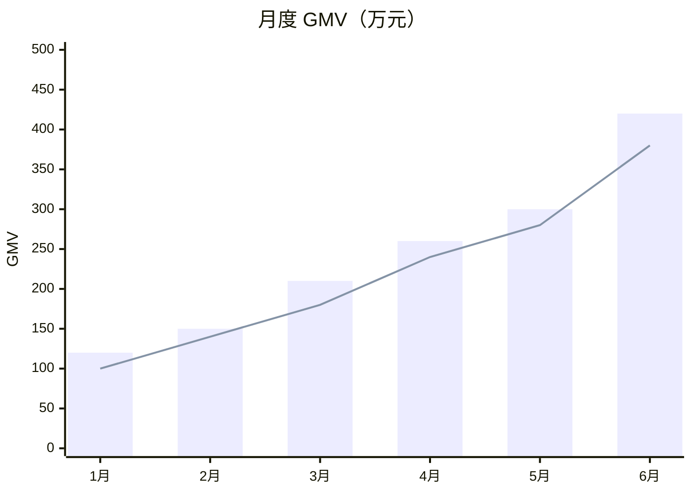
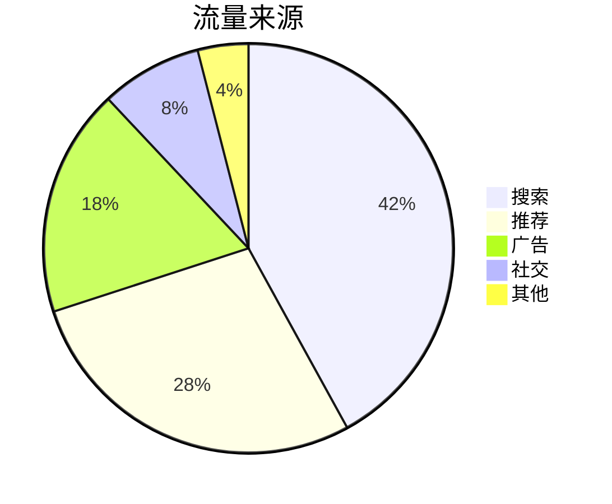
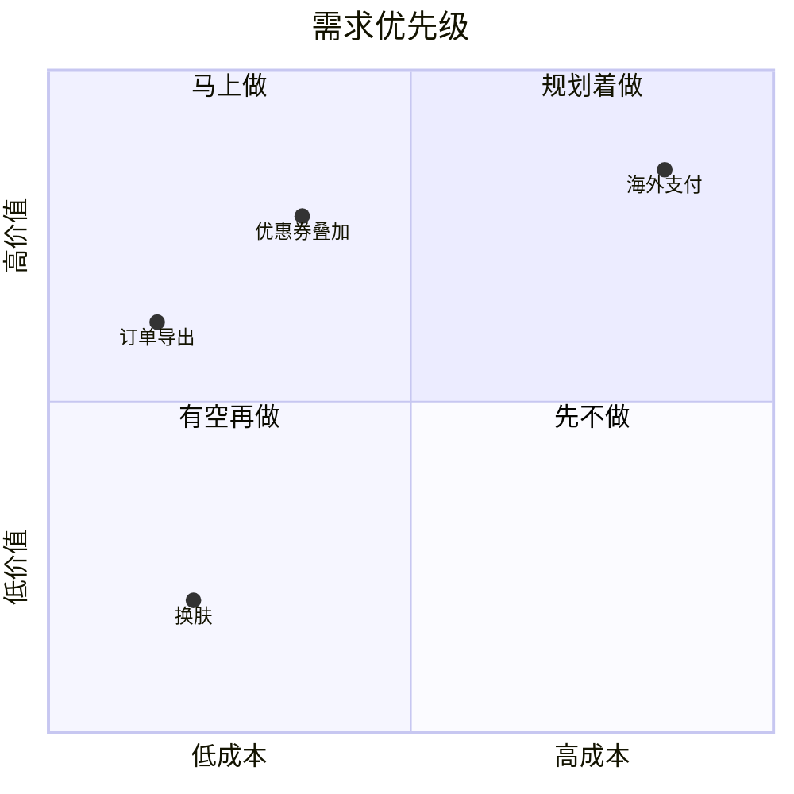
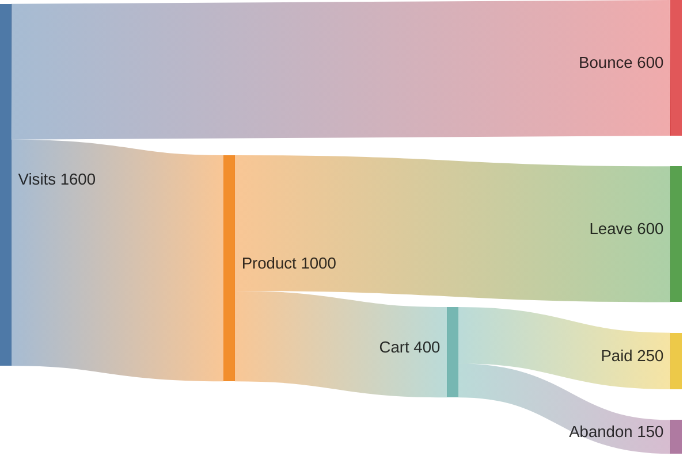
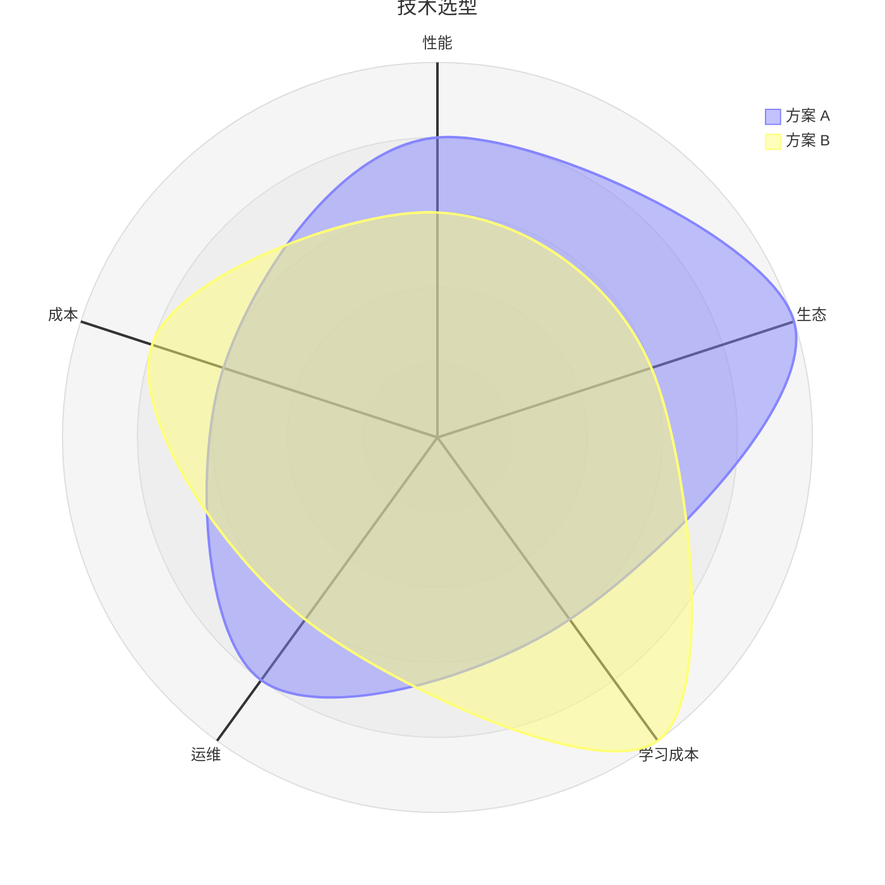
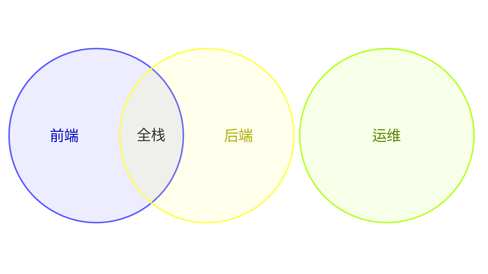
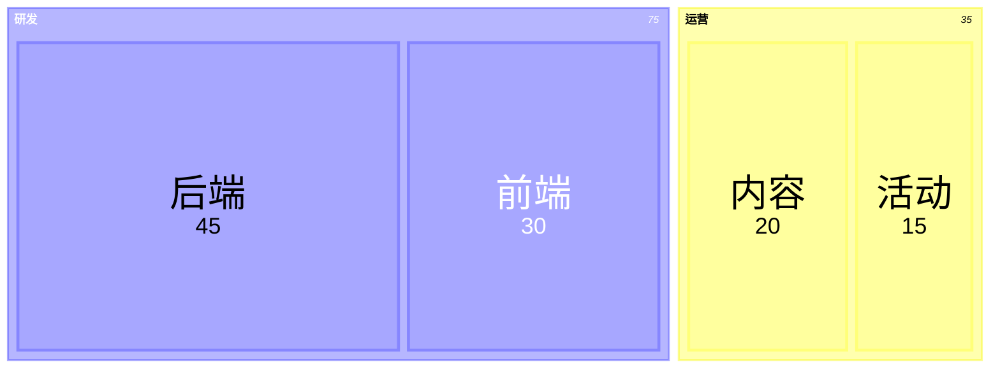

# 数据呈现类

| 想看                             | 用哪种图                       |
| -------------------------------- | ------------------------------ |
| 随时间的趋势、类别之间的对比     | 柱状图 / 折线图 `bar_line`     |
| 占比（5 类以内）                 | 饼图 / 环形图 `pie`            |
| 按两个维度打分归类               | 象限图 `quadrant`              |
| 流量、资金、转化在环节之间的流向 | 桑基图 `sankey`                |
| 多维能力对比                     | 雷达图 `radar`                 |
| 两个数值变量的相关性             | 散点图 `scatter`               |
| 数值的分布                       | 直方图 / 箱线图 `distribution` |
| 集合的交集                       | 韦恩图 `venn`                  |
| 层级结构里的占比                 | 矩形树图 `treemap`             |

数据点多、需要精确坐标轴、多系列堆叠、双轴或交互时，改用代码绘图（ECharts / matplotlib），颜色用 `palette.py chart <type>` 取。

## 柱状图 / 折线图 · `bar_line`

- **用来**：随时间的趋势、类别之间的对比。
- **别用**：占比（→ 饼图）；相关性（→ 散点图）。
- **工具**：Mermaid `xychart-beta`（beta）；超过 2 个系列、堆叠、双轴、要图例 → 代码绘图。
- **写法**：
  - `x-axis [...]`、`y-axis "名称" 最小 --> 最大`、`bar [...]`、`line [...]`；`xychart-beta horizontal` 横向。
- **要点**：
  - 柱子从 0 开始。
  - 只想突出一根柱子时用单色 + 灰色，不要每根换颜色。

<!-- sample:bar_line -->



<!-- palette:bar_line -->
**配色**（换方案时 token 不变，只换颜色）　取色：`python $SKILL/scripts/palette.py mermaid bar_line [方案] --body 正文.mmd`

| 角色 | class | token | macaron（默认）填充 / 描边 / 字色 |
|---|---|---|---|
| 系列 1 / 主系列 | `s1` | `solid:0` | `#D2D6F1` `#D2D6F1` `#111111` |
| 系列 2 | `s2` | `solid:1` | `#FBDBD1` `#FBDBD1` `#111111` |
| 系列 3 | `s3` | `solid:2` | `#D8F0ED` `#D8F0ED` `#111111` |
| 坐标轴 / 网格 | `axis` | `muted` | `#EEEFF0` `#8F929B` `#33384A` |
| 页面 / 连线 / 正文 | — | `bg` `line` `text` | `#FFFFFF` `#3B6FC2` `#33384A` |
<!-- /palette:bar_line -->

## 饼图 / 环形图 · `pie`

- **用来**：5 类以内的占比。
- **别用**：类别多或数值相近（→ 柱状图）。
- **工具**：Mermaid `pie`。
- **写法**：
  - `pie showData` 显示数值；`"名称" : 数值`。
- **要点**：
  - 超过 5 类就把小项合并成"其他"放最后。
  - 按大小顺时针排列。

<!-- sample:pie -->



<!-- palette:pie -->
**配色**（换方案时 token 不变，只换颜色）　取色：`python $SKILL/scripts/palette.py mermaid pie [方案] --body 正文.mmd`

| 角色 | class | token | macaron（默认）填充 / 描边 / 字色 |
|---|---|---|---|
| 扇区 1 | `p1` | `solid:0` | `#D2D6F1` `#D2D6F1` `#111111` |
| 扇区 2 | `p2` | `solid:1` | `#FBDBD1` `#FBDBD1` `#111111` |
| 扇区 3 | `p3` | `solid:2` | `#D8F0ED` `#D8F0ED` `#111111` |
| 扇区 4 | `p4` | `solid:3` | `#F6DEB6` `#F6DEB6` `#111111` |
| 其他（最后一块） | `other` | `muted` | `#EEEFF0` `#8F929B` `#33384A` |
| 页面 / 连线 / 正文 | — | `bg` `line` `text` | `#FFFFFF` `#3B6FC2` `#33384A` |
<!-- /palette:pie -->

## 象限图 · `quadrant`

- **用来**：按两个维度打分归类：需求优先级（价值 × 成本）、技术选型、竞品定位。
- **别用**：维度多于两个（→ 雷达图）。
- **工具**：Mermaid `quadrantChart`。
- **写法**：
  - `x-axis 低 --> 高`、`y-axis 低 --> 高`；`quadrant-1` 右上、`quadrant-2` 左上、`quadrant-3` 左下、`quadrant-4` 右下；点 `名称: [x, y]`（0–1）。
- **要点**：
  - 象限名写行动建议（马上做、规划着做……）。
  - 点不超过 15 个。

<!-- sample:quadrant -->



<!-- palette:quadrant -->
**配色**（换方案时 token 不变，只换颜色）　取色：`python $SKILL/scripts/palette.py mermaid quadrant [方案] --body 正文.mmd`

| 角色 | class | token | macaron（默认）填充 / 描边 / 字色 |
|---|---|---|---|
| 第一象限（右上） | `q1` | `ramp:2` | `#93B0DD` `#3B6FC2` `#33384A` |
| 第二象限（左上） | `q2` | `ramp:3` | `#6C93D1` `#3B6FC2` `#111111` |
| 第三象限（左下） | `q3` | `ramp:0` | `#E2E9F6` `#3B6FC2` `#33384A` |
| 第四象限（右下） | `q4` | `ramp:1` | `#BACDEA` `#3B6FC2` `#33384A` |
| 数据点 | `point` | `primary` | `#3B6FC2` `#3B6FC2` `#FFFFFF` |
| 页面 / 连线 / 正文 | — | `bg` `line` `text` | `#FFFFFF` `#3B6FC2` `#33384A` |
<!-- /palette:quadrant -->

## 桑基图 · `sankey`

- **用来**：流量、资金、转化在各环节之间的流向和损耗。
- **别用**：只有一条链路（→ 漏斗或柱状图）。
- **工具**：
  - 节点名用英文、拼音也能接受 → Mermaid `sankey-beta`（beta），中文写进图下面的对照表（写法 A）。
  - 图里必须直接显示中文 → ECharts（写法 B）。
  - 要交给别人编辑 → drawio。
- **写法**：
  - CSV 三列：`源,目标,值`；名字里有逗号就加双引号。
  - Mermaid 的节点名只能用 ASCII 字符：中文、带重音的字母（如 é）都会报 Parse error，加引号也不行，HTML 实体（`&#35775;`）也不行。原因是 Mermaid 桑基图的词法只接受可打印 ASCII，配置里也没有"显示名"可设。
  - 用 `--body` 传入正文时 palette.py 会给每个节点配色；正文里还有非 ASCII 名字时会直接报错，并提示下面两种改法。
- **要点**：
  - 从左到右按环节；流失 / 损耗放在下方。
  - 写法 A 和写法 B 用同一份 CSV（节点写成 `英文|中文`），改用另一种时不用重写数据。

**写法 A：Mermaid + 中英对照表**

节点写成 `英文|中文`，存成 `正文.csv`：

```text
sankey-beta
Visits|访问,Product|商品页,1000
Visits,Bounce|跳出,600
Product,Cart|加购,400
Product,Leave|离开,600
Cart,Paid|支付,250
Cart,Abandon|放弃,150
```

同一个节点只需在第一次出现时写中文。生成"代码块 + 对照表"，直接贴进 md：

```bash
python $SKILL/scripts/palette.py mermaid sankey [方案] --body 正文.csv --md
```

输出的代码块里只保留英文（中英对应关系也以 `%%` 注释写在代码块末尾），代码块下面跟一张对照表：

```markdown
| 图中名称 | 中文   |
| -------- | ------ |
| Visits   | 访问   |
| Product  | 商品页 |
| Bounce   | 跳出   |
| Cart     | 加购   |
| Leave    | 离开   |
| Paid     | 支付   |
| Abandon  | 放弃   |
```

**写法 B：ECharts（图里直接显示中文）**

```bash
# 依赖 echarts（装在 $SKILL/scripts 下）；导 PNG 还要 playwright 和 Chromium。缺了脚本会退出并提示安装
node $SKILL/scripts/sankey_echarts.js 正文.csv [方案] --out 转化漏斗 --png
```

- CSV 里可以直接写中文，也可以和写法 A 共用 `英文|中文` 的文件（取中文部分）；首行的 `sankey-beta`、空行和 `%%` 注释会被忽略。
- 输出 `转化漏斗.svg`，加 `--png` 再出一张 2 倍图 `转化漏斗.png`；配色和 Mermaid 版本一致（取自 `palette.py chart`）。
- 图片和 CSV 一起交付，CSV 作为可编辑源文件；存放位置按调用者或项目的规则。

<!-- sample:sankey -->



<!-- palette:sankey -->
**配色**（换方案时 token 不变，只换颜色）　取色：`python $SKILL/scripts/palette.py mermaid sankey [方案] --body 正文.mmd`

| 角色 | class | token | macaron（默认）填充 / 描边 / 字色 |
|---|---|---|---|
| 节点 1 | `n1` | `solid:0` | `#D2D6F1` `#D2D6F1` `#111111` |
| 节点 2 | `n2` | `solid:1` | `#FBDBD1` `#FBDBD1` `#111111` |
| 节点 3 | `n3` | `solid:2` | `#D8F0ED` `#D8F0ED` `#111111` |
| 节点 4 | `n4` | `solid:3` | `#F6DEB6` `#F6DEB6` `#111111` |
| 页面 / 连线 / 正文 | — | `bg` `line` `text` | `#FFFFFF` `#3B6FC2` `#33384A` |
<!-- /palette:sankey -->

## 雷达图 · `radar`

- **用来**：多维能力对比：技术选型、候选方案、能力模型。
- **别用**：维度少于 4 个（→ 柱状图）。
- **工具**：Mermaid `radar-beta`（beta）；目标平台渲染不了 → 代码绘图。
- **写法**：
  - `axis id["名称"], ...`；`curve id["名称"]{v1, v2, ...}`；`max 5`。
- **要点**：
  - 曲线不超过 3 条，轴 5–8 个。
  - 所有轴同方向（越大越好）。

<!-- sample:radar -->



<!-- palette:radar -->
**配色**（换方案时 token 不变，只换颜色）　取色：`python $SKILL/scripts/palette.py mermaid radar [方案] --body 正文.mmd`

| 角色 | class | token | macaron（默认）填充 / 描边 / 字色 |
|---|---|---|---|
| 对象 1 | `c1` | `solid:0` | `#D2D6F1` `#D2D6F1` `#111111` |
| 对象 2 | `c2` | `solid:1` | `#FBDBD1` `#FBDBD1` `#111111` |
| 对象 3 | `c3` | `solid:2` | `#D8F0ED` `#D8F0ED` `#111111` |
| 网格 / 轴 | `grid` | `muted` | `#EEEFF0` `#8F929B` `#33384A` |
| 页面 / 连线 / 正文 | — | `bg` `line` `text` | `#FFFFFF` `#3B6FC2` `#33384A` |
<!-- /palette:radar -->

## 散点图 · `scatter`

- **用来**：两个数值变量的相关性、聚类、异常点。
- **别用**：类别对比（→ 柱状图）。
- **工具**：代码绘图（Mermaid 没有散点图）：Python matplotlib 出 PNG，或 ECharts 出 HTML。
- **写法**：
  - 颜色：`python $SKILL/scripts/palette.py chart scatter` 输出 JSON，`categorical` 依次给分组，`axis` / `grid` 给坐标轴和网格。
- **要点**：
  - 分组不超过 5 个；点多时调小点并加透明度。
  - 趋势线用灰色（`trend`）。

<!-- sample:scatter -->

```python
import json, subprocess
import matplotlib.pyplot as plt

PALETTE = '$SKILL/scripts/palette.py'  # 换成 skill 的实际目录
c = json.loads(subprocess.check_output(['python', PALETTE, 'chart', 'scatter']))
plt.rcParams['font.sans-serif'] = ['PingFang SC', 'Microsoft YaHei', 'Noto Sans CJK SC', 'sans-serif']
fig, ax = plt.subplots(figsize=(6, 4), dpi=200)
fig.patch.set_facecolor(c['background']); ax.set_facecolor(c['background'])
groups = {'新用户': ([1, 2, 3, 4], [2.1, 2.9, 3.2, 4.8]), '老用户': ([1.5, 2.5, 3.5], [3.0, 3.6, 4.1])}
for i, (name, (xs, ys)) in enumerate(groups.items()):
    ax.scatter(xs, ys, s=36, color=c['categorical'][i], label=name, alpha=.85, edgecolors='none')
ax.legend(frameon=False, labelcolor=c['text'])
for side in ('top', 'right'):
    ax.spines[side].set_visible(False)
for side in ('left', 'bottom'):
    ax.spines[side].set_color(c['axis'])
ax.tick_params(colors=c['text']); ax.grid(color=c['grid'], linewidth=.6); ax.set_axisbelow(True)
fig.savefig('scatter.png', bbox_inches='tight')
```

<!-- palette:scatter -->
**配色**（换方案时 token 不变，只换颜色）　取色：`python $SKILL/scripts/palette.py chart [方案]`

| 角色 | class | token | macaron（默认）填充 / 描边 / 字色 |
|---|---|---|---|
| 分组 1 | `g1` | `solid:0` | `#D2D6F1` `#D2D6F1` `#111111` |
| 分组 2 | `g2` | `solid:1` | `#FBDBD1` `#FBDBD1` `#111111` |
| 分组 3 | `g3` | `solid:2` | `#D8F0ED` `#D8F0ED` `#111111` |
| 趋势线 | `trend` | `muted` | `#EEEFF0` `#8F929B` `#33384A` |
| 页面 / 连线 / 正文 | — | `bg` `line` `text` | `#FFFFFF` `#3B6FC2` `#33384A` |
<!-- /palette:scatter -->

## 直方图 / 箱线图 · `distribution`

- **用来**：数值的分布：接口耗时、订单金额、评分。
- **别用**：看趋势（→ 折线图）。
- **工具**：代码绘图（Mermaid 没有直方图 / 箱线图）。
- **写法**：
  - 颜色：`python $SKILL/scripts/palette.py chart distribution`，主体用 `primary`，中位数 / 均值线用正文色虚线，离群点用 `state.bad`。
- **要点**：
  - 直方图柱子之间不留缝；箱线图标出中位数和异常点。

<!-- sample:distribution -->

```python
import json, subprocess
import matplotlib.pyplot as plt

PALETTE = '$SKILL/scripts/palette.py'  # 换成 skill 的实际目录
c = json.loads(subprocess.check_output(['python', PALETTE, 'chart', 'distribution']))
plt.rcParams['font.sans-serif'] = ['PingFang SC', 'Microsoft YaHei', 'Noto Sans CJK SC', 'sans-serif']
fig, ax = plt.subplots(figsize=(6, 4), dpi=200)
fig.patch.set_facecolor(c['background']); ax.set_facecolor(c['background'])
import random
data = [random.gauss(120, 30) for _ in range(500)]
ax.hist(data, bins=24, color=c['primary'], edgecolor=c['background'], linewidth=.5)
ax.axvline(sorted(data)[len(data) // 2], color=c['text'], linestyle='--', linewidth=1)
for side in ('top', 'right'):
    ax.spines[side].set_visible(False)
for side in ('left', 'bottom'):
    ax.spines[side].set_color(c['axis'])
ax.tick_params(colors=c['text']); ax.grid(color=c['grid'], linewidth=.6); ax.set_axisbelow(True)
fig.savefig('distribution.png', bbox_inches='tight')
```

<!-- palette:distribution -->
**配色**（换方案时 token 不变，只换颜色）　取色：`python $SKILL/scripts/palette.py chart [方案]`

| 角色 | class | token | macaron（默认）填充 / 描边 / 字色 |
|---|---|---|---|
| 分布主体 | `bar` | `primary` | `#3B6FC2` `#3B6FC2` `#FFFFFF` |
| 中位数 / 均值线 | `median` | `slot3` | `#F6DEB6` `#AC9B7F` `#714E14` |
| 离群点 | `outlier` | `bad` | `#FAE0DD` `#E35144` `#33384A` |
| 坐标轴 / 网格 | `axis` | `muted` | `#EEEFF0` `#8F929B` `#33384A` |
| 页面 / 连线 / 正文 | — | `bg` `line` `text` | `#FFFFFF` `#3B6FC2` `#33384A` |
<!-- /palette:distribution -->

## 韦恩图 · `venn`

- **用来**：集合之间的交集：角色职责重叠、用户群重叠。
- **别用**：集合超过 3 个（→ 表格或 UpSet 图）。
- **工具**：Mermaid `venn-beta`（beta）；目标平台渲染不了 → drawio 或 diagram-design（三个半透明圆）。
- **写法**：
  - `set A["名称"]`；`union A,B["交集名称"]` 给交集起名。
- **要点**：
  - 集合不超过 3 个；交集名称写清楚含义。

<!-- sample:venn -->



<!-- palette:venn -->
**配色**（换方案时 token 不变，只换颜色）　取色：`python $SKILL/scripts/palette.py mermaid venn [方案] --body 正文.mmd`

| 角色 | class | token | macaron（默认）填充 / 描边 / 字色 |
|---|---|---|---|
| 集合 A | `a` | `solid:0` | `#D2D6F1` `#D2D6F1` `#111111` |
| 集合 B | `b` | `solid:1` | `#FBDBD1` `#FBDBD1` `#111111` |
| 集合 C | `c` | `solid:2` | `#D8F0ED` `#D8F0ED` `#111111` |
| 页面 / 连线 / 正文 | — | `bg` `line` `text` | `#FFFFFF` `#3B6FC2` `#33384A` |
<!-- /palette:venn -->

## 矩形树图 · `treemap`

- **用来**：层级结构里的占比：预算、代码量、存储占用。
- **别用**：层级超过 2 层（→ 旭日图，代码绘图）。
- **工具**：Mermaid `treemap-beta`（beta）；精确数值和交互 → 代码绘图（ECharts treemap）。
- **写法**：
  - 缩进表示层级，叶子写 `"名称": 数值`；叶子后加 `:::focus` 突出重点。
- **要点**：
  - 分组不超过 6 个；分组颜色按出现顺序取。

<!-- sample:treemap -->



<!-- palette:treemap -->
**配色**（换方案时 token 不变，只换颜色）　取色：`python $SKILL/scripts/palette.py mermaid treemap [方案] --body 正文.mmd`

| 角色 | class | token | macaron（默认）填充 / 描边 / 字色 |
|---|---|---|---|
| 分组 | `section` | `ramp:1` | `#BACDEA` `#3B6FC2` `#33384A` |
| 叶子 | `leaf` | `ramp:0` | `#E2E9F6` `#3B6FC2` `#33384A` |
| 重点叶子 | `focus` | `primary` | `#3B6FC2` `#3B6FC2` `#FFFFFF` |
| 页面 / 连线 / 正文 | — | `bg` `line` `text` | `#FFFFFF` `#3B6FC2` `#33384A` |
<!-- /palette:treemap -->
