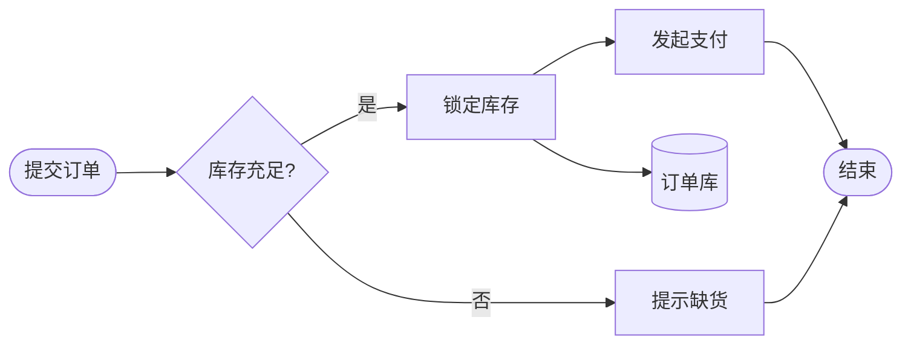
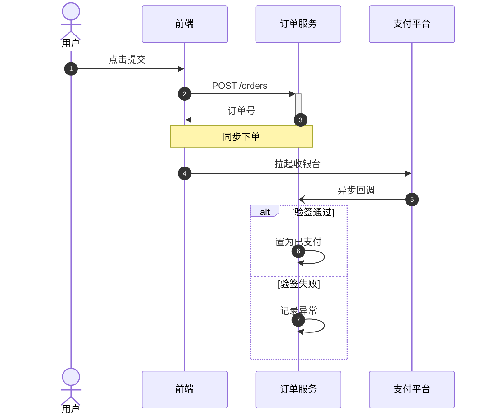
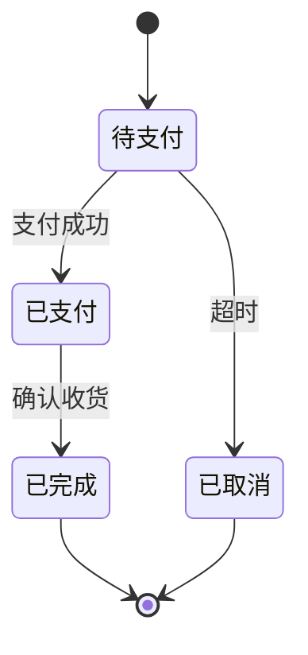
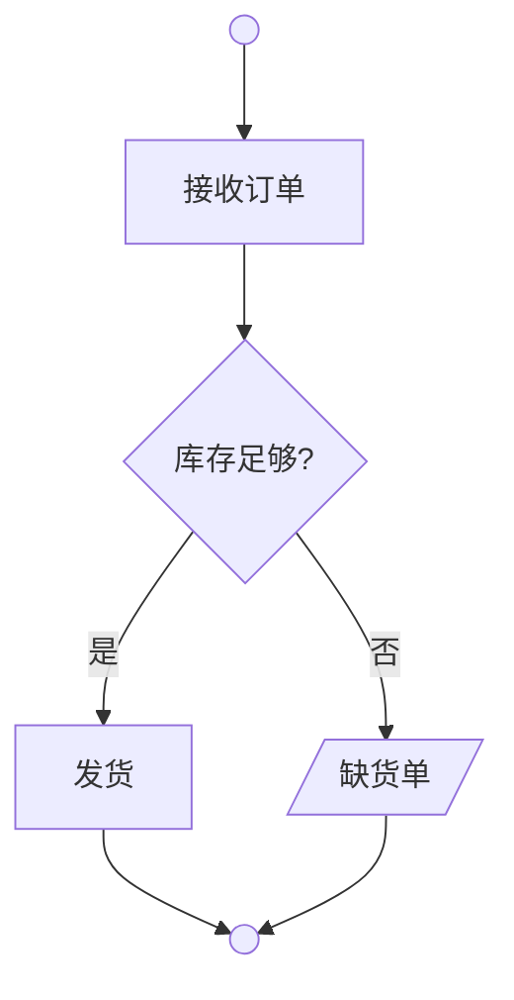
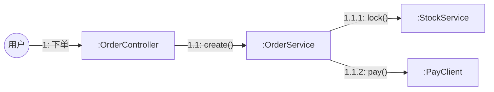
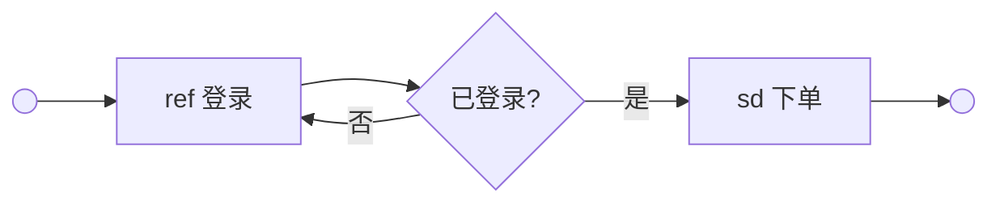
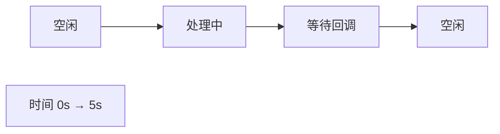

# 流程行为类

| 关注点                                      | 用哪种图                 |
| ------------------------------------------- | ------------------------ |
| 一个人 / 一个系统的步骤和分支               | 流程图 `flowchart`       |
| 多个角色、部门、系统之间的交接              | 泳道图 `swimlane`        |
| 对象之间按时间先后的调用                    | 时序图 `sequence`        |
| 一个对象有哪些状态、怎么切换                | 状态图 `state`           |
| UML 规范的流程（分叉 / 汇合、对象流、分区） | 活动图 `activity`        |
| 对象之间的连接和消息编号                    | 通信图 `communication`   |
| 多个交互片段怎么串起来                      | 交互概览图 `interaction` |
| 状态随精确时间变化                          | 时间图 `timing`          |

## 流程图 · `flowchart`

- **用来**：业务流程、算法步骤、审批逻辑、异常处理分支。
- **别用**：多角色交接（→ 泳道图）；系统之间的调用顺序（→ 时序图）；对象状态切换（→ 状态图）。
- **工具**：Mermaid `flowchart`；超过 12 个节点或要交给别人编辑 → drawio。
- **写法**：
  - 形状有语义：`([ ])` 开始 / 结束、`[ ]` 处理、`{ }` 判断、`[( )]` 数据库、`[/ /]` 输入输出、`[[ ]]` 子流程。
  - 判断的出口写在线上：`-- 是 -->`、`-- 否 -->`。
- **要点**：
  - 主路径保持一条直线（TB 或 LR），分支向一侧展开。
  - 关键路径（`key`）只标一条，异常分支（`error`）不超过 2 处。

<!-- sample:flowchart -->



<!-- palette:flowchart -->
**配色**（换方案时 token 不变，只换颜色）　取色：`python $SKILL/scripts/palette.py mermaid flowchart [方案] --body 正文.mmd`

| 角色 | class | token | macaron（默认）填充 / 描边 / 字色 |
|---|---|---|---|
| 开始 / 结束 | `startend` | `slot1` | `#FBDBD1` `#B09992` `#712A14` |
| 处理步骤 | `process` | `slot0` | `#D2D6F1` `#9396A9` `#1F2865` |
| 判断 | `decision` | `slot3` | `#F6DEB6` `#AC9B7F` `#714E14` |
| 数据 / 文档 | `data` | `slot2` | `#D8F0ED` `#97A8A6` `#256058` |
| 关键路径 | `key` | `primary` | `#3B6FC2` `#3B6FC2` `#FFFFFF` |
| 异常分支 | `error` | `bad` | `#FAE0DD` `#E35144` `#33384A` |
| 页面 / 连线 / 正文 | — | `bg` `line` `text` | `#FFFFFF` `#3B6FC2` `#33384A` |
<!-- /palette:flowchart -->

## 泳道图 · `swimlane`

- **用来**：跨角色、跨部门、跨系统的业务流程，突出"谁来做"和交接点。
- **别用**：只有一个角色（→ 流程图）。
- **工具**：Mermaid `swimlane-beta`（beta）；目标平台渲染不了时把首行换成 `flowchart LR`，正文不用改；泳道超过 4 条或要按阶段分列 → drawio。
- **写法**：
  - 每条泳道一个 `subgraph 角色名`，节点在所属泳道里声明；连线统一写在所有泳道之后。
- **要点**：
  - 泳道顺序按参与的先后。
  - 跨泳道的交接点用 `handoff`（主色）；泳道底色统一用 soft，不要每条泳道换一种颜色。

<!-- sample:swimlane -->

```mermaid
swimlane-beta LR
  subgraph U[用户]
    A([提交退款]):::startend
    F([收到退款]):::startend
  end
  subgraph S[客服]
    B{是否符合规则?}:::decision
    C[人工审核]:::task
  end
  subgraph P[财务]
    D[原路退款]:::handoff
  end
  A --> B
  B -- 是 --> D
  B -- 否 --> C --> D
  D --> F
  class U,S,P lane
```

<!-- palette:swimlane -->
**配色**（换方案时 token 不变，只换颜色）　取色：`python $SKILL/scripts/palette.py mermaid swimlane [方案] --body 正文.mmd`

| 角色 | class | token | macaron（默认）填充 / 描边 / 字色 |
|---|---|---|---|
| 开始 / 结束 | `startend` | `slot1` | `#FBDBD1` `#B09992` `#712A14` |
| 任务 | `task` | `slot0` | `#D2D6F1` `#9396A9` `#1F2865` |
| 判断 | `decision` | `slot3` | `#F6DEB6` `#AC9B7F` `#714E14` |
| 跨泳道交接点 | `handoff` | `primary` | `#3B6FC2` `#3B6FC2` `#FFFFFF` |
| 泳道底色 | `lane` | `soft` | `#EBF1F9` `#3B6FC2` `#33384A` |
| 页面 / 连线 / 正文 | — | `bg` `line` `text` | `#FFFFFF` `#3B6FC2` `#33384A` |
<!-- /palette:swimlane -->

## 时序图 · `sequence`

- **用来**：接口调用链、前后端交互、第三方回调、分布式事务。
- **别用**：只关心步骤、不关心谁调用谁（→ 流程图）。
- **工具**：Mermaid `sequenceDiagram`。
- **写法**：
  - `actor` 表示人，`participant` 表示系统；`->>` 同步调用，`-->>` 返回，`-)` 异步消息；`+` / `-` 开关激活条。
  - 片段：`alt / else`、`opt`、`loop`、`par`、`critical`；`autonumber` 自动编号；`box 颜色 名称 ... end` 给一组参与者加底色。
- **要点**：
  - 参与者从左到右按调用顺序排。
  - 一张图只讲一个场景；返回用虚线；Note 只写关键约束。

<!-- sample:sequence -->



<!-- palette:sequence -->
**配色**（换方案时 token 不变，只换颜色）　取色：`python $SKILL/scripts/palette.py mermaid sequence [方案] --body 正文.mmd`

| 角色 | class | token | macaron（默认）填充 / 描边 / 字色 |
|---|---|---|---|
| 参与者 | `participant` | `slot0` | `#D2D6F1` `#9396A9` `#1F2865` |
| 激活条 | `activation` | `slot2` | `#D8F0ED` `#97A8A6` `#256058` |
| 注释 | `note` | `note` | `#FFF6CE` `#A6A086` `#33384A` |
| alt / loop 框 | `frame` | `surface` | `#FFFFFF` `#3B6FC2` `#33384A` |
| 页面 / 连线 / 正文 | — | `bg` `line` `text` | `#FFFFFF` `#3B6FC2` `#33384A` |
<!-- /palette:sequence -->

## 状态图 · `state`

- **用来**：订单、工单、审批单的状态机；前端组件状态；枚举值流转。
- **别用**：关注的是做事的步骤（→ 流程图）。
- **工具**：Mermaid `stateDiagram-v2`。
- **写法**：
  - `state "中文名" as Id` 定义状态；`[*]` 表示开始和结束；`A --> B : 事件`。
  - `class Id ok` 指定颜色，写在状态定义之后；`state 复合状态 { ... }` 嵌套。
- **要点**：
  - 成功终态用 `ok`，失败 / 取消用 `fail`，进行中用 `active`。
  - 线上写触发事件，不写动作。

<!-- sample:state -->



<!-- palette:state -->
**配色**（换方案时 token 不变，只换颜色）　取色：`python $SKILL/scripts/palette.py mermaid state [方案] --body 正文.mmd`

| 角色 | class | token | macaron（默认）填充 / 描边 / 字色 |
|---|---|---|---|
| 普通状态 | `normal` | `slot0` | `#D2D6F1` `#9396A9` `#1F2865` |
| 进行中 | `active` | `primary` | `#3B6FC2` `#3B6FC2` `#FFFFFF` |
| 成功终态 | `ok` | `ok` | `#DEF2E7` `#4AB777` `#33384A` |
| 失败 / 取消终态 | `fail` | `bad` | `#FAE0DD` `#E35144` `#33384A` |
| 复合状态 | `composite` | `soft` | `#EBF1F9` `#3B6FC2` `#33384A` |
| 页面 / 连线 / 正文 | — | `bg` `line` `text` | `#FFFFFF` `#3B6FC2` `#33384A` |
<!-- /palette:state -->

## 活动图（UML） · `activity`

- **用来**：UML 规范的业务流程：并行分叉 / 汇合、对象流、分区。
- **别用**：不需要 UML 规范（→ 流程图）。
- **工具**：Mermaid 没有原生活动图，用 `flowchart TB` 近似；并行要画粗横条或要标准符号 → drawio（UML 图形库）。
- **写法**：
  - 实心圆 `(( )):::bar` 当起止点；`{ }` 判断 / 合并；`[/ /]` 对象节点；分区用 subgraph。
- **要点**：
  - 起止点和分叉条用 `bar`（深色）；分区底色用 `partition`。

<!-- sample:activity -->



<!-- palette:activity -->
**配色**（换方案时 token 不变，只换颜色）　取色：`python $SKILL/scripts/palette.py mermaid activity [方案] --body 正文.mmd`

| 角色 | class | token | macaron（默认）填充 / 描边 / 字色 |
|---|---|---|---|
| 动作 | `action` | `slot0` | `#D2D6F1` `#9396A9` `#1F2865` |
| 判断 / 合并 | `decision` | `slot3` | `#F6DEB6` `#AC9B7F` `#714E14` |
| 对象节点 | `object` | `slot2` | `#D8F0ED` `#97A8A6` `#256058` |
| 分叉 / 汇合条、起止点 | `bar` | `dark` | `#33384A` `#33384A` `#FFFFFF` |
| 分区底色 | `partition` | `soft` | `#EBF1F9` `#3B6FC2` `#33384A` |
| 页面 / 连线 / 正文 | — | `bg` `line` `text` | `#FFFFFF` `#3B6FC2` `#33384A` |
<!-- /palette:activity -->

## 通信图（UML） · `communication`

- **用来**：强调对象之间的连接和消息编号，是同一场景时序图的另一个视角。
- **别用**：关注时间先后（→ 时序图）。
- **工具**：Mermaid `flowchart LR` 近似；要标准 UML 符号 → drawio。
- **写法**：
  - 对象写成 `:类名` 或 `对象:类名`；线上写 `"1.1: 方法()"`。
- **要点**：
  - 编号按嵌套层级（1、1.1、1.1.1）。
  - 关键消息的接收方用 `msg`（主色）。

<!-- sample:communication -->



<!-- palette:communication -->
**配色**（换方案时 token 不变，只换颜色）　取色：`python $SKILL/scripts/palette.py mermaid communication [方案] --body 正文.mmd`

| 角色 | class | token | macaron（默认）填充 / 描边 / 字色 |
|---|---|---|---|
| 对象 | `object` | `slot0` | `#D2D6F1` `#9396A9` `#1F2865` |
| 参与者 | `actor` | `slot3` | `#F6DEB6` `#AC9B7F` `#714E14` |
| 消息编号强调 | `msg` | `primary` | `#3B6FC2` `#3B6FC2` `#FFFFFF` |
| 页面 / 连线 / 正文 | — | `bg` `line` `text` | `#FFFFFF` `#3B6FC2` `#33384A` |
<!-- /palette:communication -->

## 交互概览图（UML） · `interaction`

- **用来**：把多个时序片段（ref / sd）用活动图的控制流串起来，看整体交互。
- **别用**：只有一个片段（→ 时序图）。
- **工具**：Mermaid `flowchart LR` 近似；要在节点里嵌入完整时序片段 → drawio。
- **写法**：
  - 节点写 `ref 片段名` 或 `sd 片段名`；起止用实心圆。
- **要点**：
  - 片段名和对应时序图的标题一致，方便对照。

<!-- sample:interaction -->



<!-- palette:interaction -->
**配色**（换方案时 token 不变，只换颜色）　取色：`python $SKILL/scripts/palette.py mermaid interaction [方案] --body 正文.mmd`

| 角色 | class | token | macaron（默认）填充 / 描边 / 字色 |
|---|---|---|---|
| sd / ref 交互帧 | `frame` | `surface` | `#FFFFFF` `#3B6FC2` `#33384A` |
| 交互引用 | `occurrence` | `slot0` | `#D2D6F1` `#9396A9` `#1F2865` |
| 判断 | `decision` | `slot3` | `#F6DEB6` `#AC9B7F` `#714E14` |
| 起止点 | `bar` | `dark` | `#33384A` `#33384A` `#FFFFFF` |
| 页面 / 连线 / 正文 | — | `bg` `line` `text` | `#FFFFFF` `#3B6FC2` `#33384A` |
<!-- /palette:interaction -->

## 时间图（UML） · `timing`

- **用来**：状态随精确时间变化：心跳、超时重试、令牌过期、硬件信号。
- **别用**：没有精确时间要求（→ 状态图或时序图）。
- **工具**：drawio（Mermaid 没有时间图）；只是示意时用 Mermaid `flowchart LR` 近似。
- **写法**：
  - drawio：每条生命线一行（`lifeline` 底色），状态段是横向矩形，宽度按时长；底部画时间刻度。
- **要点**：
  - 横轴刻度统一；状态段用系列色区分；同一状态在不同生命线上用同一颜色。

Mermaid 近似画法（正式出图用 drawio，样式取 `palette.py drawio`）：

<!-- sample:timing -->



<!-- palette:timing -->
**配色**（换方案时 token 不变，只换颜色）　取色：`python $SKILL/scripts/palette.py drawio timing [方案]`

| 角色 | class | token | macaron（默认）填充 / 描边 / 字色 |
|---|---|---|---|
| 生命线行 | `lifeline` | `soft` | `#EBF1F9` `#3B6FC2` `#33384A` |
| 状态段 1 | `s1` | `series:0` | `#EDEFF9` `#D2D6F1` `#33384A` |
| 状态段 2 | `s2` | `series:1` | `#FDF1ED` `#FBDBD1` `#33384A` |
| 状态段 3 | `s3` | `series:2` | `#E1EAE9` `#D8F0ED` `#33384A` |
| 时间轴 / 刻度 | `axis` | `muted` | `#EEEFF0` `#8F929B` `#33384A` |
| 页面 / 连线 / 正文 | — | `bg` `line` `text` | `#FFFFFF` `#3B6FC2` `#33384A` |
<!-- /palette:timing -->
