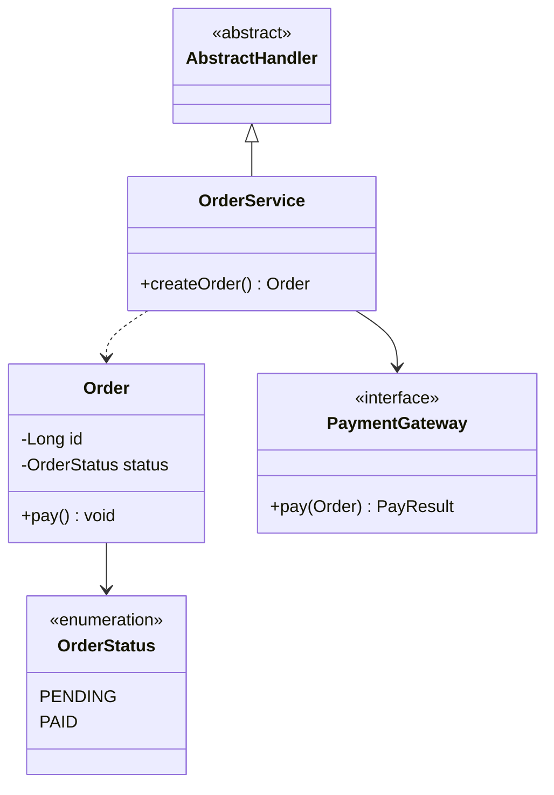
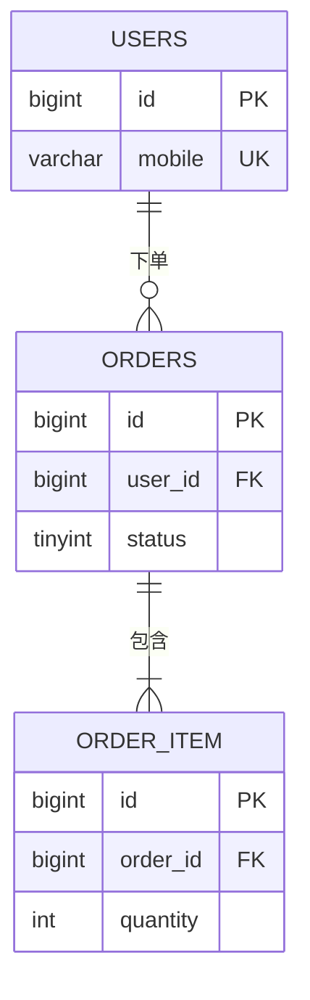
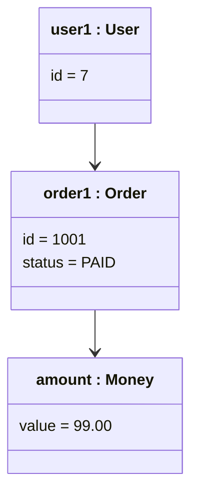
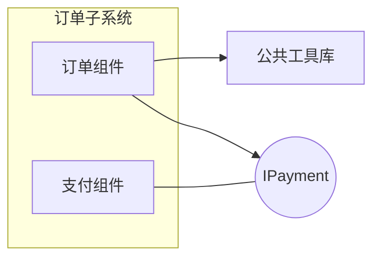
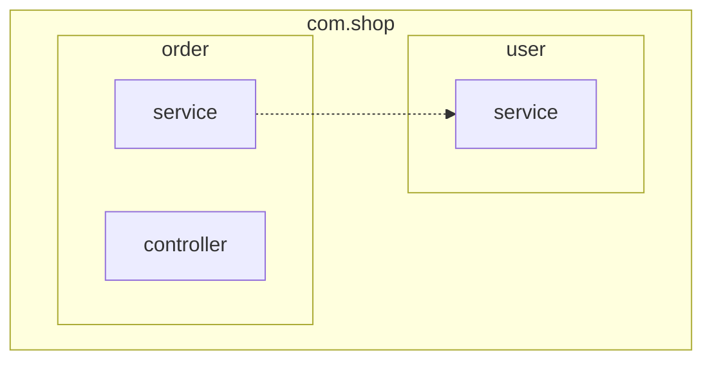
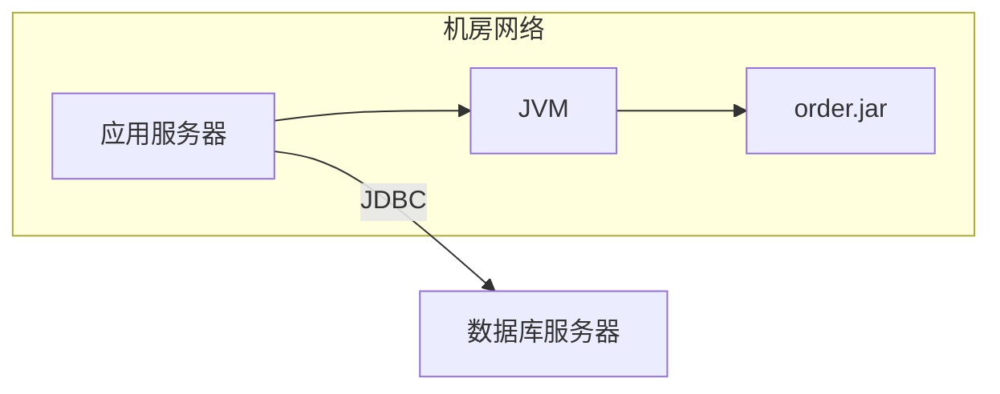
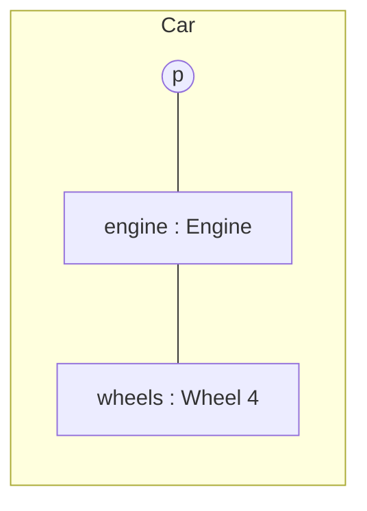
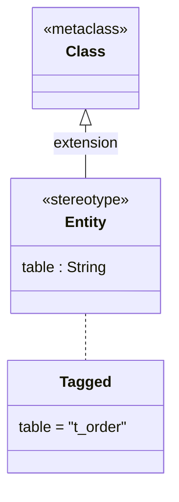

# 建模设计类

| 想讲清                           | 用哪种图               |
| -------------------------------- | ---------------------- |
| 代码里类的字段、方法、继承和依赖 | 类图 `class`           |
| 表结构和表之间的关系             | ER 图 `er`             |
| 谁用系统做什么（功能范围）       | 用例图 `usecase`       |
| 某一时刻的对象实例和取值         | 对象图 `object`        |
| 组件之间通过哪些接口依赖         | 组件图 `component`     |
| 包 / 模块的分层和依赖            | 包图 `package`         |
| 制品部署到哪些节点（UML 视角）   | 部署图 `uml_deploy`    |
| 一个类内部由哪些部件、端口组成   | 组合结构图 `composite` |
| UML 扩展（构造型、标记值）       | Profile 图 `profile`   |

UML 里 Mermaid 原生支持的只有类图、对象图（借用类图）、时序图、状态图；其余用 flowchart 近似，要标准 UML 符号时用 drawio 的 UML 图形库。

## 类图 · `class`

- **用来**：领域模型、代码结构设计、设计模式说明。
- **别用**：讲表结构（→ ER 图）。
- **工具**：Mermaid `classDiagram`。
- **写法**：
  - `class 名 { -字段 类型  +方法() 返回 }`；`<<interface>>`、`<<abstract>>`、`<<enumeration>>`。
  - 关系：`<|--` 继承、`<|..` 实现、`-->` 关联、`..>` 依赖、`*--` 组合、`o--` 聚合；`class X:::focus` 上色。
- **要点**：
  - 只画和本次设计有关的类和成员。
  - 本次改动的类用 `focus`；接口、枚举、抽象类分别用各自的槽色。

<!-- sample:class -->



<!-- palette:class -->
**配色**（换方案时 token 不变，只换颜色）　取色：`python $SKILL/scripts/palette.py mermaid class [方案] --body 正文.mmd`

| 角色 | class | token | macaron（默认）填充 / 描边 / 字色 |
|---|---|---|---|
| 普通类 | `cls` | `slot0` | `#D2D6F1` `#9396A9` `#1F2865` |
| 接口 | `iface` | `slot1` | `#FBDBD1` `#B09992` `#712A14` |
| 枚举 | `enum` | `slot2` | `#D8F0ED` `#97A8A6` `#256058` |
| 抽象类 / 约束 | `abstract` | `slot0`，虚线 | `#D2D6F1` `#9396A9` `#1F2865` |
| 本次改动的类 | `focus` | `primary` | `#3B6FC2` `#3B6FC2` `#FFFFFF` |
| 页面 / 连线 / 正文 | — | `bg` `line` `text` | `#FFFFFF` `#3B6FC2` `#33384A` |
<!-- /palette:class -->

## ER 图 · `er`

- **用来**：数据库表结构和表之间的关系，技术方案里的数据设计。
- **别用**：讲代码里的类（→ 类图）。
- **工具**：Mermaid `erDiagram`；表超过 15 张 → 拆成多张图或用 drawio。
- **写法**：
  - `A ||--o{ B : "关系"`；基数 `||` 一、`o|` 零或一、`}o` 零或多、`}|` 一或多。
  - 实体内 `类型 字段 PK/FK/UK "注释"`；在关系行里写 `实体:::core` 上色。
- **要点**：
  - 用真实表名；只列主外键和关键字段。
  - 核心实体用 `core`（主色），中间表用 `link`。

<!-- sample:er -->



<!-- palette:er -->
**配色**（换方案时 token 不变，只换颜色）　取色：`python $SKILL/scripts/palette.py mermaid er [方案] --body 正文.mmd`

| 角色 | class | token | macaron（默认）填充 / 描边 / 字色 |
|---|---|---|---|
| 实体 | `entity` | `slot0` | `#D2D6F1` `#9396A9` `#1F2865` |
| 核心实体 | `core` | `accent` | `#C8D7EE` `#3B6FC2` `#33384A` |
| 中间表 | `link` | `slot2` | `#D8F0ED` `#97A8A6` `#256058` |
| 页面 / 连线 / 正文 | — | `bg` `line` `text` | `#FFFFFF` `#3B6FC2` `#33384A` |
<!-- /palette:er -->

## 用例图 · `usecase`

- **用来**：谁用系统做什么：功能范围、需求边界。
- **别用**：要讲交互步骤（→ 页面流程图或时序图）。
- **工具**：Mermaid `usecase-beta`（beta，默认直接用，回复里注明需要较新的 Mermaid）；调用者说平台不支持时用 `flowchart LR` 近似（参与者 `(( ))`、用例 `([ ])`、subgraph 当边界）；要标准 UML 符号和精细排版 → drawio。
- **写法**：
  - `actor 别名("显示名")` 放在边界外；`systemBoundary "系统名" … end` 里写用例 `别名("显示名")`。
  - 关联 `Customer --> Browse`；包含 `A ..> : include B`；扩展 `B ..> : extend A`。
  - 用例挂 `:::uc` / `:::ext`，参与者挂 `:::person`；class 名不能用 `actor` 这类关键字。
- **要点**：
  - 用例写成"动词 + 名词"；一张图一个系统边界。

<!-- sample:usecase -->

```mermaid
usecase-beta
  direction LR
  actor Customer("顾客")
  systemBoundary "电商系统"
    Browse("浏览商品"):::uc
    Order("下单"):::uc
    Coupon("使用优惠券"):::ext
  end
  Customer --> Browse
  Customer --> Order
  Coupon ..> : extend Order
```

<!-- palette:usecase -->
**配色**（换方案时 token 不变，只换颜色）　取色：`python $SKILL/scripts/palette.py mermaid usecase [方案] --body 正文.mmd`

| 角色 | class | token | macaron（默认）填充 / 描边 / 字色 |
|---|---|---|---|
| 参与者 | `person` | `slot3` | `#F6DEB6` `#AC9B7F` `#714E14` |
| 用例 | `uc` | `slot0` | `#D2D6F1` `#9396A9` `#1F2865` |
| 扩展 / 包含用例 | `ext` | `slot1` | `#FBDBD1` `#B09992` `#712A14` |
| 系统边界 | `boundary` | `boundary`，虚线 | `#FFFFFF` `#3B6FC2` `#33384A` |
| 页面 / 连线 / 正文 | — | `bg` `line` `text` | `#FFFFFF` `#3B6FC2` `#33384A` |
<!-- /palette:usecase -->

## 对象图（UML） · `object`

- **用来**：某一时刻的对象实例和取值，用来解释类图或举例。
- **别用**：讲类的定义（→ 类图）。
- **工具**：Mermaid `classDiagram`（借用类图语法）。
- **写法**：
  - `class order1["order1 : Order"] { status = PAID }`：标签写"实例名 : 类名"，属性写"字段 = 值"。
- **要点**：
  - 关注的对象用 `focus`，值对象用 `value`。

<!-- sample:object -->



<!-- palette:object -->
**配色**（换方案时 token 不变，只换颜色）　取色：`python $SKILL/scripts/palette.py mermaid object [方案] --body 正文.mmd`

| 角色 | class | token | macaron（默认）填充 / 描边 / 字色 |
|---|---|---|---|
| 对象 | `obj` | `slot0` | `#D2D6F1` `#9396A9` `#1F2865` |
| 关注的对象 | `focus` | `primary` | `#3B6FC2` `#3B6FC2` `#FFFFFF` |
| 值对象 | `value` | `slot2` | `#D8F0ED` `#97A8A6` `#256058` |
| 页面 / 连线 / 正文 | — | `bg` `line` `text` | `#FFFFFF` `#3B6FC2` `#33384A` |
<!-- /palette:object -->

## 组件图（UML） · `component`

- **用来**：组件 / 模块之间通过哪些接口依赖。
- **别用**：讲运行时调用顺序（→ 时序图）。
- **工具**：Mermaid `flowchart LR` 近似；要标准组件符号 → drawio。
- **写法**：
  - 组件 `[ ]`，接口用圆形 `(( ))` 表示"棒棒糖"，子系统用 subgraph。
- **要点**：
  - 组件、库、接口分别用 `comp` / `lib` / `iface`；子系统底色用 `group`。

<!-- sample:component -->



<!-- palette:component -->
**配色**（换方案时 token 不变，只换颜色）　取色：`python $SKILL/scripts/palette.py mermaid component [方案] --body 正文.mmd`

| 角色 | class | token | macaron（默认）填充 / 描边 / 字色 |
|---|---|---|---|
| 组件 | `comp` | `slot0` | `#D2D6F1` `#9396A9` `#1F2865` |
| 库 | `lib` | `slot1` | `#FBDBD1` `#B09992` `#712A14` |
| 接口 | `iface` | `slot3` | `#F6DEB6` `#AC9B7F` `#714E14` |
| 包 / 子系统 | `group` | `soft`，虚线 | `#EBF1F9` `#3B6FC2` `#33384A` |
| 页面 / 连线 / 正文 | — | `bg` `line` `text` | `#FFFFFF` `#3B6FC2` `#33384A` |
<!-- /palette:component -->

## 包图（UML） · `package`

- **用来**：包 / 模块的分层和依赖，检查循环依赖。
- **别用**：要看类的细节（→ 类图）。
- **工具**：Mermaid `flowchart TB` + 嵌套 subgraph。
- **写法**：
  - 外层包、子包都是 subgraph；依赖用虚线 `-.->`。
- **要点**：
  - 外层包 `pkg1`、子包 `pkg2`，越往里越浅；关注的包用 `focus`。
  - 只画有依赖的包。

<!-- sample:package -->



<!-- palette:package -->
**配色**（换方案时 token 不变，只换颜色）　取色：`python $SKILL/scripts/palette.py mermaid package [方案] --body 正文.mmd`

| 角色 | class | token | macaron（默认）填充 / 描边 / 字色 |
|---|---|---|---|
| 顶层包 | `pkg1` | `ramp:1` | `#BACDEA` `#3B6FC2` `#33384A` |
| 子包 | `pkg2` | `ramp:0` | `#E2E9F6` `#3B6FC2` `#33384A` |
| 关注的包 | `focus` | `primary` | `#3B6FC2` `#3B6FC2` `#FFFFFF` |
| 页面 / 连线 / 正文 | — | `bg` `line` `text` | `#FFFFFF` `#3B6FC2` `#33384A` |
<!-- /palette:package -->

## 部署图（UML） · `uml_deploy`

- **用来**：UML 视角的节点、执行环境、制品（jar / 镜像）部署关系。
- **别用**：要讲云上部署全景（→ 部署架构图）。
- **工具**：Mermaid `flowchart LR` 近似；要立方体节点符号 → drawio。
- **写法**：
  - 设备节点、执行环境、制品依次嵌套或连线；网络边界用 subgraph + `zone`（虚线）。
- **要点**：
  - 设备、环境、制品分别用 `device` / `env` / `artifact`。

<!-- sample:uml_deploy -->



<!-- palette:uml_deploy -->
**配色**（换方案时 token 不变，只换颜色）　取色：`python $SKILL/scripts/palette.py mermaid uml_deploy [方案] --body 正文.mmd`

| 角色 | class | token | macaron（默认）填充 / 描边 / 字色 |
|---|---|---|---|
| 设备节点 | `device` | `slot0` | `#D2D6F1` `#9396A9` `#1F2865` |
| 执行环境 | `env` | `slot1` | `#FBDBD1` `#B09992` `#712A14` |
| 制品 | `artifact` | `slot2` | `#D8F0ED` `#97A8A6` `#256058` |
| 网络边界 | `zone` | `boundary`，虚线 | `#FFFFFF` `#3B6FC2` `#33384A` |
| 页面 / 连线 / 正文 | — | `bg` `line` `text` | `#FFFFFF` `#3B6FC2` `#33384A` |
<!-- /palette:uml_deploy -->

## 组合结构图（UML） · `composite`

- **用来**：一个类内部由哪些部件组成、通过哪些端口和外部交互。
- **别用**：一般的类关系（→ 类图）。
- **工具**：drawio 优先；Mermaid `flowchart LR` 近似。
- **写法**：
  - 类元边框用 subgraph（`frame`），部件写成 `名称 : 类型`，端口用小圆 `(( ))`。
- **要点**：
  - 端口用 `port`（槽3）放在边框边缘。

<!-- sample:composite -->



<!-- palette:composite -->
**配色**（换方案时 token 不变，只换颜色）　取色：`python $SKILL/scripts/palette.py mermaid composite [方案] --body 正文.mmd`

| 角色 | class | token | macaron（默认）填充 / 描边 / 字色 |
|---|---|---|---|
| 类元边框 | `frame` | `boundary`，虚线 | `#FFFFFF` `#3B6FC2` `#33384A` |
| 部件 | `part` | `slot0` | `#D2D6F1` `#9396A9` `#1F2865` |
| 端口 | `port` | `slot3` | `#F6DEB6` `#AC9B7F` `#714E14` |
| 页面 / 连线 / 正文 | — | `bg` `line` `text` | `#FFFFFF` `#3B6FC2` `#33384A` |
<!-- /palette:composite -->

## Profile 图（UML） · `profile`

- **用来**：UML 扩展：自定义构造型、标记值（比如给实体类加数据库映射）。
- **别用**：一般的类设计（→ 类图）。
- **工具**：Mermaid `classDiagram`。
- **写法**：
  - `<<stereotype>>`、`<<metaclass>>`；扩展关系 `Class <|-- Entity : extension`。
- **要点**：
  - 构造型、元类、标记值分别用 `stereo` / `meta` / `tagged`。

<!-- sample:profile -->



<!-- palette:profile -->
**配色**（换方案时 token 不变，只换颜色）　取色：`python $SKILL/scripts/palette.py mermaid profile [方案] --body 正文.mmd`

| 角色 | class | token | macaron（默认）填充 / 描边 / 字色 |
|---|---|---|---|
| 构造型 | `stereo` | `slot1` | `#FBDBD1` `#B09992` `#712A14` |
| 元类 | `meta` | `slot0` | `#D2D6F1` `#9396A9` `#1F2865` |
| 标记值 | `tagged` | `slot2` | `#D8F0ED` `#97A8A6` `#256058` |
| 页面 / 连线 / 正文 | — | `bg` `line` `text` | `#FFFFFF` `#3B6FC2` `#33384A` |
<!-- /palette:profile -->
