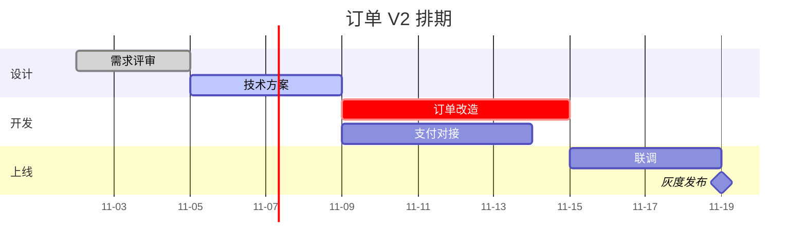
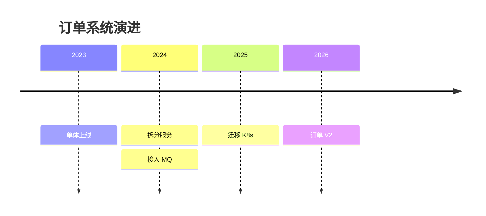
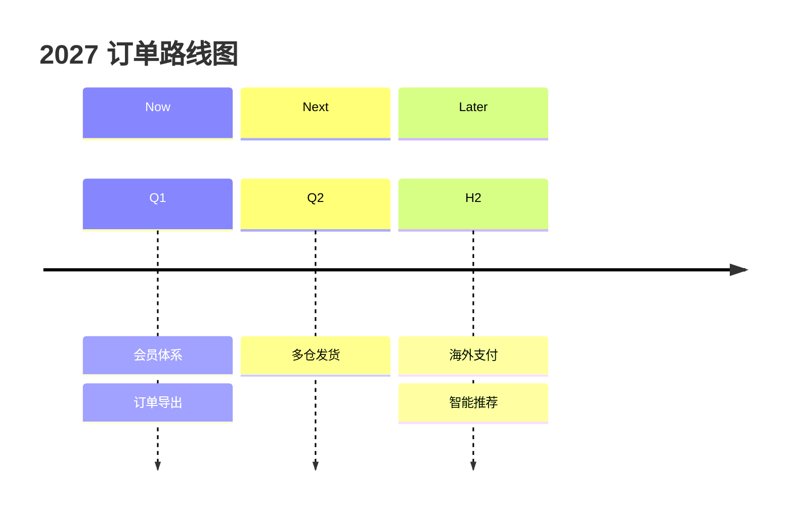
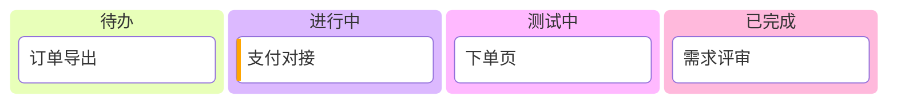
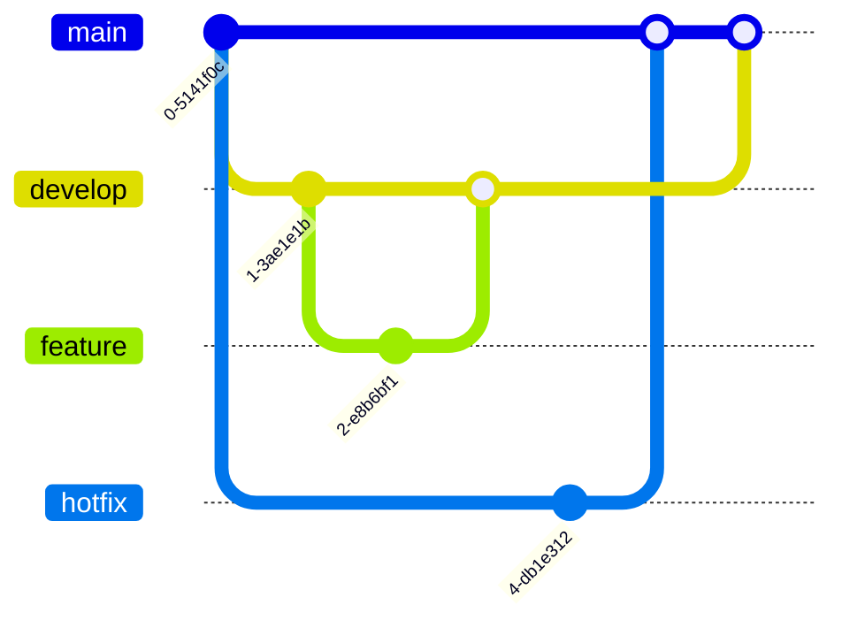

# 计划进度类

| 想讲清                                    | 用哪种图              |
| ----------------------------------------- | --------------------- |
| 任务排期、依赖、关键路径                  | 甘特图 `gantt`        |
| 已经发生的事件 / 版本演进                 | 时间线 `timeline`     |
| 未来的方向（Now / Next / Later 或按季度） | 路线图 `roadmap`      |
| 任务现在处在哪个阶段                      | 看板 `kanban`         |
| 分支策略、发布流程                        | Git 分支图 `gitgraph` |

## 甘特图 · `gantt`

- **用来**：任务排期、依赖、关键路径、里程碑。
- **别用**：只想看任务在哪个阶段（→ 看板）。
- **工具**：Mermaid `gantt`。
- **写法**：
  - `dateFormat YYYY-MM-DD`、`axisFormat %m-%d`；任务 `名称 :状态, id, 开始, 时长`，状态可选 `done` / `active` / `crit` / `milestone`。
  - `after id` 表示依赖；`excludes weekends` 排除周末。
- **要点**：
  - section 按阶段或团队分；关键路径用 `crit`；里程碑时长写 `0d`。
  - 任务名不超过 8 个字。

<!-- sample:gantt -->

<!-- palette:gantt -->
**配色**（换方案时 token 不变，只换颜色）　取色：`python $SKILL/scripts/palette.py mermaid gantt [方案] --body 正文.mmd`

| 角色 | class | token | macaron（默认）填充 / 描边 / 字色 |
|---|---|---|---|
| 普通任务 | `task` | `slot0` | `#D2D6F1` `#9396A9` `#1F2865` |
| 进行中 | `active` | `accent` | `#C8D7EE` `#3B6FC2` `#33384A` |
| 已完成 | `done` | `done` | `#F3F3F3` `#BBBBBB` `#33384A` |
| 关键路径 | `crit` | `bad` | `#FAE0DD` `#E35144` `#33384A` |
| 里程碑 | `milestone` | `slot3` | `#F6DEB6` `#AC9B7F` `#714E14` |
| 分组底色 | `section` | `soft` | `#EBF1F9` `#3B6FC2` `#33384A` |
| 页面 / 连线 / 正文 | — | `bg` `line` `text` | `#FFFFFF` `#3B6FC2` `#33384A` |
<!-- /palette:gantt -->

## 时间线 · `timeline`

- **用来**：已经发生的事件、版本演进、项目历程。
- **别用**：未来规划（→ 路线图）；有依赖的排期（→ 甘特图）。
- **工具**：Mermaid `timeline`。
- **写法**：
  - `时间 : 事件 : 事件`；`section` 分期。
- **要点**：
  - 时间点不超过 8 个，每个时间点不超过 3 个事件。

<!-- sample:timeline -->

<!-- palette:timeline -->
**配色**（换方案时 token 不变，只换颜色）　取色：`python $SKILL/scripts/palette.py mermaid timeline [方案] --body 正文.mmd`

| 角色 | class | token | macaron（默认）填充 / 描边 / 字色 |
|---|---|---|---|
| 时期 1 | `p1` | `solid:0` | `#D2D6F1` `#D2D6F1` `#111111` |
| 时期 2 | `p2` | `solid:1` | `#FBDBD1` `#FBDBD1` `#111111` |
| 时期 3 | `p3` | `solid:2` | `#D8F0ED` `#D8F0ED` `#111111` |
| 时期 4 | `p4` | `solid:3` | `#F6DEB6` `#F6DEB6` `#111111` |
| 时期 5 | `p5` | `solid:4` | `#DEE7CD` `#DEE7CD` `#111111` |
| 页面 / 连线 / 正文 | — | `bg` `line` `text` | `#FFFFFF` `#3B6FC2` `#33384A` |
<!-- /palette:timeline -->

## 路线图 · `roadmap`

- **用来**：未来的方向：Now / Next / Later 或按季度。
- **别用**：精确到天的排期（→ 甘特图）。
- **工具**：Mermaid `timeline` + section（颜色由深到浅表示确定程度）；多主题泳道 × 季度 → drawio。
- **写法**：
  - `section Now` / `section Next` / `section Later`，每段下写 `时间 : 事项`。
- **要点**：
  - 越远越粗：Now 写具体交付，Later 写方向。

<!-- sample:roadmap -->

<!-- palette:roadmap -->
**配色**（换方案时 token 不变，只换颜色）　取色：`python $SKILL/scripts/palette.py mermaid roadmap [方案] --body 正文.mmd`

| 角色 | class | token | macaron（默认）填充 / 描边 / 字色 |
|---|---|---|---|
| Now（已确定） | `now` | `ramp:4` | `#3B6FC2` `#3B6FC2` `#FFFFFF` |
| Next（规划中） | `next` | `ramp:2` | `#93B0DD` `#3B6FC2` `#33384A` |
| Later（方向） | `later` | `ramp:0` | `#E2E9F6` `#3B6FC2` `#33384A` |
| 主题泳道 1 | `t1` | `series:0` | `#F6F7FC` `#D2D6F1` `#33384A` |
| 主题泳道 2 | `t2` | `series:1` | `#FEF8F6` `#FBDBD1` `#33384A` |
| 页面 / 连线 / 正文 | — | `bg` `line` `text` | `#FFFFFF` `#3B6FC2` `#33384A` |
<!-- /palette:roadmap -->

## 看板 · `kanban`

- **用来**：任务当前处在哪个阶段，一眼看 WIP。
- **别用**：要看时间和依赖（→ 甘特图）。
- **工具**：Mermaid `kanban`。
- **写法**：
  - 列 `id[列名]`，卡片缩进写 `id[卡片]`；卡片元数据 `@{ assigned: '张三', ticket: 'JIRA-1', priority: 'High' }`，priority 可选 `Very High` / `High` / `Low` / `Very Low`。
- **要点**：
  - 列 3–5 个，列颜色按系列色轮换。

<!-- sample:kanban -->

<!-- palette:kanban -->
**配色**（换方案时 token 不变，只换颜色）　取色：`python $SKILL/scripts/palette.py mermaid kanban [方案] --body 正文.mmd`

| 角色 | class | token | macaron（默认）填充 / 描边 / 字色 |
|---|---|---|---|
| 待办列 | `todo` | `solid:0` | `#D2D6F1` `#D2D6F1` `#111111` |
| 进行中列 | `doing` | `solid:1` | `#FBDBD1` `#FBDBD1` `#111111` |
| 测试列 | `review` | `solid:2` | `#D8F0ED` `#D8F0ED` `#111111` |
| 完成列 | `done` | `solid:3` | `#F6DEB6` `#F6DEB6` `#111111` |
| 高优先级标签 | `urgent` | `bad` | `#FAE0DD` `#E35144` `#33384A` |
| 页面 / 连线 / 正文 | — | `bg` `line` `text` | `#FFFFFF` `#3B6FC2` `#33384A` |
<!-- /palette:kanban -->

## Git 分支图 · `gitgraph`

- **用来**：分支策略、发布流程、合并顺序。
- **别用**：讲代码演进历史（→ 时间线）。
- **工具**：Mermaid `gitGraph`。
- **写法**：
  - `commit`、`branch 名`、`checkout 名`、`merge 名`、`commit id: "说明" tag: "v1.0"`、`cherry-pick id: "x"`。
- **要点**：
  - 分支按出现顺序取系列色（main、develop、feature、hotfix）。
  - 只画说明策略需要的提交。

<!-- sample:gitgraph -->

<!-- palette:gitgraph -->
**配色**（换方案时 token 不变，只换颜色）　取色：`python $SKILL/scripts/palette.py mermaid gitgraph [方案] --body 正文.mmd`

| 角色 | class | token | macaron（默认）填充 / 描边 / 字色 |
|---|---|---|---|
| main 分支 | `main` | `solid:0` | `#D2D6F1` `#D2D6F1` `#111111` |
| develop 分支 | `develop` | `solid:1` | `#FBDBD1` `#FBDBD1` `#111111` |
| feature 分支 | `feature` | `solid:2` | `#D8F0ED` `#D8F0ED` `#111111` |
| hotfix 分支 | `hotfix` | `solid:3` | `#F6DEB6` `#F6DEB6` `#111111` |
| 页面 / 连线 / 正文 | — | `bg` `line` `text` | `#FFFFFF` `#3B6FC2` `#33384A` |
<!-- /palette:gitgraph -->
