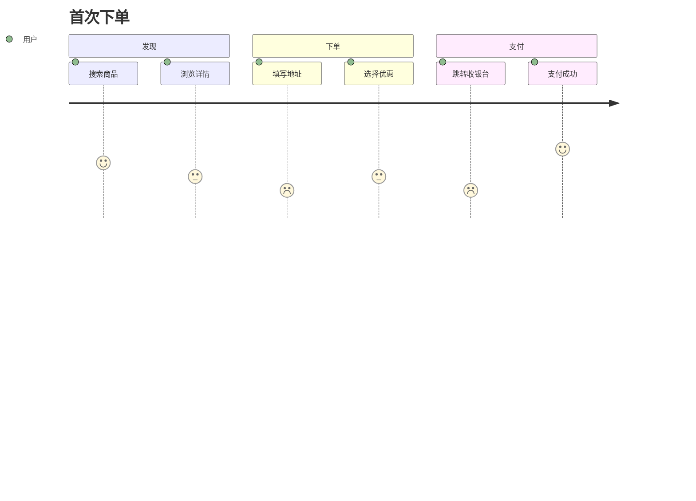
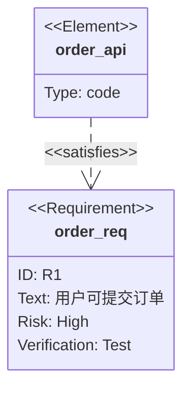
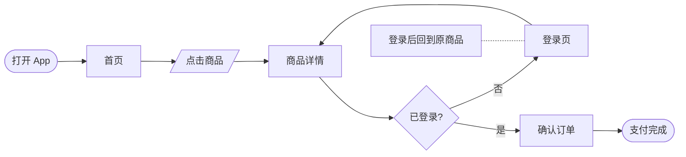
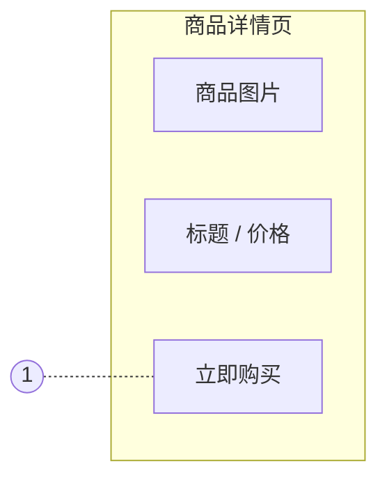
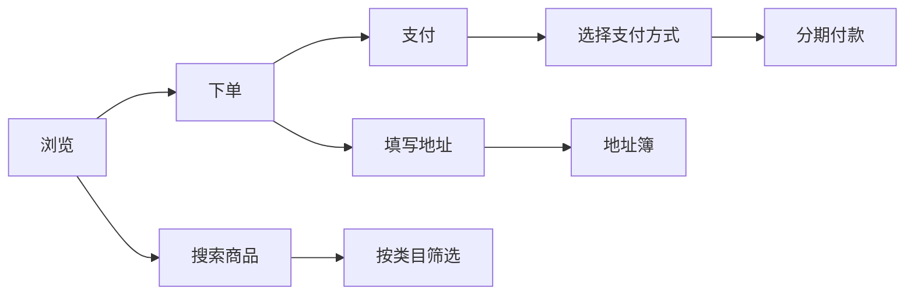

# 产品设计类

需求管理、交互设计、原型设计里常用的图。

| 想讲清                                        | 用哪种图                                   |
| --------------------------------------------- | ------------------------------------------ |
| 用户完成一件事的阶段、触点、情绪              | 用户旅程图 `journey`                       |
| 需求条目之间、需求与设计 / 测试之间的追踪关系 | 需求图 `requirement`                       |
| 页面之间怎么跳转、有哪些交互分支              | 页面流程图 `ui_flow`                       |
| 页面布局、元素和标注                          | 线框图 / 原型图 `wireframe`                |
| 按用户活动组织需求、切出 MVP                  | 用户故事地图 `story_map`                   |
| 需求优先级排序                                | 象限图 `quadrant`（见 types-data.md）      |
| 用户访谈、反馈归类                            | 亲和图 `affinity`（见 types-thinking.md）  |
| 需求范围的发散梳理                            | 思维导图 `mindmap`（见 types-thinking.md） |

## 用户旅程图 · `journey`

- **用来**：用户完成一件事的阶段、步骤和情绪变化，找体验痛点。
- **别用**：要画页面跳转（→ 页面流程图）。
- **工具**：Mermaid `journey`（1–5 分显示为表情）；要加触点、痛点、机会点多行泳道 → drawio。
- **写法**：
  - `section 阶段`；`步骤: 分数: 角色1, 角色2`。
- **要点**：
  - 阶段 3–6 个；分数如实反映情绪低谷，低分步骤就是痛点。

<!-- sample:journey -->

<!-- palette:journey -->
**配色**（换方案时 token 不变，只换颜色）　取色：`python $SKILL/scripts/palette.py mermaid journey [方案] --body 正文.mmd`

| 角色 | class | token | macaron（默认）填充 / 描边 / 字色 |
|---|---|---|---|
| 阶段 1 | `stage1` | `series:0` | `#F6F7FC` `#D2D6F1` `#33384A` |
| 阶段 2 | `stage2` | `series:1` | `#FEF8F6` `#FBDBD1` `#33384A` |
| 阶段 3 | `stage3` | `series:2` | `#F7FCFB` `#D8F0ED` `#33384A` |
| 阶段 4 | `stage4` | `series:3` | `#FDF8F0` `#F6DEB6` `#33384A` |
| 痛点标注 | `pain` | `bad` | `#FAE0DD` `#E35144` `#33384A` |
| 页面 / 连线 / 正文 | — | `bg` `line` `text` | `#FFFFFF` `#3B6FC2` `#33384A` |
<!-- /palette:journey -->

## 需求图 · `requirement`

- **用来**：需求条目之间、需求与设计 / 代码 / 测试之间的追踪关系（SysML 需求图）。
- **别用**：只是列需求清单（→ 表格或思维导图）。
- **工具**：Mermaid `requirementDiagram`。
- **写法**：
  - `requirement 标识 { id: R1  text: "..."  risk: high  verifymethod: test }`；类型还有 `functionalRequirement`、`interfaceRequirement`、`performanceRequirement`、`designConstraint` 等。
  - `element 名 { type: code }`；关系 `- satisfies ->`、`- verifies ->`、`- traces ->`、`- contains ->`、`- derives ->`、`- refines ->`、`- copies ->`。
  - 标识用英文（中文标识会报错，非要用中文就加引号），中文内容写在 `text` 里。
- **要点**：
  - 一个需求一个框；只画有追踪价值的关系。

<!-- sample:requirement -->

<!-- palette:requirement -->
**配色**（换方案时 token 不变，只换颜色）　取色：`python $SKILL/scripts/palette.py mermaid requirement [方案] --body 正文.mmd`

| 角色 | class | token | macaron（默认）填充 / 描边 / 字色 |
|---|---|---|---|
| 需求 | `req` | `slot0` | `#D2D6F1` `#9396A9` `#1F2865` |
| 设计 / 测试元素 | `element` | `slot2` | `#D8F0ED` `#97A8A6` `#256058` |
| 页面 / 连线 / 正文 | — | `bg` `line` `text` | `#FFFFFF` `#3B6FC2` `#33384A` |
<!-- /palette:requirement -->

## 页面流程图 / 交互流程 · `ui_flow`

- **用来**：页面之间的跳转、登录拦截等状态分支、交互说明（PRD / 交互文档里最常用）。
- **别用**：要画页面长什么样（→ 线框图）。
- **工具**：Mermaid `flowchart LR`；要带页面缩略图 → drawio；需求阶段的高保真交互稿 → Figma。
- **写法**：
  - 页面 `[ ]`、用户操作 `[/ /]`、判断 `{ }`、入口 / 出口 `([ ])`；交互说明用 `annotation` 节点虚线连到页面。
- **要点**：
  - 主路径自左向右一条线；页面名和真实页面一致。
  - 返回 / 回退用虚线。

<!-- sample:ui_flow -->

<!-- palette:ui_flow -->
**配色**（换方案时 token 不变，只换颜色）　取色：`python $SKILL/scripts/palette.py mermaid ui_flow [方案] --body 正文.mmd`

| 角色 | class | token | macaron（默认）填充 / 描边 / 字色 |
|---|---|---|---|
| 页面 | `page` | `slot0` | `#D2D6F1` `#9396A9` `#1F2865` |
| 用户操作 | `action` | `slot2` | `#D8F0ED` `#97A8A6` `#256058` |
| 判断 / 状态分支 | `decision` | `slot3` | `#F6DEB6` `#AC9B7F` `#714E14` |
| 入口 / 出口 | `entry` | `slot1` | `#FBDBD1` `#B09992` `#712A14` |
| 交互说明 | `annotation` | `note` | `#FFF6CE` `#A6A086` `#33384A` |
| 页面 / 连线 / 正文 | — | `bg` `line` `text` | `#FFFFFF` `#3B6FC2` `#33384A` |
<!-- /palette:ui_flow -->

## 线框图 / 原型图 · `wireframe`

- **用来**：页面布局、信息结构、元素优先级（低保真）；PRD 里的页面示意。
- **别用**：要可点击、可演示的高保真原型（→ Figma）。
- **工具**：drawio（mockup 图形库）；Mermaid 只能做极简的区块示意。
- **写法**：
  - drawio：画布 `canvas`，图片占位 `block`（加对角线），组件区块 `component`，主按钮 `primaryBtn`，标注编号 `marker`（红色圆点）+ 右侧说明列表。
- **要点**：
  - 灰阶为主，只有主操作一个颜色。
  - 用真实文案，不用占位假字；标注编号和说明一一对应。

Mermaid 近似画法（正式出图用 drawio，样式取 `palette.py drawio`）：

<!-- sample:wireframe -->

<!-- palette:wireframe -->
**配色**（换方案时 token 不变，只换颜色）　取色：`python $SKILL/scripts/palette.py drawio wireframe [方案]`

| 角色 | class | token | macaron（默认）填充 / 描边 / 字色 |
|---|---|---|---|
| 页面画布 | `canvas` | `surface` | `#FFFFFF` `#3B6FC2` `#33384A` |
| 占位块 / 图片 | `block` | `muted` | `#EEEFF0` `#8F929B` `#33384A` |
| 主按钮 / 关键操作 | `primaryBtn` | `primary` | `#3B6FC2` `#3B6FC2` `#FFFFFF` |
| 组件区块 | `component` | `soft` | `#EBF1F9` `#3B6FC2` `#33384A` |
| 标注编号 / 说明 | `marker` | `bad` | `#FAE0DD` `#E35144` `#33384A` |
| 页面 / 连线 / 正文 | — | `bg` `line` `text` | `#FFFFFF` `#3B6FC2` `#33384A` |
<!-- /palette:wireframe -->

## 用户故事地图 · `story_map`

- **用来**：按用户活动（骨架）横向排列，下面挂任务和故事，横线切出 MVP 和后续版本。
- **别用**：只是排期（→ 甘特图或路线图）。
- **工具**：Mermaid `flowchart LR` 近似；卡片超过 20 张或要协作拖动 → drawio。
- **写法**：
  - 第一行用户活动用 `-->` 串起来；每个活动下挂任务，再挂故事卡。
- **要点**：
  - 用户活动用主色，任务用槽色，故事卡用便签黄。
  - 本期 MVP 用 `mvp`，后续版本用 `later`（灰）。

<!-- sample:story_map -->

<!-- palette:story_map -->
**配色**（换方案时 token 不变，只换颜色）　取色：`python $SKILL/scripts/palette.py mermaid story_map [方案] --body 正文.mmd`

| 角色 | class | token | macaron（默认）填充 / 描边 / 字色 |
|---|---|---|---|
| 用户活动（骨架） | `activity` | `primary` | `#3B6FC2` `#3B6FC2` `#FFFFFF` |
| 用户任务 | `task` | `slot0` | `#D2D6F1` `#9396A9` `#1F2865` |
| 故事卡 | `story` | `note` | `#FFF6CE` `#A6A086` `#33384A` |
| MVP / 本期发布 | `mvp` | `slot3` | `#F6DEB6` `#AC9B7F` `#714E14` |
| 后续版本 | `later` | `muted` | `#EEEFF0` `#8F929B` `#33384A` |
| 页面 / 连线 / 正文 | — | `bg` `line` `text` | `#FFFFFF` `#3B6FC2` `#33384A` |
<!-- /palette:story_map -->
