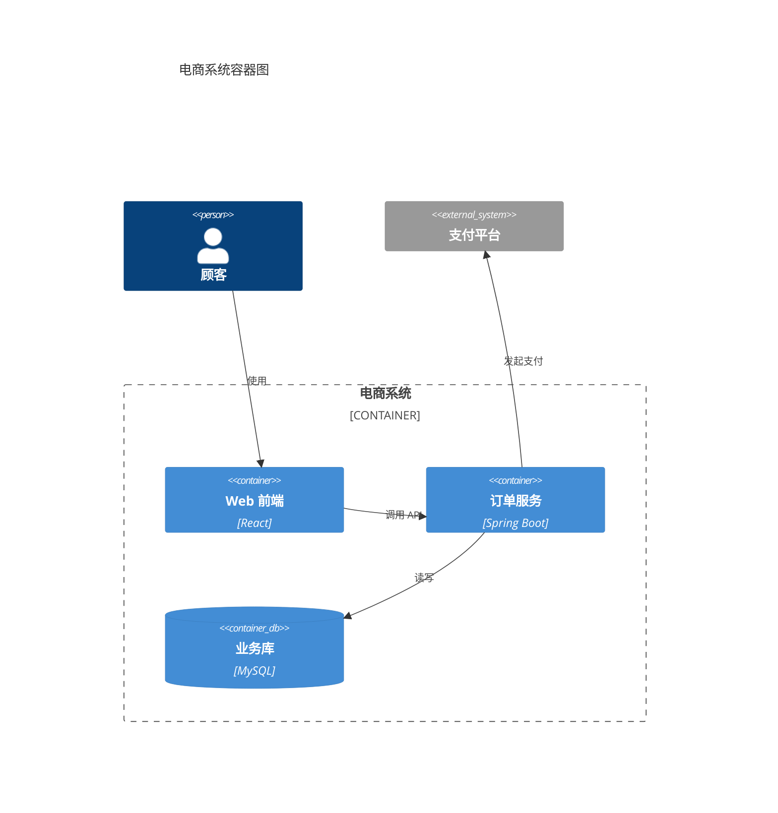
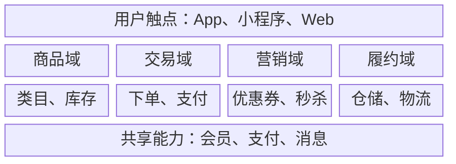
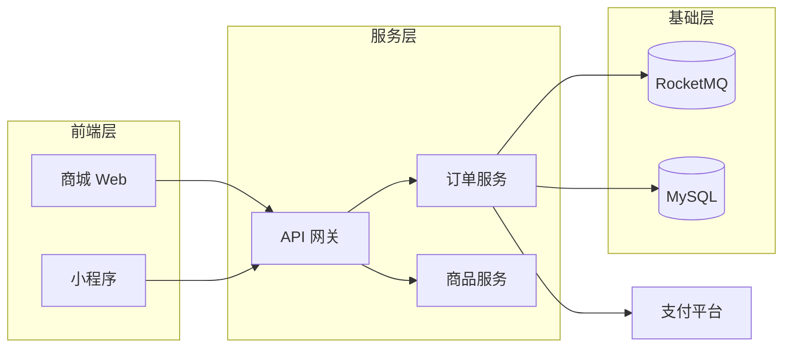
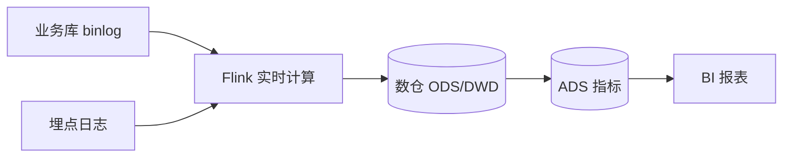
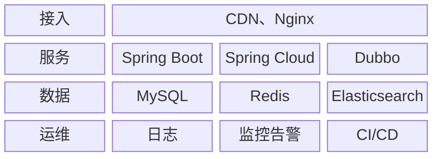
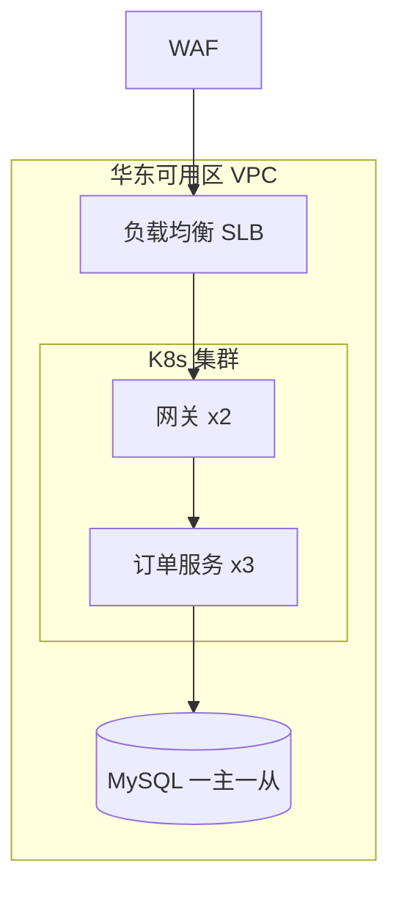
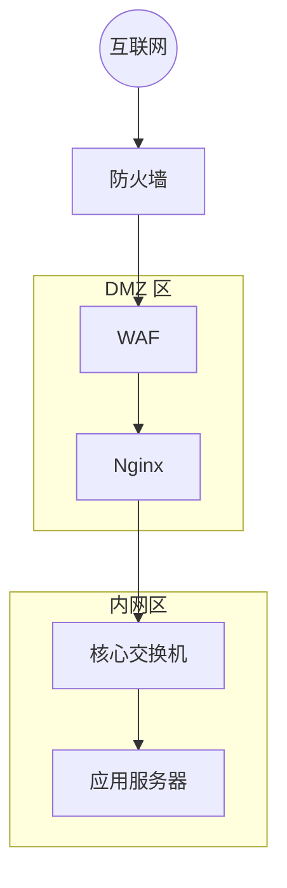

# 系统结构类

架构图先想清楚给谁看、讲哪一层，一张图只讲一层。

| 想讲清                                    | 用哪种图                 |
| ----------------------------------------- | ------------------------ |
| 系统和外部的人 / 系统怎么交互，再逐层下钻 | C4 模型 `c4`             |
| 业务由哪些域和能力组成                    | 业务架构图 `biz_arch`    |
| 由哪些应用 / 服务组成、怎么调用           | 应用架构图 `app_arch`    |
| 数据从哪来、怎么计算、存在哪、给谁用      | 数据架构图 `data_arch`   |
| 每一层用了什么技术                        | 技术架构图 `tech_arch`   |
| 跑在哪些地域、集群、机器上                | 部署架构图 `deploy_arch` |
| 网络分区、设备和安全边界                  | 网络拓扑图 `network`     |

分层的通用顺序（自上而下）：用户 / 渠道 → 接入（CDN、网关）→ 应用 / 服务 → 中间件 → 数据 → 基础设施。

## C4 模型（Context / Container / Component） · `c4`

- **用来**：技术方案的系统总览：系统上下文（Context）→ 容器（Container）→ 组件（Component）逐层下钻。
- **别用**：讲业务能力（→ 业务架构图）；讲机器和网络（→ 部署架构图）。
- **工具**：Mermaid `C4Context` / `C4Container` / `C4Component` / `C4Deployment`；正式评审要精细排版 → drawio（C4 图形库）。
- **写法**：
  - 元素：`Person`、`System` / `System_Ext`、`Container` / `ContainerDb`、`Component`；边界 `Container_Boundary(别名, "名称") { ... }`；关系 `Rel(起点, 终点, "说明", "协议")`。
  - C4 的元素颜色不走主题变量，要逐个写 `UpdateElementStyle`；用 `--body` 传入正文时 palette.py 会按元素类型自动生成。
- **要点**：
  - 一张图只画一层。
  - 外部系统用灰色；关系线写"动词 + 协议"。

<!-- sample:c4 -->

<!-- palette:c4 -->
**配色**（换方案时 token 不变，只换颜色）　取色：`python $SKILL/scripts/palette.py mermaid c4 [方案] --body 正文.mmd`

| 角色 | class | token | macaron（默认）填充 / 描边 / 字色 |
|---|---|---|---|
| 人员 | `person` | `primary` | `#3B6FC2` `#3B6FC2` `#FFFFFF` |
| 本系统 / 容器 | `system` | `slot0` | `#D2D6F1` `#9396A9` `#1F2865` |
| 组件 | `component` | `slot2` | `#D8F0ED` `#97A8A6` `#256058` |
| 数据库 | `db` | `slot2` | `#D8F0ED` `#97A8A6` `#256058` |
| 外部系统 | `external` | `muted` | `#EEEFF0` `#8F929B` `#33384A` |
| 边界 | `boundary` | `boundary`，虚线 | `#FFFFFF` `#3B6FC2` `#33384A` |
| 页面 / 连线 / 正文 | — | `bg` `line` `text` | `#FFFFFF` `#3B6FC2` `#33384A` |
<!-- /palette:c4 -->

## 业务架构图 · `biz_arch`

- **用来**：给业务方、管理层讲业务域、业务能力和共享能力（中台）的分层。
- **别用**：讲服务和调用（→ 应用架构图）。
- **工具**：Mermaid `block-beta`（分层方块排版）；层多、要图标和精细排版 → drawio，12 块以内要发布级效果 → diagram-design。
- **写法**：
  - `columns N` 定列数；`id["名称"]:N` 跨 N 列；一行一层；`class a,b 角色` 上色，写在块定义之后。
- **要点**：
  - 自上而下：用户触点 → 业务域 → 业务能力 → 共享能力。
  - 同层方块等宽，只用名词。

<!-- sample:biz_arch -->

<!-- palette:biz_arch -->
**配色**（换方案时 token 不变，只换颜色）　取色：`python $SKILL/scripts/palette.py mermaid biz_arch [方案] --body 正文.mmd`

| 角色 | class | token | macaron（默认）填充 / 描边 / 字色 |
|---|---|---|---|
| 用户触点层 | `channel` | `primary` | `#3B6FC2` `#3B6FC2` `#FFFFFF` |
| 业务域标题 | `domain` | `slot1` | `#FBDBD1` `#B09992` `#712A14` |
| 业务能力 | `capability` | `slot0` | `#D2D6F1` `#9396A9` `#1F2865` |
| 共享能力 / 中台 | `shared` | `slot2` | `#D8F0ED` `#97A8A6` `#256058` |
| 分层底色 | `band` | `soft` | `#EBF1F9` `#3B6FC2` `#33384A` |
| 页面 / 连线 / 正文 | — | `bg` `line` `text` | `#FFFFFF` `#3B6FC2` `#33384A` |
<!-- /palette:biz_arch -->

## 应用架构图 · `app_arch`

- **用来**：系统由哪些应用 / 服务组成、依赖和调用方向；技术方案评审最常用。
- **别用**：讲每层用什么技术（→ 技术架构图）。
- **工具**：Mermaid `flowchart` + subgraph 分层；超过 12 个节点 → drawio。
- **写法**：
  - 每层一个 subgraph；先声明节点，最后统一写连线；中间件、数据库用 `[( )]`。
- **要点**：
  - 分层容器用 `layer`（soft 底色），层名写在容器标题。
  - 外部系统用灰色放在边缘；调用方向保持一致。

<!-- sample:app_arch -->

<!-- palette:app_arch -->
**配色**（换方案时 token 不变，只换颜色）　取色：`python $SKILL/scripts/palette.py mermaid app_arch [方案] --body 正文.mmd`

| 角色 | class | token | macaron（默认）填充 / 描边 / 字色 |
|---|---|---|---|
| 前端 / 渠道应用 | `client` | `slot1` | `#FBDBD1` `#B09992` `#712A14` |
| 服务 | `service` | `slot0` | `#D2D6F1` `#9396A9` `#1F2865` |
| 中间件 / 基础服务 | `infra` | `slot2` | `#D8F0ED` `#97A8A6` `#256058` |
| 外部系统 | `external` | `muted` | `#EEEFF0` `#8F929B` `#33384A` |
| 分层容器 | `layer` | `soft`，虚线 | `#EBF1F9` `#3B6FC2` `#33384A` |
| 页面 / 连线 / 正文 | — | `bg` `line` `text` | `#FFFFFF` `#3B6FC2` `#33384A` |
<!-- /palette:app_arch -->

## 数据架构图 · `data_arch`

- **用来**：数据采集 → 计算 → 分层存储（ODS / DWD / DWS / ADS）→ 消费的链路。
- **别用**：讲表结构（→ ER 图）。
- **工具**：Mermaid `flowchart LR`；分层多、要图标 → drawio。
- **写法**：
  - 从左到右按数据流向；存储用圆柱 `[( )]`。
- **要点**：
  - 数据源、计算、存储、消费分别用 `source` / `compute` / `store` / `consume`，四种颜色就是四个环节。

<!-- sample:data_arch -->

<!-- palette:data_arch -->
**配色**（换方案时 token 不变，只换颜色）　取色：`python $SKILL/scripts/palette.py mermaid data_arch [方案] --body 正文.mmd`

| 角色 | class | token | macaron（默认）填充 / 描边 / 字色 |
|---|---|---|---|
| 数据源 | `source` | `slot1` | `#FBDBD1` `#B09992` `#712A14` |
| 采集 / 计算 | `compute` | `slot0` | `#D2D6F1` `#9396A9` `#1F2865` |
| 存储 | `store` | `slot2` | `#D8F0ED` `#97A8A6` `#256058` |
| 数据消费 / 报表 | `consume` | `slot3` | `#F6DEB6` `#AC9B7F` `#714E14` |
| 分层容器 | `layer` | `soft`，虚线 | `#EBF1F9` `#3B6FC2` `#33384A` |
| 页面 / 连线 / 正文 | — | `bg` `line` `text` | `#FFFFFF` `#3B6FC2` `#33384A` |
<!-- /palette:data_arch -->

## 技术架构图 · `tech_arch`

- **用来**：每一层选了什么技术（技术栈全景），选型评审。
- **别用**：讲服务调用关系（→ 应用架构图）。
- **工具**：Mermaid `block-beta`：左列层名，右侧技术组件；要真实 logo → drawio。
- **写法**：
  - 左列 `L1["接入"]:1`，右侧组件按列排；横切能力（日志、监控、CI/CD）单独一行。
- **要点**：
  - 层名用主色，组件白底；横切能力用 `cross`；本次新增或替换的组件用 `highlight`。

<!-- sample:tech_arch -->

<!-- palette:tech_arch -->
**配色**（换方案时 token 不变，只换颜色）　取色：`python $SKILL/scripts/palette.py mermaid tech_arch [方案] --body 正文.mmd`

| 角色 | class | token | macaron（默认）填充 / 描边 / 字色 |
|---|---|---|---|
| 层名称 | `layer` | `primary` | `#3B6FC2` `#3B6FC2` `#FFFFFF` |
| 技术组件 | `item` | `surface` | `#FFFFFF` `#3B6FC2` `#33384A` |
| 横切能力（日志 / 监控 / CI） | `cross` | `slot3` | `#F6DEB6` `#AC9B7F` `#714E14` |
| 本次新增 / 重点 | `highlight` | `slot1` | `#FBDBD1` `#B09992` `#712A14` |
| 页面 / 连线 / 正文 | — | `bg` `line` `text` | `#FFFFFF` `#3B6FC2` `#33384A` |
<!-- /palette:tech_arch -->

## 部署架构图 · `deploy_arch`

- **用来**：服务部署在哪些地域 / 可用区 / VPC / 集群，实例数和流量入口。
- **别用**：讲逻辑分层（→ 应用架构图）。
- **工具**：drawio 优先（真实云厂商 / K8s 图标、嵌套边界）；Mermaid 两种写法：`flowchart TB` + 嵌套 subgraph（走角色配色），或 `architecture-beta`（内置 cloud / database / disk / internet / server 图标，可接 iconify 图标；颜色走主题默认，不走角色 class；beta，默认直接用）。
- **写法**：
  - 边界嵌套：地域 → 可用区 / VPC（`zone`，虚线）→ 子网 / 集群（`subnet`）→ 节点；节点名后写实例数，如 `x3`。
  - `architecture-beta`：`group vpc(cloud)[华东可用区 VPC]`、`service db(database)[MySQL 一主一从] in vpc`、`lb:R --> L:gw`（冒号后是连线接在节点的哪一侧，L / R / T / B）。
- **要点**：
  - 流量自上而下：用户 → WAF / CDN → 负载均衡 → 网关 → 服务 → 存储。
  - 安全设备用 `security`（失败色）。

<!-- sample:deploy_arch -->

<!-- palette:deploy_arch -->
**配色**（换方案时 token 不变，只换颜色）　取色：`python $SKILL/scripts/palette.py mermaid deploy_arch [方案] --body 正文.mmd`

| 角色 | class | token | macaron（默认）填充 / 描边 / 字色 |
|---|---|---|---|
| 地域 / 可用区 / VPC | `zone` | `boundary`，虚线 | `#FFFFFF` `#3B6FC2` `#33384A` |
| 子网 / 集群 | `subnet` | `soft` | `#EBF1F9` `#3B6FC2` `#33384A` |
| 计算节点 / Pod | `node` | `slot0` | `#D2D6F1` `#9396A9` `#1F2865` |
| 负载均衡 / 网关 | `gateway` | `slot1` | `#FBDBD1` `#B09992` `#712A14` |
| 数据库 / 存储 | `db` | `slot2` | `#D8F0ED` `#97A8A6` `#256058` |
| 安全设备 | `security` | `bad` | `#FAE0DD` `#E35144` `#33384A` |
| 页面 / 连线 / 正文 | — | `bg` `line` `text` | `#FFFFFF` `#3B6FC2` `#33384A` |
<!-- /palette:deploy_arch -->

## 网络拓扑图 · `network`

- **用来**：网络分区（外网 / DMZ / 内网）、网络设备、链路和安全边界。
- **别用**：讲服务部署（→ 部署架构图）。
- **工具**：drawio（网络设备图标）；示意级别用 Mermaid `flowchart TB`，或 `architecture-beta`（内置 internet / server / database 图标，颜色走主题默认，不走角色 class）。
- **写法**：
  - 每个分区一个 subgraph，用 `class 分区 dmz` 上底色；设备在分区内声明。
- **要点**：
  - DMZ 用警告色，内网用 soft，外网用灰色。
  - 防火墙、WAF 放在分区边界上。

<!-- sample:network -->

<!-- palette:network -->
**配色**（换方案时 token 不变，只换颜色）　取色：`python $SKILL/scripts/palette.py mermaid network [方案] --body 正文.mmd`

| 角色 | class | token | macaron（默认）填充 / 描边 / 字色 |
|---|---|---|---|
| 外网 | `internet` | `muted` | `#EEEFF0` `#8F929B` `#33384A` |
| DMZ 区 | `dmz` | `warn` | `#FBEEE2` `#E8A35D` `#33384A` |
| 内网区 | `intranet` | `soft` | `#EBF1F9` `#3B6FC2` `#33384A` |
| 网络设备 | `device` | `slot0` | `#D2D6F1` `#9396A9` `#1F2865` |
| 服务器 | `server` | `surface` | `#FFFFFF` `#3B6FC2` `#33384A` |
| 防火墙 / WAF | `security` | `bad` | `#FAE0DD` `#E35144` `#33384A` |
| 页面 / 连线 / 正文 | — | `bg` `line` `text` | `#FFFFFF` `#3B6FC2` `#33384A` |
<!-- /palette:network -->
