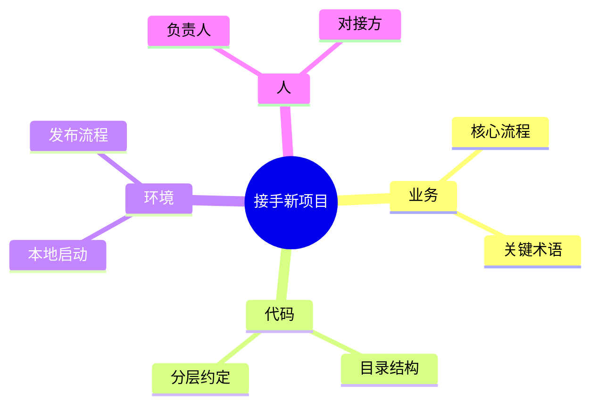
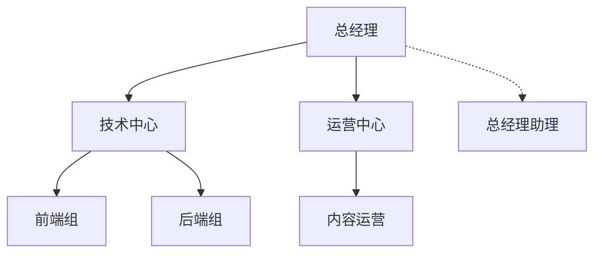
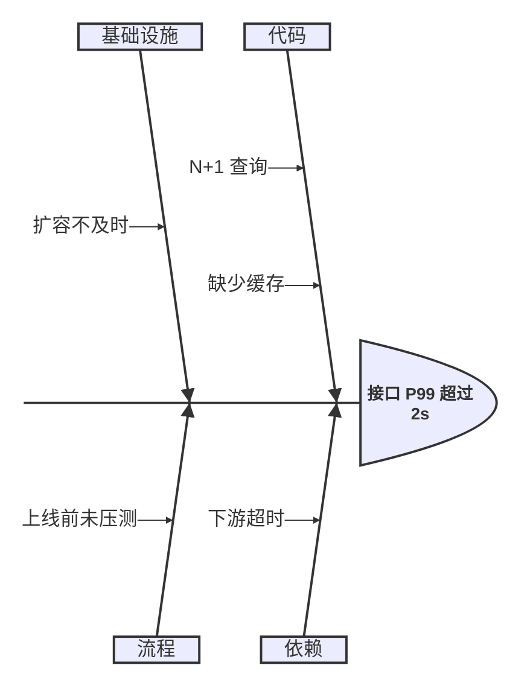
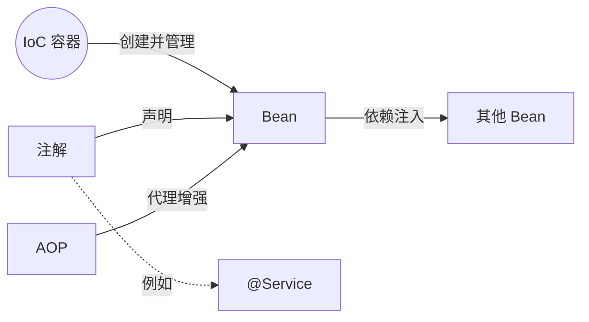
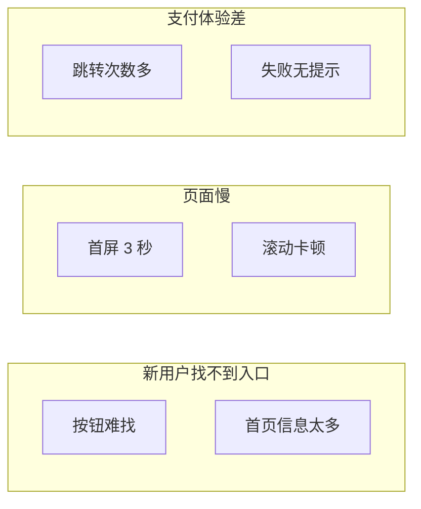

# 思考梳理类

| 想做什么                             | 用哪种图                  |
| ------------------------------------ | ------------------------- |
| 围绕一个主题发散、整理知识点         | 思维导图 `mindmap`        |
| 有上下级 / 隶属关系的树              | 树形图 / 组织结构图 `org` |
| 找一个问题的原因                     | 鱼骨图 `fishbone`         |
| 讲清概念之间的关系（关系要写在线上） | 概念图 `concept`          |
| 把一堆零散的想法、反馈归类           | 亲和图 `affinity`         |

## 思维导图 · `mindmap`

- **用来**：围绕一个中心主题发散：知识整理、会议纪要、项目梳理、需求范围梳理。
- **别用**：节点之间有交叉关系（→ 概念图）；有先后步骤（→ 流程图）。
- **工具**：Mermaid `mindmap`；节点超过 40 个或要交付编辑 → drawio。
- **写法**：
  - 缩进表示层级；根节点 `root((主题))` 画成圆形，`[ ]` 方形、`( )` 圆角。
  - 一级分支按出现顺序自动取 `cScale1..` 的颜色，二级以下继承分支色。
- **要点**：
  - 一级分支 3–7 个，每个分支不超过 3 层。
  - 节点只写关键词，不写整句。

<!-- sample:mindmap -->

<!-- palette:mindmap -->
**配色**（换方案时 token 不变，只换颜色）　取色：`python $SKILL/scripts/palette.py mermaid mindmap [方案] --body 正文.mmd`

| 角色 | class | token | macaron（默认）填充 / 描边 / 字色 |
|---|---|---|---|
| 中心主题 | `root` | `primary` | `#3B6FC2` `#3B6FC2` `#FFFFFF` |
| 分支 1 | `b1` | `solid:0` | `#D2D6F1` `#D2D6F1` `#111111` |
| 分支 2 | `b2` | `solid:1` | `#FBDBD1` `#FBDBD1` `#111111` |
| 分支 3 | `b3` | `solid:2` | `#D8F0ED` `#D8F0ED` `#111111` |
| 分支 4 | `b4` | `solid:3` | `#F6DEB6` `#F6DEB6` `#111111` |
| 分支 5 | `b5` | `solid:4` | `#DEE7CD` `#DEE7CD` `#111111` |
| 分支 6 | `b6` | `solid:5` | `#A4A7BC` `#A4A7BC` `#111111` |
| 页面 / 连线 / 正文 | — | `bg` `line` `text` | `#FFFFFF` `#3B6FC2` `#33384A` |
<!-- /palette:mindmap -->

## 树形图 / 组织结构图 · `org`

- **用来**：组织架构、模块 / 目录树、产品功能树。
- **别用**：要表达先后顺序（→ 流程图）。
- **工具**：Mermaid `flowchart TB`；超过 3 层或 20 个节点 → drawio（树形布局）。
- **写法**：
  - 自上而下 `flowchart TB`；同一层的节点连续声明，布局更整齐。
  - 虚线 `-.->` 表示虚线汇报、助理岗位。
- **要点**：
  - 只有顶层用主色，第二层用槽色，其余白底描边。
  - 同层节点文字长度尽量一致。

<!-- sample:org -->

<!-- palette:org -->
**配色**（换方案时 token 不变，只换颜色）　取色：`python $SKILL/scripts/palette.py mermaid org [方案] --body 正文.mmd`

| 角色 | class | token | macaron（默认）填充 / 描边 / 字色 |
|---|---|---|---|
| 顶层节点 | `top` | `primary` | `#3B6FC2` `#3B6FC2` `#FFFFFF` |
| 第二层 | `l2` | `slot0` | `#D2D6F1` `#9396A9` `#1F2865` |
| 第三层及以下 | `l3` | `surface` | `#FFFFFF` `#3B6FC2` `#33384A` |
| 虚线汇报 / 助理 | `aux` | `muted`，虚线 | `#EEEFF0` `#8F929B` `#33384A` |
| 页面 / 连线 / 正文 | — | `bg` `line` `text` | `#FFFFFF` `#3B6FC2` `#33384A` |
<!-- /palette:org -->

## 鱼骨图 · `fishbone`

- **用来**：故障复盘、质量问题的根因分析（人机料法环测，或 代码 / 依赖 / 基础设施 / 流程）。
- **别用**：原因已经清楚，只是列改进项（→ 思维导图）。
- **工具**：Mermaid `ishikawa-beta`（beta，目标平台渲染不了时改用 drawio）；要给每个大类分色、标出根因 → drawio。
- **写法**：
  - 第一行是问题（鱼头），下一级缩进是原因大类，再下一级是具体原因。
  - Mermaid 的鱼骨图只认 `mainBkg`、`lineColor`、`textColor` 三个颜色。
- **要点**：
  - 原因大类 4–6 个，用名词。
  - 具体原因写成可验证的事实；drawio 里已验证的根因用 `verified`（失败色）标出。

<!-- sample:fishbone -->

<!-- palette:fishbone -->
**配色**（换方案时 token 不变，只换颜色）　取色：`python $SKILL/scripts/palette.py mermaid fishbone [方案] --body 正文.mmd`

| 角色 | class | token | macaron（默认）填充 / 描边 / 字色 |
|---|---|---|---|
| 问题（鱼头） | `head` | `slot3` | `#F6DEB6` `#AC9B7F` `#714E14` |
| 原因大类 | `cat` | `slot0` | `#D2D6F1` `#9396A9` `#1F2865` |
| 具体原因 | `cause` | `surface` | `#FFFFFF` `#3B6FC2` `#33384A` |
| 已验证的根因 | `verified` | `bad` | `#FAE0DD` `#E35144` `#33384A` |
| 页面 / 连线 / 正文 | — | `bg` `line` `text` | `#FFFFFF` `#3B6FC2` `#33384A` |
<!-- /palette:fishbone -->

## 概念图 · `concept`

- **用来**：讲清一组概念之间的关系：技术原理、领域知识；关系写在连线上。
- **别用**：只有层级、没有横向关系（→ 思维导图）。
- **工具**：Mermaid `flowchart LR`。
- **写法**：
  - `A -- 关系动词 --> B`；核心概念用 `(( ))` 圆形；例子用虚线 `-. 例如 .->`。
- **要点**：
  - 每条线都要有动词标签。
  - 核心概念只有 1 个，用主色；一级概念不超过 6 个。

<!-- sample:concept -->

<!-- palette:concept -->
**配色**（换方案时 token 不变，只换颜色）　取色：`python $SKILL/scripts/palette.py mermaid concept [方案] --body 正文.mmd`

| 角色 | class | token | macaron（默认）填充 / 描边 / 字色 |
|---|---|---|---|
| 核心概念 | `core` | `primary` | `#3B6FC2` `#3B6FC2` `#FFFFFF` |
| 一级概念 | `concept` | `slot0` | `#D2D6F1` `#9396A9` `#1F2865` |
| 二级概念 | `sub` | `surface` | `#FFFFFF` `#3B6FC2` `#33384A` |
| 例子 / 实例 | `example` | `slot2` | `#D8F0ED` `#97A8A6` `#256058` |
| 页面 / 连线 / 正文 | — | `bg` `line` `text` | `#FFFFFF` `#3B6FC2` `#33384A` |
<!-- /palette:concept -->

## 亲和图 · `affinity`

- **用来**：把用户访谈、反馈、头脑风暴的零散便签归类成主题（KJ 法）。
- **别用**：已有明确分类体系（→ 思维导图或表格）。
- **工具**：Mermaid `flowchart LR` + `subgraph` 当分组；便签超过 30 张或要协作拖动 → drawio。
- **写法**：
  - 每组一个 `subgraph 组名`，组名写成一句结论；组内便签用 `g1`–`g4` 类。
- **要点**：
  - 一组一个颜色（系列色轮换），便签保留用户原话。
  - 分组 3–6 个。

<!-- sample:affinity -->

<!-- palette:affinity -->
**配色**（换方案时 token 不变，只换颜色）　取色：`python $SKILL/scripts/palette.py mermaid affinity [方案] --body 正文.mmd`

| 角色 | class | token | macaron（默认）填充 / 描边 / 字色 |
|---|---|---|---|
| 分组 1 便签 | `g1` | `series:0` | `#F6F7FC` `#D2D6F1` `#33384A` |
| 分组 2 便签 | `g2` | `series:1` | `#FEF8F6` `#FBDBD1` `#33384A` |
| 分组 3 便签 | `g3` | `series:2` | `#F7FCFB` `#D8F0ED` `#33384A` |
| 分组 4 便签 | `g4` | `series:3` | `#FDF8F0` `#F6DEB6` `#33384A` |
| 分组标题 | `title` | `primary` | `#3B6FC2` `#3B6FC2` `#FFFFFF` |
| 页面 / 连线 / 正文 | — | `bg` `line` `text` | `#FFFFFF` `#3B6FC2` `#33384A` |
<!-- /palette:affinity -->
